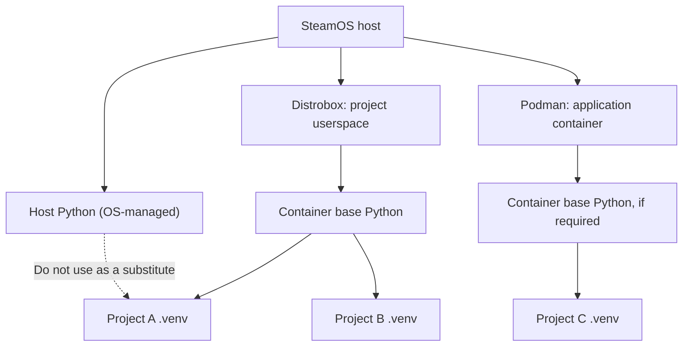
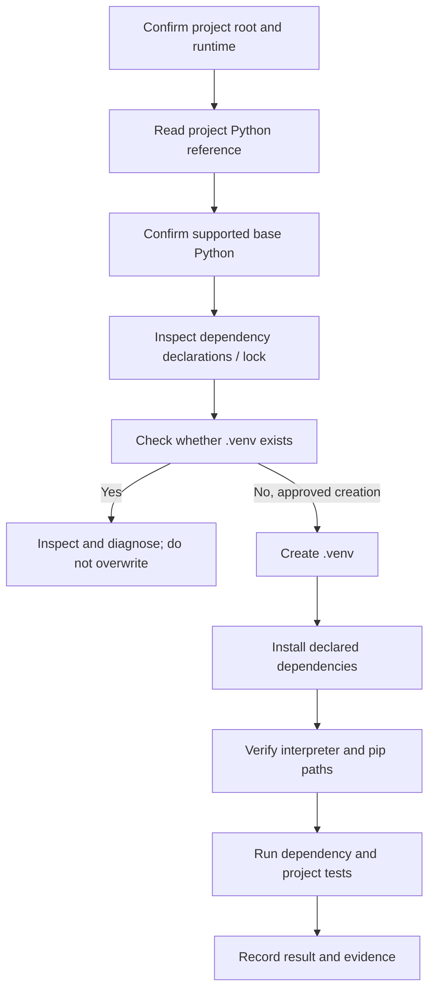

# Python Runtime & Virtual Environment Standard

| Document control | Value |
|---|---|
| Document role | Shared technical reference / platform standard |
| Scope | Python applications and tools developed or operated on the Steam Deck |
| Applies to | Current and future projects in this repository |
| Platform focus | SteamOS host, Distrobox environments and Podman containers |
| Format | Markdown |
| Status | Shared reference; project-specific facts remain authoritative |
| Maintainer | laconic-lab |
| Last updated | 2026-11-06 |

> **Purpose:** define a consistent, safe and reproducible approach to Python interpreters, virtual environments, dependency installation, verification and maintenance across Steam Deck projects. This document defines shared principles and reusable procedures. It does **not** prescribe one Python version, one container, one project path or one dependency set for every project.

---

## 1. Executive summary

Use a dedicated Python virtual environment for each Python application or independently maintained Python toolset. Keep the base interpreter and operating-system packages in the environment that owns them; keep application libraries inside that application's `.venv`.

The standard operating pattern is:

1. Identify the target project and its actual execution environment.
2. Read its own Python reference, dependency manifests and startup instructions.
3. Select a supported base interpreter deliberately.
4. Create one project-local `.venv` only when needed and authorized.
5. Invoke that environment's interpreter explicitly for deterministic commands.
6. Install or change dependencies only with a project-specific plan.
7. Verify interpreter identity, package consistency and application behavior.
8. Record the actual result in the project's documentation.

**Do not assume the SteamOS host Python is the correct interpreter for a project.** A project may run inside Distrobox or Podman and use the Python interpreter installed there. Host, container and project virtual-environment versions may legitimately differ.

## 2. Repository context and applicability

The repository contains several different workload types. A Python virtual environment is appropriate for Python applications and tools; it is not a universal requirement for every project.

| Project / area | Recorded technology or role | Python-documentation implication |
|---|---|---|
| SteamOS host / `deck/` | Host platform, maintenance scripts and shared standards | Keep host Python changes exceptional; do not use host Python as an application dependency location by default |
| Shyrka | Python AI agent and dashboard in `localai-box` | Has a project-specific `.venv` and a detailed environment inventory |
| Odysseus | Python application / Agent project; v1 retired and v2 separately audited | Historical v1 Python details are not a v2 baseline; v2 must document its own interpreter and environment |
| Stable Diffusion | `stable-diffusion.cpp`, CMake/Ninja, Vulkan, Node.js frontend tooling | Python is not the primary documented application runtime; do not add a Python venv unless a specific Python component requires one |
| Pi-hole | Rootless Podman DNS service | Python venv is not part of the documented Pi-hole service runtime |
| SSH | SteamOS host OpenSSH service and shell/client documentation | Python venv is not required for the documented SSH service |
| Waydroid | Container feasibility audit and supporting scripts | Python venv is not a prerequisite for the documented audit architecture |
| Future projects | Varies | Select Python only when the workload actually needs it; then follow this standard |

This classification is based on the repository documentation reviewed for this standard. It is not a live audit of project runtimes.

### 2.1 Shared standard versus project-specific reference

```text
deck/docs/PYTHON-VIRTUAL-ENVIRONMENT-STANDARD.md
        |
        | Defines reusable policy and procedures
        |
        +--------------------+---------------------+
        |                    |                     |
        v                    v                     v
shyrka/docs/           odysseus/docs/         future-project/
PYTHON-ENVIRONMENT.md  (v2 reference,       PYTHON-ENVIRONMENT.md
                         when established)
        |                    |                     |
        +--------------------+---------------------+
                             |
                 Records each project's own:
                 - Python version
                 - runtime/container
                 - project root and .venv path
                 - dependency manifests
                 - startup/test commands
                 - evidence date and status
```

The shared standard must not become a second inventory of every project's live Python version. Project-specific references own those facts.

## 3. Core policy

| Rule | Standard |
|---|---|
| Environment ownership | One independent `.venv` per Python application or independently maintained project |
| Base interpreter | Select from the interpreter available in the project's actual runtime |
| Host Python | Do not install project dependencies into SteamOS host Python |
| Container Python | Use the Python interpreter inside the container that owns the application runtime |
| Package installation | Use the target venv's interpreter with `-m pip` |
| Isolation | Do not share one application's installed packages with another application |
| Reproducibility | Maintain an appropriate dependency declaration and, where justified, a lock or fully pinned set |
| Version selection | Follow the application's supported Python range and test evidence; do not copy another project's version |
| Change control | Inspect first; obtain approval before installing, upgrading, removing or rebuilding dependencies |
| Git | Do not commit the `.venv` directory |
| Recovery | Recreate environments from declared dependencies; do not treat a copied `.venv` as a portable backup |
| Evidence | Record actual interpreter, environment path, dependency source and verification date |

A virtual environment isolates Python packages; it does not isolate the process from the host filesystem, network, credentials, devices or other operating-system resources. Treat Python package isolation and system/container security as separate concerns.

## 4. Execution environment boundaries

Before running any Python command, identify which environment owns the process.

| Context | Example | Python command target |
|---|---|---|
| SteamOS host | Host maintenance or an explicitly host-level Python tool | Host interpreter only when the task specifically requires it |
| Distrobox | Project userspace such as `localai-box` or another named box | Interpreter installed inside that Distrobox, then the project's `.venv` |
| Podman container | Application container with a Python runtime | Interpreter and venv inside that container |
| Client workstation | Linux Mint or Windows development client | A separate client-side environment; never copy the Deck's `.venv` across machines |

### 4.1 Environment ownership schema



Projects may share a compatible base interpreter inside one container, but each application should have its own venv and dependency set. Sharing a base interpreter does not mean sharing site-packages.

### 4.2 Distrobox is not the venv

These layers have different responsibilities:

- Distrobox provides the Linux userspace, system libraries and base Python installation.
- The venv contains project-specific Python packages and entry points.
- The project source tree contains application code and dependency declarations.
- Persistent application data belongs in explicitly documented data paths, not inside the disposable venv.

Do not install Python application dependencies globally in the Distrobox merely because it is already separate from the SteamOS host.

## 5. Selecting the Python version

Do not choose a Python version simply because it is newest or because another project uses it.

Use this order:

1. Read the application's supported Python version range in its documentation or packaging metadata.
2. Inspect `pyproject.toml`, setup metadata, CI configuration, release notes and dependency constraints where available.
3. Check whether required packages provide compatible wheels or support the target interpreter and architecture.
4. Prefer a maintained Python release compatible with the application and its dependencies.
5. Use the version already verified by the project when maintaining a working deployment, unless a diagnosed reason justifies changing it.
6. Record the selected interpreter and the evidence behind the choice.

### 5.1 Compatibility decision schema

```text
Application's declared Python range
              |
              v
Required package / native-extension compatibility
              |
              v
Base interpreter available in the target runtime
              |
              v
Existing verified project baseline?
        /                 \
      yes                  no
       |                    |
Preserve it unless       Select a supported
a change is justified   maintained version
       \                    /
        v                  v
       Create / use the project's own .venv
                         |
                         v
             Verify imports, tests and runtime
```

### 5.2 Version policy

- Do not impose a repository-wide Python minor version.
- Do not assume host and container Python versions should match.
- Do not upgrade a working project's Python version as routine maintenance.
- Do not downgrade Python merely to silence one dependency error without checking the actual compatibility requirement.
- If a project requires a different Python minor version, document how that interpreter is supplied in the owning environment.
- Python version changes can require rebuilding the venv and reinstalling native extensions; treat them as a planned migration.

## 6. Virtual-environment layout

For a conventional Python application, use a project-local layout:

```text
<PROJECT_ROOT>/
├── .venv/                    # generated; excluded from Git
├── .gitignore
├── pyproject.toml            # preferred project/dependency metadata, when applicable
├── requirements.txt          # optional pip requirements input
├── requirements-dev.txt      # optional development/test dependencies
├── src/                      # application source, if using src layout
├── tests/                    # tests, if present
└── README.md
```

Not every project needs every file. Use the dependency and packaging format already established by the project unless there is a clear reason to migrate it.

### 6.1 Why `.venv` is the default name

- It is recognizable by common Python tooling and editors.
- It is local to the project and easy to exclude from Git.
- It avoids confusion with `.env`, which commonly stores environment variables.
- It makes the interpreter path predictable on Linux: `.venv/bin/python`.

A project may use a different venv path for a documented reason. Its project-specific reference must state the exact path.

### 6.2 Git ignore

At minimum, a project using a local venv should ignore it:

```gitignore
.venv/
__pycache__/
*.py[cod]
.pytest_cache/
.mypy_cache/
.ruff_cache/
```

Adapt the ignore list to the actual tools and repository. Do not blindly replace an existing `.gitignore`; inspect and merge entries so project-specific exclusions are preserved.

Never commit a venv, interpreter binary, installed site-packages, local build artifacts or machine-specific absolute paths as though they were portable project configuration.

## 7. Creating a new virtual environment

**Creation changes the project filesystem.** Use this procedure only when a new environment is required, the target path is confirmed absent, and the operation is authorized.

### 7.1 Pre-creation checks

Confirm:

- Correct host/container context.
- Correct project root.
- Intended base interpreter and supported Python version.
- `.venv` does not already exist.
- Required venv support is installed in the base interpreter environment.
- Existing dependencies and local changes have been recorded.
- The project has a dependency declaration or a deliberate minimal bootstrap plan.

Do not use `--clear`, remove an existing directory, or overwrite a working environment as a shortcut.

### 7.2 Create

From the project root, after selecting the correct base interpreter:

```bash
python3 -m venv .venv
```

If multiple Python versions are installed, call the intended one explicitly, for example:

```bash
python3.12 -m venv .venv
```

The versioned executable above is an example only. Use the version actually supported and installed in the target runtime.

### 7.3 Verify immediately

```bash
./.venv/bin/python --version
./.venv/bin/python -c 'import sys; print(sys.executable); print(sys.prefix); print(sys.base_prefix)'
./.venv/bin/python -m pip --version
```

Expected characteristics:

- `sys.executable` points inside the project's `.venv`.
- `sys.prefix` points to the `.venv`.
- `sys.base_prefix` points to the base Python installation.
- `sys.prefix != sys.base_prefix`.
- `python -m pip --version` reports pip located in the same venv.

If these checks do not match, stop before installing packages.

## 8. Activating versus explicit interpreter paths

Activation is optional. It changes the current shell's PATH so that `python`, `pip` and installed console scripts resolve to the venv.

### Linux / SteamOS / Distrobox / Podman shell

```bash
source .venv/bin/activate
python --version
python -m pip --version
deactivate
```

### Preferred deterministic form for scripts and remote commands

```bash
./.venv/bin/python --version
./.venv/bin/python -m pip --version
./.venv/bin/python -m pytest
```

Use the explicit path in automation, SSH commands, Distrobox one-liners and operational documentation. It avoids relying on a previously activated shell or an inherited PATH.

**Do not assume `VIRTUAL_ENV` proves that a venv is active.** Explicit interpreter invocation works without activation, so the environment variable may be absent even when the venv interpreter is being used.

## 9. Package installation and dependency management

Always bind pip to the intended interpreter:

```bash
./.venv/bin/python -m pip install <PACKAGE>
```

Avoid an unqualified `pip install` in instructions that might run in different shells or environments. `python -m pip` makes the interpreter/package-manager relationship explicit.

### 9.1 Dependency source of truth

Prefer the project's existing dependency declaration. Common approaches include:

| File / format | Purpose | Guidance |
|---|---|---|
| `pyproject.toml` | Project metadata, supported Python range, dependencies and tool configuration | Preferred modern project metadata where the application supports it |
| `requirements.txt` | pip requirements input | Suitable for straightforward applications and deployment installs |
| `requirements-dev.txt` | Additional development/test tools | Keep development-only packages distinct where useful |
| Constraints file | Restricts versions selected by pip | Does not, by itself, declare the full set of required packages |
| Lock file | Records a resolved dependency set for reproducible installation | Use the lock mechanism supported by the project's chosen tooling |
| `pip freeze` output | Snapshot of installed distributions | Useful for evidence or emergency inventory; not automatically a curated dependency specification |

Do not introduce Poetry, uv, Pipenv, Conda or another tool merely for fashion. Adopt a dependency manager when it solves a real reproducibility or workflow problem and the project explicitly documents it.

### 9.2 Install from a declared file

Example, only after the project and dependency file are confirmed:

```bash
./.venv/bin/python -m pip install -r requirements.txt
```

For a project using supported `pyproject.toml` metadata, the project's own documented install command may instead be appropriate.

### 9.3 Package changes are controlled changes

The following actions alter the environment and require a project-specific reason and authorization:

- Installing a new package.
- Upgrading or downgrading a package.
- Removing a package.
- Changing dependency pins or constraints.
- Installing editable source or VCS dependencies.
- Changing package indexes or trusted hosts.
- Updating pip or build tooling.
- Rebuilding the venv.

Do not run `pip install --upgrade -r requirements.txt` as routine maintenance. It can change many dependency versions and break a working application.

Do not install application packages into the SteamOS host Python, use `sudo pip`, or bypass OS package protections with `--break-system-packages`.

### 9.4 System libraries versus Python packages

Some Python packages depend on native libraries, compilers, headers or operating-system packages. Those dependencies belong to the base runtime/container or another explicitly managed build layer—not automatically inside pip.

Before installing a system package, identify whether it belongs to SteamOS, a Distrobox or a Podman image. Do not install host packages to solve a dependency problem that belongs inside a project container.

## 10. Project root and import behavior

The interpreter path and the current working directory are separate things.

Calling `/path/to/project/.venv/bin/python` does not automatically change the shell's current directory. Imports from a project package may fail if the command runs outside the project root or if the project is not installed/configured for imports.

Recommended pattern:

```bash
cd <PROJECT_ROOT> || exit 1
./.venv/bin/python -c 'import sys; print(sys.executable)'
```

For a project-specific import:

```bash
cd <PROJECT_ROOT> || exit 1
./.venv/bin/python -c 'import <PROJECT_PACKAGE>; print("import OK")'
```

Replace placeholders with the actual project path and import package. Do not assume every repository uses a `src` package layout.

A `ModuleNotFoundError` does not automatically mean the venv is corrupt. Check the working directory, package layout, installation mode and import path before changing dependencies.

## 11. Runtime verification checklist

Run checks in the environment that actually runs the application.

### 11.1 Interpreter and venv identity

```bash
./.venv/bin/python - <<'PY'
import sys
import sysconfig

print("Python version :", sys.version)
print("Executable     :", sys.executable)
print("Prefix         :", sys.prefix)
print("Base prefix    :", sys.base_prefix)
print("Venv active    :", sys.prefix != sys.base_prefix)
print("Purelib        :", sysconfig.get_paths()["purelib"])
PY
```

### 11.2 pip and package consistency

```bash
./.venv/bin/python -m pip --version
./.venv/bin/python -m pip list
./.venv/bin/python -m pip check
```

Interpretation:

- `pip --version` should identify the venv's pip path.
- `pip list` inventories installed packages; it does not prove the application works.
- `pip check` checks declared installed-package dependency compatibility; it does not run application tests.

### 11.3 Application checks

Use only checks actually supported by the project:

```bash
./.venv/bin/python -m compileall -q <SOURCE_DIRECTORY>
./.venv/bin/python -m unittest discover -s tests -p 'test_*.py' -v
```

If the project uses pytest, invoke it through the venv and only if it is declared/installed:

```bash
./.venv/bin/python -m pytest
```

Do not assume a test framework exists. Use the project's documented commands and record the exact result, exit status and date.

### 11.4 Verification matrix

| Check | Confirms | Does not confirm |
|---|---|---|
| `python --version` | Interpreter version | Correct project environment |
| `sys.executable` | Actual interpreter path | Package health |
| `sys.prefix != sys.base_prefix` | Running in a venv | Host/container isolation |
| `python -m pip --version` | pip associated with that interpreter | Dependency correctness |
| `pip check` | Installed dependency metadata consistency | Runtime or business logic |
| Import test | Selected imports resolve | Full application correctness |
| Unit/integration tests | Tested behavior for that test set | Untested paths or live service state |
| Application startup check | Application starts under tested conditions | Security or long-term reliability |

## 12. Distrobox command pattern

When the application runs inside Distrobox, enter the correct box and use the venv inside it.

Illustrative read-only check from the SteamOS host:

```bash
distrobox enter <BOX_NAME> -- bash -lc '
cd <PROJECT_ROOT> || exit 1
./.venv/bin/python -c "import sys; print(sys.version); print(sys.executable); print(sys.prefix); print(sys.base_prefix)"
'
```

Rules:

- Replace `<BOX_NAME>` and `<PROJECT_ROOT>` with verified project values.
- Confirm the path exists inside the named Distrobox.
- Do not assume a host path is mounted inside every container.
- Do not use the host interpreter path from inside the container.
- Do not install packages until the interpreter and project root are verified.
- Keep the Distrobox lifecycle separate from the venv lifecycle; activating or deactivating a venv does not start or stop the container.

For a Podman-managed application, use the project's documented container exec procedure and verify the interpreter path inside that container. Do not assume the Distrobox command applies to Podman.

## 13. Environment variables and secrets

A Python venv is not a secret store.

- Do not place API keys, passwords or tokens in source files, dependency files, command history or committed examples.
- Keep secret-bearing `.env` files out of Git and restrict their access according to the project's security design.
- Do not print all environment variables as a routine diagnostic; they may contain credentials.
- Do not assume that a value is safe because it is only available inside a Distrobox or venv.
- Avoid passing secrets on command lines where they may be exposed in process listings, logs or shell history.
- Do not make a venv responsible for deciding which Agent, plugin or process may access a credential.

Use the shared [Engineering & Security Baseline](./ENGINEERING-AND-SECURITY-BASELINE.md) for broader credential and process-security requirements.

## 14. Persistence, backup and recovery

A venv is generated runtime state, not the canonical source of a project.

| Item | Normal treatment |
|---|---|
| Application source | Version-controlled project files |
| Dependency declaration | Version-controlled `pyproject.toml`, requirements or equivalent |
| Lock / pinned dependency data | Version-controlled when used by the project |
| `.venv/` | Generated; normally excluded from Git and reproducible |
| pip cache | Re-creatable cache; not normally required for recovery |
| User/application data | Back up according to the project's data policy |
| Models and large assets | Project-specific persistence and integrity policy |
| Credentials | Separate protected backup/rotation policy; never commit |

### 14.1 Why a venv should not be copied between environments

Virtual environments commonly contain scripts with absolute interpreter paths and may depend on the base interpreter, operating-system libraries, architecture and compiled extensions. They are generally not portable across:

- Host and container.
- Different Distrobox images.
- Different Python minor versions.
- Different filesystem paths.
- Different Linux distributions.
- Linux and Windows.
- Different CPU architectures.

If the project root or base runtime moves, recreate the venv at the intended location from the project's dependency declarations. Do not copy an existing `.venv` as a migration strategy.

### 14.2 Recovery sequence



This is a controlled recovery outline, not authorization to rebuild an existing environment. A restore may also require system libraries, model files, databases, credentials or other project data documented elsewhere.

## 15. Troubleshooting decision table

| Symptom | First checks | Do not do first |
|---|---|---|
| Wrong Python version | `sys.executable`, `sys.version`, container identity | Upgrade or downgrade Python immediately |
| `pip` installs into wrong location | Use `<venv>/bin/python -m pip --version` | Run another global pip command |
| `ModuleNotFoundError` | Working directory, package layout, venv interpreter, declared dependencies | Delete and recreate the venv |
| `No module named venv` or ensurepip failure | Base interpreter's venv support and owning OS package | Install random pip packages globally |
| Import fails after Python upgrade | Base interpreter, native extensions, venv metadata and dependency compatibility | Repeatedly reinstall packages without diagnosis |
| Dependency conflict | Project manifest, lock/constraints, `pip check`, package compatibility | Upgrade every package at once |
| Native build failure | Compiler, headers, OS libraries, wheel availability, target architecture | Install build dependencies on the SteamOS host without confirming ownership |
| Works in terminal but not service | Service executable path, working directory, environment and user identity | Assume interactive shell activation is inherited |
| Project import fails only outside root | Current working directory and packaging/import configuration | Add arbitrary `PYTHONPATH` permanently |
| Container cannot see project path | Mounts and actual container path | Assume host/container paths are identical |
| Venv appears corrupted | Inspect interpreter, `pyvenv.cfg`, pip and project state; preserve evidence | Delete or overwrite it as first response |

### 15.1 Externally managed Python installations

Some Linux distributions mark their system Python as externally managed. This is a safeguard against pip modifying files owned by the operating-system package manager.

When pip refuses a global installation:

1. Confirm which interpreter and environment were invoked.
2. If this is an application dependency, create/use the project's venv.
3. If the missing component is a system-level Python/venv package, use the package manager of the owning environment, with appropriate approval.
4. Do not bypass the protection with `--break-system-packages` as a routine workaround.

## 16. Change-management procedure

Treat Python runtime changes as application changes.

| Stage | Required action |
|---|---|
| 1 — Scope | Identify project, runtime, desired outcome and affected environment |
| 2 — Inspect | Read the project reference, manifests, startup scripts and current interpreter state |
| 3 — Assess | Check compatibility, native dependencies, persistence, rollback and impact |
| 4 — Propose | State exact interpreter/package changes and why they are required |
| 5 — Authorize | Obtain approval before package installs, upgrades, removals or venv recreation |
| 6 — Preserve | Record current versions and relevant dependency state; back up application data if affected |
| 7 — Change | Apply the smallest project-scoped change |
| 8 — Verify | Check interpreter, pip, dependencies, tests and application behavior |
| 9 — Document | Update the project-specific Python reference and change history |

A request to inspect an environment does not authorize package installation. A request to fix one dependency does not authorize a Python upgrade or full environment rebuild.

## 17. Project-specific Python reference template

Every Python application should maintain a concise project-specific reference. Copy and complete this template; do not copy another project's values.

```markdown
# <PROJECT> — Python Environment Reference

| Field | Verified value |
|---|---|
| Evidence date | YYYY-MM-DD |
| Host | <SteamOS / other> |
| Runtime | <host / Distrobox name / Podman container> |
| Project root | <absolute path as seen by the runtime> |
| Base Python | <version and executable path> |
| Venv path | <absolute path> |
| Venv interpreter | <absolute path> |
| Python support range | <from project metadata> |
| Dependency source | <pyproject / requirements / lock> |
| Install command | <project-specific command> |
| Test command | <project-specific command> |

## Environment verification
<exact read-only commands>

## Dependencies
<authoritative dependency files and relevant native libraries>

## Startup and execution
<exact project command and working-directory requirements>

## Tests
<supported test/syntax/import commands and dated outcomes>

## Change history
<authorized interpreter or dependency changes>
```

Mark each value as VERIFIED, DOCUMENTED, REPORTED, PROPOSED or PENDING according to the [Project Documentation Standard](./PROJECT-DOCUMENTATION-STANDARD.md). A dated environment inventory is not live telemetry.

## 18. Current repository references

The following project documents contain project-specific Python context:

- [Shyrka — Python Environment](../../shyrka/docs/PYTHON-ENVIRONMENT.md): recorded host/container/interpreter inventory, venv path, dependencies and historical tests. Its dated values apply to Shyrka only.
- [Odysseus — project documentation](../../odysseus/README.md): v1 was retired and its original Distrobox removed; historical v1 interpreter details must not be reused as v2 configuration. The v2 audit must establish its own Python runtime if/when relevant.
- [Stable Diffusion — Project Details](../../stable.diffusion/docs/PROJECT-DETAILS.md): documents a C++/CMake/Vulkan workload and Node.js frontend tooling; it does not establish a Python venv requirement.
- [Pi-hole](../../pi-hole/README.md), [SSH](../../SSH/README.md) and [Waydroid](../../waydroid/README.md): their current documented service/audit roles do not require a shared Python venv by default.

When a project adopts Python, add its own reference and link it from that project's README. Do not add unused Python environments merely to conform to this document.

## 19. Authoritative technical references

This standard follows the Python and Python Packaging Authority guidance for virtual environments and package installation. Consult the documentation matching the project's actual Python version and packaging tools:

- [Python — venv: Creation of virtual environments](https://docs.python.org/3/library/venv.html)
- [Python Packaging User Guide — Installing packages using pip and virtual environments](https://packaging.python.org/en/latest/guides/installing-using-pip-and-virtual-environments/)
- [Python Packaging User Guide — Installing packages](https://packaging.python.org/en/latest/tutorials/installing-packages/)
- [Python — Installing Python modules](https://docs.python.org/3/installing/)

Upstream documentation evolves. Recheck version-specific behavior when selecting a new interpreter, packaging tool or installation workflow.

---

## 20. Final rules

1. One Python application, one project-owned venv.
2. The venv belongs to the runtime that executes the application.
3. Never confuse SteamOS host Python with container or project Python.
4. Use the venv's explicit interpreter and `python -m pip`.
5. Keep dependencies declared and reproducible.
6. Do not share, copy or commit `.venv` directories.
7. Diagnose before installing, upgrading, deleting or rebuilding.
8. Treat Python package isolation and OS security isolation as separate boundaries.
9. Keep project-specific versions and paths in project-specific documentation.
10. Update evidence after an authorized and verified change.
