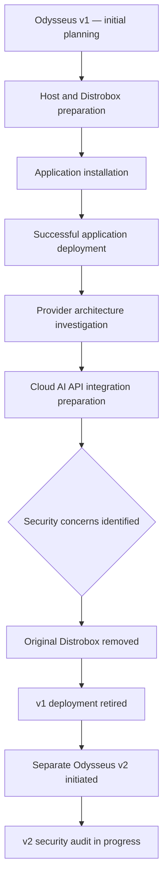

# Odysseus v1 — First Installation and Retirement Record

| Document control | Value |
|---|---|
| Project | Odysseus — first installation |
| Generation | v1 |
| Platform | Steam Deck / SteamOS |
| Historical runtime | Distrobox: `odysseus-box` |
| Historical project path | `/home/deck/OdysseusProject` |
| Historical recovery path | `/home/deck/OdysseusRecovery` |
| Installation outcome | Successful |
| Final deployment status | Retired; original Distrobox removed |
| Successor | Odysseus v2, separately initiated |
| Current purpose | Historical record only |
| Last reorganized | 2026-11-06 |

> **WARNING — NOT AN INSTALLATION GUIDE.** The first installation worked, but security issues were discovered during subsequent Cloud AI API integration. The original Distrobox deployment was removed. Odysseus v2 is a separate project and is currently undergoing its own audit.

## 1. Executive summary

The first Odysseus installation was successfully deployed on the Steam Deck. The project progressed beyond initial setup into provider architecture investigation and Cloud AI API integration preparation.

The work was discontinued because security concerns emerged while implementing the Cloud AI API integration. The original Distrobox was removed and a separate Odysseus v2 project was initiated.

| Question | Historical outcome |
|---|---|
| Did the first installation succeed? | **Yes.** |
| Did the project reach Cloud AI provider integration? | **Yes.** |
| Was the original deployment retained? | **No.** |
| Was the original Distrobox removed? | **Yes.** |
| Is v2 simply the old Distrobox restarted? | **No.** It is a separate successor project. |
| Is v2 approved for deployment? | **No conclusion here.** It is undergoing its own audit. |

Installation success and deployment approval are separate decisions.

## 2. Project timeline

This is a project-history diagram, not a deployment procedure.

## 3. Former environment — historical reference

| Item | Historical value |
|---|---|
| Host | Steam Deck, SteamOS |
| Host account | `deck` |
| Distrobox | `odysseus-box` |
| Container distribution | Ubuntu 24.04, recorded during provider investigation |
| Application directory | `/home/deck/OdysseusProject` |
| Recovery directory | `/home/deck/OdysseusRecovery` |
| Project Python | `/home/deck/OdysseusProject/.venv/bin/python` |
| Project Python version | 3.12.3, historical observation |
| ChromaDB | Separate Podman container in the historical design |
| Lifecycle | Manual project start/stop scripts |

The old project directory was intended for application source, dependencies and project data. The recovery directory was intended for backups, recovery scripts and selected recovery documentation. This organizational separation did not itself establish a security boundary.

### 3.1 Former lifecycle model

The intended model was manual: no automatic start at Steam Deck boot; enter the Distrobox explicitly; use dedicated project start, status, stop and log scripts. Historical script names included `odysseus_start.sh`, `odysseus_status.sh`, `odysseus_stop.sh` and `odysseus_logs.sh`.

These names are recorded for identification only. Do not recreate or execute the scripts on the basis of this document.

## 4. Installation outcome

The first installation was successful. The project was installed and operated within the intended Distrobox-based environment, and work progressed to the next phase: integrating external Cloud AI providers.

A successful application installation did not establish that the overall deployment was safe for every later capability. Adding external API credentials and expanding the application's access to host-side secrets changed the security requirements.

**A working application is not automatically a safely contained application.**

## 5. Why the first deployment was retired

Security issues were discovered during Cloud AI API implementation. The original Distrobox deployment was subsequently removed, and a new Odysseus project was initiated.

The central lesson is that provider credentials, agent capabilities, host-mounted files and runtime permissions must be reviewed as one effective security boundary.

This record does not invent a single root cause or claim that one setting alone caused the retirement. Detailed findings belong to the relevant security review and v2 audit records.

### 5.1 Consequences

- The former v1 Distrobox is not a supported runtime.
- Historical local files and credentials are not presumed safe to restore.
- The old runtime must not be reconstructed from transcript snippets.
- Provider integration plans from v1 are not proof of working integrations.
- The successor project must establish its own architecture and security evidence.

## 6. Useful engineering outcomes

The first project produced reusable historical knowledge:

1. A SteamOS/Distrobox installation path was explored and successfully used.
2. Host and container execution contexts were explicitly distinguished.
3. The project used a dedicated Python virtual environment rather than assuming host Python was suitable.
4. Manual lifecycle management was preferred over automatic startup.
5. Recovery material was separated from the application directory.
6. Provider architecture investigation identified existing application integration points.
7. Credential handling exposed important questions about host mounts, file permissions and application access.
8. Model discovery, authentication and provider health were identified as separate concerns.

These are lessons, not blanket approval to reuse the old implementation.

## 7. What must not be carried forward automatically

| Historical item | Required treatment |
|---|---|
| Old Distrobox | Do not recreate |
| Old container configuration | Reassess from first principles |
| Old virtual environment | Do not restore |
| Old application database | Do not restore without explicit review |
| Old caches and generated data | Do not restore by default |
| Old `.env` files | Do not restore |
| Old API keys and credential files | Do not restore or expose |
| Old startup/shutdown scripts | Do not assume they are safe |
| Old host mounts and permissions | Re-evaluate in the successor audit |
| Old provider integration code | Reassess against v2 architecture and audit |

## 8. Relationship to Odysseus v2

Odysseus v2 is a separate successor project, not a continuation of the old container's runtime state. Its records are maintained separately under [second.installation](../second.installation/).

The v2 audit must establish its own runtime and privilege model, filesystem mounts, network exposure, credential access, agent permissions, lifecycle, logging and recovery boundaries.

No conclusion in this historical v1 record substitutes for v2 evidence.

## 9. Source records

The original exports are preserved in [archive/originals](./archive/originals/):

1. First installation reference and project conversation.
2. Groq provider inspection and investigation conversation.
3. Groq provider implementation handover and initial work.

They are large conversation exports. The curated Markdown documents in this directory are the preferred entry point.

## 10. Final status

| Area | Historical status |
|---|---|
| First installation | Successful |
| Cloud AI API integration | Security issues discovered during implementation |
| Original Distrobox | Removed |
| v1 deployment | Retired |
| Historical records | Preserved |
| Odysseus v2 | Separate successor project |
| v2 audit | In progress |

**Final interpretation:** Odysseus v1 was successfully installed and then deliberately retired after security concerns emerged during Cloud AI API integration. Its history is preserved for reference; the current v2 project must be evaluated independently.
