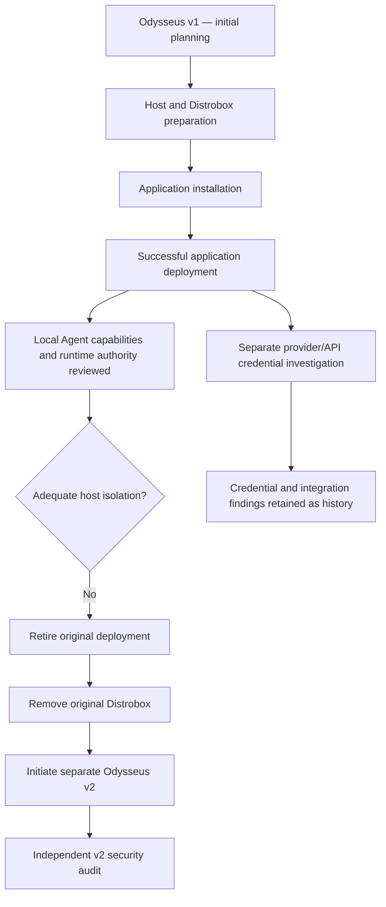

# Odysseus v1 — First Installation and Retirement Record

| Document control | Value |
|---|---|
| Project | Odysseus — first installation |
| Generation | v1 |
| Platform | Steam Deck / SteamOS |
| Historical runtime | Distrobox: `odysseus-box` |
| Historical project path | `/home/deck/OdysseusProject` |
| Historical recovery path | `/home/deck/OdysseusRecovery` |
| Installation outcome | Successful |
| Final deployment status | Retired; original Distrobox removed |
| Primary retirement reason | Local Agent authority and inadequate host isolation |
| Separate workstream | Cloud AI provider integration and credential handling |
| Successor | Odysseus v2, separately initiated |
| Current purpose | Historical record only |
| Last corrected | 2026-11-06 |

> **WARNING — NOT AN INSTALLATION GUIDE.** Odysseus v1 installed and operated successfully. It was retired because the local autonomous Agent's available capabilities, combined with the original Distrobox's permissions and host exposure, created an unacceptable security boundary. Cloud AI API credential handling was a separate concern, not the primary reason for removing the original Distrobox.

## 1. Executive summary

The first Odysseus installation was successfully deployed on the Steam Deck. The application worked, and the project progressed into further capability and provider investigations.

A subsequent security review focused on the local Agent: what actions it could request, which tools could execute those actions, which identity the processes used, and how much of the host filesystem and system interface the runtime exposed. The original Distrobox did not provide adequate isolation for an autonomous Agent with powerful local tools.

The concern was not that the model could magically escape a properly isolated container. The concern was that the container already exposed significant host resources and authority. If an Agent tool could invoke shell or filesystem operations inside that environment, those operations could act on resources that were already mounted or otherwise available to the process.

The original Distrobox was therefore removed and the v1 deployment retired. A separate Odysseus v2 project was initiated with a security-first approach.

| Question | Historical outcome |
|---|---|
| Did the first installation succeed? | **Yes.** |
| Was the local Agent/runtime security reviewed? | **Yes.** |
| Was the original execution boundary considered adequate? | **No.** |
| Was the original Distrobox removed? | **Yes.** |
| Was Cloud AI API credential work the primary retirement reason? | **No.** It was a separate workstream. |
| Is v2 simply the old Distrobox restarted? | **No.** It is a separate successor project. |
| Is v2 approved for deployment? | **No conclusion here.** It is undergoing its own audit. |

Installation success and deployment security are separate decisions.

## 2. Project timeline



This is a project-history diagram, not a deployment procedure. The provider investigation is shown separately to avoid implying that it caused the v1 retirement.

## 3. Former environment — historical reference

| Item | Historical value |
|---|---|
| Host | Steam Deck, SteamOS |
| Host account | `deck` |
| Distrobox | `odysseus-box` |
| Container distribution | Ubuntu 24.04, recorded during provider investigation |
| Application directory | `/home/deck/OdysseusProject` |
| Recovery directory | `/home/deck/OdysseusRecovery` |
| Project Python | `/home/deck/OdysseusProject/.venv/bin/python` |
| Project Python version | 3.12.3, historical observation |
| ChromaDB | Separate Podman container in the historical design |
| Lifecycle | Manual project start/stop scripts |

The old project directory was intended for application source, dependencies and project data. The recovery directory was intended for backups, recovery scripts and selected recovery documentation. This organizational separation did not itself establish a security boundary.

### 3.1 Former lifecycle model

The intended model was manual: no automatic start at Steam Deck boot; enter the Distrobox explicitly; use dedicated project start, status, stop and log scripts. Historical script names included `odysseus_start.sh`, `odysseus_status.sh`, `odysseus_stop.sh` and `odysseus_logs.sh`.

These names are recorded for identification only. Do not recreate or execute the scripts on the basis of this document.

## 4. Why the local Agent/runtime was retired

The decisive concern was the combination of autonomous Agent behavior, powerful local tools and an execution environment that did not adequately separate those tools from the host.

An LLM-based Agent is not a conventional deterministic script. It interprets goals and context, selects tools and generates tool inputs. Untrusted material—such as web pages, retrieved documents, tool output or prompt-injection text—may influence its decisions. Prompt-injection resistance and approval prompts are useful controls, but they are not substitutes for OS-enforced isolation.

The technical review of the former `odysseus-box` recorded an excessively permissive configuration, including:

| Area | Historical finding recorded during review | Security implication |
|---|---|---|
| Container privilege | Privileged container configuration | Weakened container isolation from host |
| Process identity | Container process ran with host-user identity / same UID context | User-owned host files could remain accessible according to permissions |
| Host home | Read/write access to `/home/deck` | Broad access to user files and configuration |
| Host root | Host filesystem exposed read/write under `/run/host` | Potential access to host paths beyond the project workspace |
| Devices and system interfaces | Read/write exposure of `/dev` and `/sys` | Expanded access to host device and kernel-facing interfaces |
| Network | Host networking | Reduced network namespace separation |
| AppArmor | Unconfined profile | No effective AppArmor confinement for the container |
| Masking | `unmask=all` recorded | Removed additional masking restrictions |

These are historical review findings about the former deployment configuration. They are not claims about the current Steam Deck, the current v2 project or every possible Distrobox configuration.

### 4.1 Why this mattered for an autonomous Agent

The application exposed or was intended to expose powerful capabilities such as shell execution, Python execution and filesystem operations. When such tools execute with the application process's effective identity and permissions, their authority is bounded by the process environment—not by the Agent's intended task description.

The practical risk chain was:

```text
Untrusted or misleading input reaches the Agent
                  |
                  v
Agent selects a powerful local tool
                  |
                  v
Tool executes as the application process
                  |
                  v
Process inherits the runtime's effective permissions
                  |
                  v
Broad host mounts / privileges make host resources reachable
                  |
                  v
Potential host-file access, modification or other unintended actions
```

The concern was not a proven successful exploit or a demonstrated container escape. It was that the original runtime gave the Agent tool process access to host resources that should not have been inside its authority boundary in the first place.

**Key principle:** a container is not a meaningful security boundary for an Agent if the container is configured to expose the host resources and privileges that the Agent must be prevented from using.

### 4.2 Why prompt instructions alone were insufficient

System prompts, tool descriptions, confirmation steps and application-level role checks can reduce accidental or malicious tool use. They do not provide the same guarantee as operating-system controls.

A safer design must enforce restrictions outside the model, including:

- Non-privileged execution identity.
- No broad host-home or host-root mounts.
- Workspace-scoped filesystem access.
- No unnecessary device or kernel-interface access.
- Network isolation and explicit egress policy.
- Mandatory access-control confinement where available.
- Capability reduction and syscall restrictions where appropriate.
- Default-deny tool availability and narrow per-tool permissions.
- Human approval for sensitive actions, without treating approval as a sandbox.

These are security requirements and design principles, not a statement that v2 has already implemented or passed each control.

## 5. Separate workstream: Cloud AI providers and credentials

During the v1 period, a separate investigation examined integration with cloud AI providers, initially Groq and later a planned set of providers. That work identified questions around credential storage, request-time resolution, session persistence, logging, provider health and the Distrobox's access to host-side key files.

Those findings remain relevant historical engineering material. They are documented separately in:

- [Provider Investigation](./ODYSSEUS-V1-PROVIDER-INVESTIGATION.md)
- [Groq Integration Attempt](./ODYSSEUS-V1-GROQ-INTEGRATION-ATTEMPT.md)

**Causal distinction:** provider/API-key handling was not the primary reason the original Odysseus v1 deployment and Distrobox were retired. The retirement decision concerned local Agent authority and insufficient host isolation.

## 6. Installation outcome

The first installation was successful. The application was installed and operated in the historical Distrobox environment. The subsequent retirement was a deliberate security decision, not an installation failure.

A successful application installation does not establish that its later Agent capabilities can safely operate with the same runtime permissions.

## 7. Engineering lessons retained

1. Assess an Agent's effective authority, not only the list of tasks it is intended to perform.
2. Treat shell, Python and filesystem tools as privileged execution interfaces.
3. Assume untrusted content may attempt to influence Agent tool selection.
4. Do not rely on prompt instructions as the primary security boundary.
5. Do not expose host home, host root, devices or kernel interfaces to an Agent runtime without a compelling and tightly controlled reason.
6. A same-UID process may access host-user files exposed through mounts, subject to effective permissions.
7. Container privilege, namespace configuration, mounts, capabilities, MAC profiles and network policy must be reviewed together.
8. Provider credentials need their own narrow access design; keeping a key outside Git does not isolate it from a process that can read it.
9. Installation success and security approval are separate milestones.
10. Rebuild the security boundary before enabling powerful Agent tools.

## 8. What must not be carried forward automatically

| Historical item | Required treatment |
|---|---|
| Old Distrobox | Do not recreate |
| Old container configuration | Do not reuse; reassess from first principles |
| Old privileged settings and host mounts | Do not reproduce |
| Old virtual environment | Do not restore |
| Old application database | Do not restore without explicit review |
| Old caches and generated data | Do not restore by default |
| Old `.env` files | Do not restore |
| Old API keys and credential files | Do not restore or expose |
| Old startup/shutdown scripts | Do not assume they are safe |
| Old provider integration code | Reassess against v2 architecture and audit |

## 9. Relationship to Odysseus v2

Odysseus v2 is a separate successor project, not a continuation of the old container's runtime state. Its records are maintained separately under [second.installation](../second.installation/).

The v2 audit must establish its own evidence for:

- Agent roles, autonomy and tool authority.
- Shell, Python and filesystem execution boundaries.
- Runtime identity, privileges, capabilities and namespaces.
- Host filesystem mounts and device exposure.
- Network access and egress restrictions.
- Prompt-injection handling and untrusted-content boundaries.
- Credential access and secret handling.
- MCP, email, background tasks and scheduled execution.
- Lifecycle, logging, backup and recovery.

No conclusion in this historical v1 record substitutes for v2 evidence. The current audit's findings and decisions belong in the v2 documentation tree.

## 10. Source records

The original installation and provider conversation exports are preserved in [archive/originals](./archive/originals/). They are primary historical source material, but may contain intermediate or superseded instructions. The curated Markdown documents in this directory are the preferred entry point.

## 11. Final status

| Area | Historical status |
|---|---|
| First installation | Successful |
| Local Agent/runtime security | Inadequate host isolation identified |
| Primary retirement reason | Local Agent authority and host-isolation risk |
| Original Distrobox | Removed |
| v1 deployment | Retired |
| Cloud AI provider investigation | Separate workstream; incomplete as production integration |
| Historical records | Preserved |
| Odysseus v2 | Separate successor project |
| v2 audit | In progress |

**Final interpretation:** Odysseus v1 worked, but its local autonomous Agent was paired with a runtime that exposed too much host authority. The deployment was deliberately retired and the original Distrobox removed. Cloud AI API and credential work is a separate historical subject. Odysseus v2 must be assessed independently.
