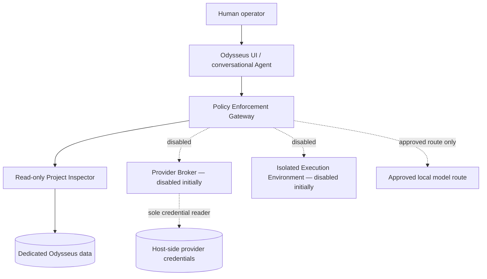
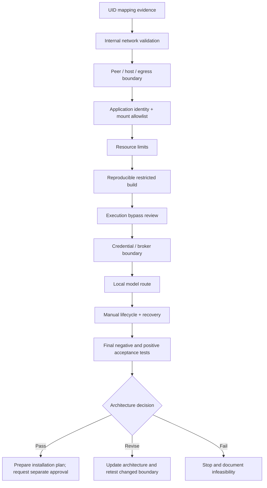

# ODYSSEUS — Phase 1.4 Deployment Feasibility & Security Audit

> **Canonical living audit · Second rebuild · ChatGPT continuity handoff**
>
> **Document ID:** ODYSSEUS-PHASE-1.4-AUDIT  
> **Version:** 1.2  
> **Record date:** 2026-11-07  
> **Status:** ACTIVE — AUDIT ONLY / NO INSTALLATION AUTHORIZED  
> **Canonical path:** `odysseus/docs/second.installation/2.audit/ODYSSEUS-PHASE-1.4-DEPLOYMENT-FEASIBILITY-AUDIT.md`

---

## 0. Read this first — mandatory continuation protocol

This is the authoritative, cumulative technical record for **Audit 2 / Phase 1.4** of the Odysseus second rebuild. It exists to survive long conversations, context-window loss, subscription limits and new ChatGPT sessions.

**A new ChatGPT conversation must begin by reading this document and the parent README. It must not begin from assumed memory, a partial chat summary, or a request that the user repeat already recorded diagnostics.**

### 0.1 Non-negotiable workflow

1. Read this canonical document from top to bottom before proposing audit work.
2. Read the parent [second.installation README](../README.md) and the closed [Phase 1.3 audit](../1.audit/archive/ODYSSEUS%20%E2%80%94%20Phase%201.3%20Reset%20%26%20Security%20Audit.md).
3. Read the archived source export relevant to the next test when its exact command or output is needed.
4. Identify the next **open dependency gate** in §12. Do not restart from generic groundwork.
5. Before any command, state:
   - the gate and test ID it serves;
   - the exact question it answers;
   - which prior evidence it relies on;
   - why it is not a repetition;
   - where it runs (SteamOS host, disposable container, application container, or client);
   - the risk, side effects, cleanup and approval boundary.
6. Diagnosis precedes modification. Read-only inspection is the default.
7. Obtain explicit approval before creating or changing host/container resources, downloading images, installing packages, changing networks, mounts, services, firewall rules, cgroups or persistent configuration.
8. After **every completed test**, update this canonical document immediately, including the exact command actually executed, relevant output, exit status, interpretation and cleanup. Do not move to another test first.
9. After every **five completed tests**, perform a consistency review and preserve an unchanged, versioned archive snapshot of the canonical document. Do not wait for a new chat.
10. Also preserve a snapshot before a major architecture/security decision, material restructuring, or a change that would make the previous state difficult to reconstruct.
11. A failed, partial, inconclusive or aborted test is still a test record. Never turn a failure into a pass by changing the wording.
12. Update the parent README whenever the canonical document, archive layout, audit status or continuation point changes.

### 0.2 Five-test checkpoint rule

The checkpoint is counted from the last completed documentation review, not from the start of a new conversation.

| Event | Required action |
|---|---|
| Test 1–4 after checkpoint | Update this document immediately after each test |
| Test 5 after checkpoint | Update the test record, then review all five records and cross-references |
| Five-test review | Check status consistency, exact commands, output, exit codes, cleanup, conclusions and next gate |
| Snapshot | Copy the reviewed canonical content unchanged to `archive/YYYY-MM-DD/ODYSSEUS-PHASE-1.4-DEPLOYMENT-FEASIBILITY-AUDIT-vX.Y.md` |
| Post-snapshot | Increment the canonical version and record the snapshot in the change log |
| New conversation | Read the current canonical document; do not replay the five completed tests |

**No test may be recorded only in chat.** If the document cannot be updated immediately, stop the audit sequence and resume documentation before further testing.

### 0.3 Evidence and status vocabulary

| Status | Meaning |
|---|---|
| **CONFIRMED** | The specific proposition was directly demonstrated by recorded evidence |
| **PASS** | A defined test met its stated acceptance criterion |
| **FAIL** | A defined test did not meet its acceptance criterion |
| **PARTIAL** | Some but not all required behavior was demonstrated |
| **INCONCLUSIVE** | Evidence is ambiguous, incomplete, conflicting or insufficient |
| **NOT TESTED** | No execution evidence exists |
| **PROPOSED** | Suggested but not executed |
| **BLOCKED** | A prerequisite, safety boundary or technical limitation prevents the test |
| **SUPERSEDED** | A later test or decision replaces the earlier conclusion; historical record remains |

A host capability existing is not proof that a container can use it. A configuration option existing is not proof of enforcement. A successful test of one destination, identity or mount does not prove all destinations, identities or mounts safe.

### 0.4 Document role and evidence boundary

This document is:
- the active technical ledger and continuation handoff;
- the authoritative index of completed, failed and pending work;
- the place to record new decisions and architecture changes;
- the anti-repetition reference for future ChatGPT sessions.

This document is not:
- an installation guide;
- approval to install Odysseus, LXC, packages, images or services;
- proof that a proposed architecture is secure;
- a replacement for the original chronological source exports preserved in the archive;
- a substitute for revalidation after a relevant kernel, SteamOS, Podman, runtime or application-source change.

---

## 1. Mission, scope and current verdict

### 1.1 Mission

Determine whether the second Odysseus rebuild can be deployed on SteamOS with enforceable security boundaries, least privilege, manual lifecycle and no collateral impact on existing projects.

The objective is not merely to make the application run. The objective is to establish whether the application can be made to act only through narrowly authorized interfaces, even when the model, prompt, user role or external content is hostile or mistaken.

> **Odysseus may reason broadly, but it must act narrowly.**

### 1.2 Current verdict

**Audit remains active. Installation is not authorized.**

The existing rootless Podman foundation has useful controls, but testing has identified important limitations and distinctions:

- Default rootless Podman UID mapping maps container UID/GID 0 to host UID/GID 1000 (`deck`). This is not acceptable as the preferred application boundary.
- Podman `--userns=auto` failed because the available subordinate ID allocation was insufficient for the requested automatic mapping. Both the default and explicit size-1024 attempts failed. Do not retry without a materially different supported configuration and a documented reason.
- `--userns=nomap` successfully mapped container UID/GID 0 to host ID 1 in the tested namespace map.
- A narrowly scoped bind-mount test demonstrated that the tested `nomap` container root could not read a host-owned mode-700 directory or create a file in it.
- `--network=none` blocked the tested host SSH, router DNS and public HTTPS destinations.
- The default rootless Podman bridge allowed tested access to the router DNS service and public HTTPS; DNS name resolution also worked. The default bridge is therefore not an acceptable security boundary for an Agent that must have no general LAN or Internet access.
- A dedicated Podman `--internal` network was runtime-tested in NET-03. It blocked the tested host SSH, router DNS, public HTTPS and DNS-name-resolution attempts. Peer-to-peer behavior between two containers remains untested.
- AppArmor and SELinux are disabled on the inspected host. Seccomp is enabled. Do not claim mandatory access-control protection that is not active.
- No Odysseus application container, LXC container or production network has been created.

These results support continued bounded feasibility work. They do **not** establish that the proposed architecture is ready to install.

### 1.3 Decision outcomes

The audit must finish with one explicit outcome:

| Outcome | Meaning | Permitted next step |
|---|---|---|
| **PROCEED — conditional** | Required controls have been demonstrated for a specific deployment profile | Prepare a reviewed installation plan; still obtain installation approval |
| **REVISE** | Security is plausible but architecture, runtime or policy must change | Update architecture and test the changed boundary |
| **STOP — infeasible** | Required security cannot be established without unacceptable privilege or host changes | Document the reason and close the audit without installation |

A successful container start is never, by itself, a proceed decision.

---

## 2. Relationship to Audit 1 — Phase 1.3

**Audit 1 is closed as a source-level security audit. Audit 2 is a separate deployment/runtime feasibility audit.**

Primary record: [ODYSSEUS — Phase 1.3 Reset & Security Audit](../1.audit/archive/ODYSSEUS%20%E2%80%94%20Phase%201.3%20Reset%20%26%20Security%20Audit.md)

### 2.1 What Audit 1 established

The Phase 1.3 source audit examined authentication and roles, Agent tool schemas and dispatch, shell and Python execution, filesystem tools, MCP, internal APIs, integrations, credentials, browser execution, background jobs and scheduling.

It found that upstream Odysseus contains powerful execution and integration paths. Prompt instructions and a non-admin role alone are not sufficient security boundaries. The intended rebuild therefore requires default-deny tool policy and external enforcement.

The audited source baseline was:

| Field | Recorded value |
|---|---|
| Repository | `odysseus-dev/odysseus-current` |
| Branch | `dev` |
| Commit | `142b93ad86073efb24981df385423f58fe5376b1` |
| Signature | Unsigned |
| Audit 1 result | Source-level audit closed; runtime validation not performed |

Reconcile the source identity and commit again before any future build. Never silently follow a moving branch.

### 2.2 What Audit 1 did not establish

It did not prove runtime isolation, safe UID mapping, mount permissions, network enforcement, cgroup enforcement, credential separation or application behavior inside the final deployment. Those questions belong to Audit 2.

### 2.3 Separation rule

Do not retroactively rewrite Audit 1 to include runtime evidence. Do not treat Audit 1's source-level conclusions as runtime test results. Keep the two audit verdicts independent.

---

## 3. User environment, protected resources and safety boundary

### 3.1 Known host baseline

Values below are historical observations from the 2026-11-06 audit. They are not guaranteed current after a system update.

| Field | Recorded value |
|---|---|
| Device | Steam Deck OLED |
| Host account | `deck` |
| Hostname | `Laco` |
| Host LAN address | `192.168.1.161` |
| SteamOS kernel | `7.2.7-valve2-2-neptune-72` |
| Podman | `6.0.2` |
| Rootless Podman | Yes |
| Network backend | Netavark `2.0.0` |
| OCI runtime | crun `1.28` (one later info output identified `1.28-dirty`) |
| Cgroups | v2 |
| Cgroup manager | systemd |
| Seccomp | Enabled |
| AppArmor | Disabled |
| SELinux | Disabled |
| Storage driver | overlay |
| Graph root | `/home/deck/.local/share/containers/storage` |
| Rootless runtime directory | `/run/user/1000/containers` |

### 3.2 Protected resources — strict exclusion

The following are outside the Odysseus audit's operational authority:

| Resource | Protection rule |
|---|---|
| Pi-hole Distrobox `pihole-box` | Do not stop, start, modify, recreate or inspect internals |
| Pi-hole container `pihole` | Do not stop, start, modify, recreate or inspect internals |
| Stable Diffusion Distrobox `Stable-box` | Do not stop, start, modify, recreate or inspect internals |
| LocalAI Distrobox `localai-box` | Do not stop, start, modify, recreate or inspect internals |
| LocalAI service / model data | Do not start, stop, modify or use as an unapproved test target |
| SSH configuration and recovery | Do not alter or weaken |
| Existing project data and credentials | Do not mount, read, copy, expose or modify |

Global Podman metadata listings may be used when needed to verify resource inventory, but avoid querying protected container internals. Do not use broad cleanup commands such as `podman system prune`.

### 3.3 Credentials

The existing Groq key is preserved outside the project at:

`/home/deck/.config/odysseus/providers/groq/odysseus-groq.key`

Its previously verified metadata was owner `deck:deck`, mode `0600`. **Never read, print, copy, hash, mount or otherwise access its contents during this audit.** Credential metadata may be checked only when necessary and approved; the key itself is not a test fixture.

Do not expose provider secrets in command output, logs, screenshots, GitHub, documentation or chat.

### 3.4 Host modification rules

- Do not disable SteamOS read-only/immutable mode.
- Do not modify host firewall, routing, DNS, systemd delegation, cgroups, kernel parameters or security settings without explicit approval.
- Do not enable boot autostart or persistent services.
- Do not install packages or download images without approval.
- Do not delete/reinstall/reset anything without explicit approval.
- Use temporary, uniquely named test resources and verify cleanup.
- Do not use privileged containers, host networking, host PID/IPC namespaces, broad host mounts or the Podman socket as shortcuts.

---

## 4. Target security architecture — proposed, not deployed

### 4.1 Logical architecture



This diagram expresses the target trust boundaries. It is not evidence that the components exist or that the boundaries are enforced.

### 4.2 Component authority matrix

| Component | Intended authority | Explicitly denied |
|---|---|---|
| UI / Agent | Conversation, planning, bounded session state | Host shell, Python, arbitrary filesystem, Podman, SSH, credentials, arbitrary network |
| Policy Gateway | Authenticate and authorize narrowly defined operations | Arbitrary command execution; implicit privilege escalation |
| Project Inspector | Read-only, allowlisted project metadata/files | Writes, deletes, traversal, unrelated home data, secrets |
| Provider Broker | Specific approved provider operations and secret retrieval | Agent-visible raw keys, arbitrary URLs, general shell |
| Execution environment | Disabled in initial profile; later separately designed | Host namespaces, host socket, broad mounts, ambient credentials |
| Human operator | Explicitly approves operations outside Agent policy | No automatic transfer of human admin authority to the Agent |

### 4.3 Initial Agent capability policy

| Capability | Initial policy |
|---|---|
| Conversation and reasoning | Allow |
| Read own sessions | Allow within application policy |
| Read approved project metadata | Through Inspector only |
| Read approved project files | Through Inspector only |
| Write or delete project files | Deny |
| Bash / shell | Deny |
| Arbitrary Python | Deny |
| Arbitrary filesystem | Deny |
| SSH | Deny |
| Podman / Docker API | Deny |
| MCP | Disabled |
| Email | Disabled |
| Browser automation | Disabled |
| Downloads / arbitrary URL fetch | Disabled |
| Scheduler / background jobs | Disabled |
| Provider API calls | Disabled until separately authorized |
| Host administration | Deny |

**Administrator login status must not grant the conversational Agent unrestricted execution authority.**

### 4.4 Credential flow

```text
Agent request
    |
    v
Policy Gateway validates operation + user approval
    |
    v
Provider Broker accepts a fixed provider/operation identifier
    |
    v
Broker retrieves secret without returning it to Agent
    |
    v
Broker performs the approved request
    |
    v
Sanitized response returned to Gateway / Agent
    |
    v
Logs contain metadata, never raw credential material
```

No key in Agent environment, prompt, logs, Compose, source tree or UI container. No arbitrary URL chosen by the Agent. No silent cloud fallback.

---

## 5. Runtime choices — terminology and architecture comparison

The audit must distinguish container managers, container formats, namespaces and virtual machines. They are not interchangeable security guarantees.

### 5.1 Podman

Podman is a container engine and lifecycle manager. It can run OCI containers rootlessly, configure namespaces, capabilities, seccomp, cgroups, mounts and networks.

**Advantages for this project**
- Already present and rootless on this Steam Deck.
- OCI image workflow and explicit per-container configuration.
- Supports `--userns=nomap`, `--network=none`, capability dropping and internal networks.
- Fits the existing audit evidence and proposed component separation.

**Limitations**
- Rootless does not mean every container process is mapped to an unprivileged subordinate host ID; the default mapping observed here maps container root to `deck`.
- Network defaults may allow LAN and Internet egress.
- Host security mechanisms remain those actually enabled by SteamOS.
- A container shares the host kernel; it is not a VM.

### 5.2 Distrobox

Distrobox is a convenience layer for creating integrated development environments using a container engine (commonly Podman). It intentionally integrates containers with the host desktop and user environment.

**Why it is not the preferred Odysseus security boundary**
- Typical configurations expose the host home directory, runtime sockets, devices and host integration.
- Processes can run with the host user's identity.
- Convenience integration increases the number of host interfaces to audit.
- The previous Odysseus deployment was removed after excessive privileges, host networking and broad mounts were identified.

Distrobox remains useful for development or maintenance, but its convenience defaults must not be mistaken for a hardened application sandbox.

### 5.3 LXC

LXC (Linux Containers) is a low-level userspace interface to Linux kernel container features: namespaces, cgroups, capabilities, mounts, devices and related controls. It is not itself a VM and it does not provide a separate kernel.

**LXC is not automatically more secure than Podman.** Its security depends on the exact user-namespace mapping, cgroup delegation, AppArmor/SELinux availability, seccomp policy, device access, mount configuration, network setup and lifecycle integration.

Typical LXC concepts:
- **Unprivileged container:** container root maps to an unprivileged host UID/GID range.
- **Privileged container:** container root has a much more direct relationship to host root; avoid for this project.
- **ID maps:** define how container UID/GID ranges map to host IDs.
- **Cgroup v2 delegation:** the container manager needs an appropriately delegated writable cgroup subtree for resource control and nested cgroup operations.
- **LXC configuration:** controls namespaces, mounts, devices, capabilities, security profiles and networking.
- **Lifecycle:** `lxc-create`, `lxc-start`, `lxc-info`, `lxc-stop`, `lxc-destroy` and related tools.

LXC can be launched directly on the host, or nested inside another container. These are materially different architectures.

#### LXC architecture alternatives

| Option | Topology | Main concern | Audit status |
|---|---|---|---|
| A. Rootless Podman only | SteamOS → Podman containers | Must prove UID, mount, network and cgroup boundaries | Partially tested |
| B. Direct host-level unprivileged LXC | SteamOS → unprivileged LXC | Host cgroup delegation, device access, security profile and package impact | Not tested; no LXC install |
| C. LXC nested inside rootless Podman | SteamOS → Podman → LXC | Requires nested namespace/device/cgroup behavior and outer boundary support | Not proven |
| D. LXC inside a privileged outer container | SteamOS → privileged container → LXC | Excessive authority and weak isolation assumptions | Rejected as a default approach |
| E. Virtual machine | SteamOS → VM → guest containers/application | Higher resource and operational cost; independent guest kernel | Not evaluated |

**Important distinction:** a read-only cgroup mount observed inside a rootless Podman container is evidence about that outer Podman boundary. It does not prove that direct host-level unprivileged LXC is impossible. Conversely, `Delegate=yes` on the user's systemd service is not proof that a particular LXC process has a writable delegated subtree.

LXC must not be installed merely to “see what happens.” First establish the exact host-level test, package source/version, required permissions, cgroup path, device access, service behavior, rollback and cleanup. Obtain approval for that bounded plan.

### 5.4 LXD and Incus

LXD and Incus are higher-level container/VM managers built around system-container and VM workflows. They provide management APIs, profiles, images, storage pools, networks and lifecycle automation.

They are not simply alternate names for LXC:
- LXC is the lower-level container runtime/library/tooling.
- LXD and Incus provide a management layer and broader system.
- Their daemon/API and default profile/network/storage behavior introduce additional authority and services to audit.

Neither should be introduced into this project without a specific demonstrated need. A management daemon is not a substitute for a security model.

### 5.5 Docker / Compose

Docker Engine and Compose provide container lifecycle and application orchestration. Compose is a declarative configuration format/tool, not an isolation boundary. A secure-looking YAML file does not prove runtime enforcement.

For this project, any OCI/Compose configuration must be reviewed for:
- `privileged`, added capabilities and devices;
- host PID/IPC/network namespaces;
- bind mounts and named volumes;
- socket mounts, especially `/run/podman/podman.sock` or Docker socket;
- published ports and network attachments;
- user, UID/GID mapping and entrypoint behavior;
- environment variables and credential inheritance;
- restart policies and service dependencies;
- health checks and hidden helper containers.

### 5.6 Runtime selection rule

Do not choose LXC, Podman, Distrobox, Incus, LXD or a VM based on familiarity or the apparent simplicity of installation. Choose only after the target architecture's security requirements are mapped to tested enforcement mechanisms.

---

## 6. Rootless Podman and host baseline — recorded evidence

### 6.1 Identity and subordinate ID configuration

Recorded host identity:

```text
uid=1000(deck) gid=1000(deck) groups=1000(deck),973,998
/etc/subuid: deck:100000:65536
/etc/subgid: deck:100000:65536
user.max_user_namespaces = 59068
newuidmap and newgidmap available
```

### 6.2 Mapping comparison

**Default rootless mapping observed:**

```text
         0       1000          1
         1     100000      65536
```

This means container UID 0 maps to host UID 1000 (`deck`). It does not satisfy the preferred separation for a sensitive application process.

**`--userns=nomap` test observed:**

```text
uid=0(root) gid=0(root)
UID map:
         0          1      65536
GID map:
         0          1      65536
```

In this test, container UID/GID 0 mapped to host ID 1, not host UID/GID 1000. This is positive evidence for the specific test configuration. It does not automatically establish compatibility with the upstream application's expected UID 1000, file ownership, volumes or entrypoint.

**`--userns=auto` attempts:** failed with insufficient unused IDs. Do not repeat without a documented change in subordinate-ID allocation or Podman behavior.

### 6.3 Runtime and security capabilities

Recorded:
- Podman 6.0.2, rootless.
- Netavark 2.0.0, pasta and rootlessport available.
- OCI runtime crun 1.28 / 1.28-dirty.
- Seccomp enabled; profile at `/usr/share/containers/seccomp.json`.
- AppArmor disabled; SELinux disabled.
- cgroup v2; systemd manager; user service reports `Delegate=yes`.
- User-level controllers reported: `cpu memory pids dmem`.
- Overlay graph driver; graphroot under `/home/deck/.local/share/containers/storage`.
- `fuse-overlayfs` available; storage reports shifting support.

Host-level controller presence is not proof of per-container writable delegation or resource enforcement. Test actual limits on the exact candidate configuration before relying on them.

### 6.4 Existing default network

```text
name: podman
driver: bridge
subnet: 10.88.0.0/16
gateway: 10.88.0.1
IPv6: disabled
DNS enabled: false
internal: false
containers at inspection: none
```

Do not reuse the default `podman` network as the Odysseus isolation boundary.

---

## 7. Mount and filesystem isolation evidence

### 7.1 Host path metadata observed

| Path | Recorded mode / owner |
|---|---|
| `/home/deck` | `0700` |
| `/home/deck/.local` | `0755` |
| `/home/deck/.local/share` | `0755` |
| `/home/deck/.local/share/containers` | `0700` |
| `/home/deck/.local/share/containers/storage` | `0700` |

Host filesystem was ext4, mounted read-write.

### 7.2 Completed private-directory bind-mount test

The user explicitly approved a temporary directory:

`/home/deck/Odysseus-mount-test`

The test used:
- a host-owned private directory (mode 0700);
- a sentinel file (mode 0600);
- rootless Podman with `--userns=nomap`;
- `--network=none`;
- all capabilities dropped;
- `no-new-privileges`;
- a single narrow bind mount to `/probe:rw`.

Inside the container, UID/GID 0 saw the mounted directory as UID/GID 65534, mode 0700. It could not read the sentinel and could not create the test file.

Host verification confirmed:
- the sentinel remained unchanged;
- no container-created file existed;
- the four protected project containers were unchanged;
- the temporary test directory was removed after explicit cleanup approval.

**Conclusion:** PASS for the tested host-owned private directory, mapping and mount configuration.

**Limit:** this does not prove all host paths, devices, sockets, mount options, symlink traversal, volumes or future application mounts safe. Every production mount requires its own allowlist and review.

### 7.3 Mount policy for any future deployment

- No `/home/deck`, `/home`, `/etc`, `/run`, `/var`, host root or project-wide mounts.
- No provider credential directory or SSH key/config mounts.
- No Podman/Docker socket.
- No broad `/dev`, `/sys` or runtime directory mounts.
- Prefer a dedicated, narrowly scoped data directory with explicit ownership and mode.
- Prefer read-only mounts for Inspector inputs.
- Do not assume file mode alone protects secrets from processes sharing the same host UID.
- Record every mount source, destination, read/write mode, ownership mapping and purpose.

---

## 8. Network isolation evidence and target policy

### 8.1 Host network baseline

Recorded:
- wired interface `enp4s0f3u1u4` up, address `192.168.1.161/24`;
- default route via `192.168.1.254`;
- local LAN `192.168.1.0/24`;
- global IPv6 addresses present;
- Wi-Fi interface down at inspection;
- DNS settings included Quad9 and link-specific Cloudflare/Google resolvers.

These are historical observations. Refresh only if the host network changes or a specific test requires current values.

### 8.2 Completed connectivity tests

The temporary container used the cached `python:3-alpine` image, `--userns=nomap`, no host mounts, dropped capabilities and no-new-privileges. No image download was performed.

| Destination / operation | `--network=none` | Default Podman bridge |
|---|---|---|
| Host SSH `192.168.1.161:22` | Blocked; socket error | Connection refused; destination was reached but port refused |
| Router DNS `192.168.1.254:53` | Blocked | TCP connection succeeded |
| Public HTTPS `1.1.1.1:443` | Blocked | TCP connection succeeded |
| Resolve `example.com` | Failed | Name resolved to `104.20.23.154` |

No temporary test containers remained after verification.

**Interpretation:** `--network=none` blocked the tested destinations. The default bridge permitted tested router/LAN and public Internet connectivity. The host SSH refusal is not proof of host unreachability. Name resolution success does not by itself identify the exact DNS transport or resolver path.

### 8.3 Target network policy

| Component | Required initial policy |
|---|---|
| UI | Reachable only from explicitly trusted LAN clients on the intended published port |
| Gateway | Internal component communication only |
| Inspector | Internal only; no general egress |
| Provider Broker | Disabled until separately approved; later only provider-specific egress |
| Execution environment | No network by default |
| Local model | Only a specifically approved route; no broad host-network access |
| Public Internet | Deny by default for Agent and Inspector |
| Arbitrary private LAN | Deny |
| SSH | Deny |
| Podman/Docker API | Deny |
| MCP servers | Deny initially |

A Podman `--internal` network is a candidate for private component communication, not a complete policy by itself. Published ports, host services, additional network attachments, DNS, IPv6, routing and container-to-container communication must be examined.

### 8.4 Next network test — not yet executed

**PROPOSED:** create one uniquely named temporary Podman internal network and one disposable container using only the already cached test image. Test the host, router, public Internet and DNS from that container. Do not alter the existing `podman` network. Remove only the named test container/network after recording evidence.

This test requires explicit user approval before resource creation. The exact commands and cleanup plan must be shown first. It is not authorized by this document.

---

## 9. Cgroups, resource controls and host security

### 9.1 Recorded host observations

- Unified cgroup v2 hierarchy.
- systemd cgroup manager.
- `user@1000.service` reported `Delegate=yes`.
- Available user-level controllers reported: `cpu`, `memory`, `pids`, `dmem`.
- Podman uses crun.
- Seccomp enabled.
- AppArmor and SELinux disabled.

### 9.2 Interpretation

Cgroup v2 and delegated controllers make resource management plausible. They do not establish that every candidate container has a writable subtree or that configured limits are enforced.

The cgroup inspection performed inside a disposable rootless Podman container found a read-only cgroup mount, empty subtree control and no demonstrated writable child delegation. A later host-level read-only query identified the Podman systemd manager and runtime but did not change the container mount result.

### 9.3 Resource policy

Before any application component is launched, define and verify:
- CPU quota/weight;
- memory maximum and swap behavior;
- PID maximum;
- storage budget;
- log growth/rotation;
- bounded startup/health-check behavior.

Do not guess limits or run resource-heavy workloads without approval. The Steam Deck remains a general-purpose/gaming device.

---

## 10. Audit journey — completed stages and evidence index

The original 1.4.0–1.4.14 source exports have been moved unchanged into `archive/2026-11-06/source-exports/`. They are chronological evidence, not the active handoff. This section summarizes the sequence so a new ChatGPT session can navigate without replaying it.

| Source record | Scope | Result / durable finding |
|---|---|---|
| 1.4.0 | Initial rebuild security architecture and installation principles | Established pinned source, restricted Agent identity, default deny, brokered credentials and manual lifecycle as target requirements |
| 1.4.1 | Consolidated read-only host/environment inventory | Collected SteamOS, hardware, Podman, Distrobox, Odysseus remnants and credential metadata; no credential contents read |
| 1.4.2 | Environment results and recovery inventory | Confirmed no active Odysseus deployment; identified Pi-hole and recovery material as protected; corrected source-repository chronology |
| 1.4.3 | Recovery analysis | Preserved historical documentation/scripts as reference only; no old environment or script assumed reusable |
| 1.4.4 | Recovery scripts and launcher review | Legacy START/STOP scripts not reusable as-is; host Podman control and broad binding were unsafe for Agent authority |
| 1.4.5 | CheckBox and recovery review | CheckBox has protective intent but remains a trusted host-admin tool, not an Agent permission model; user later stated CheckBox work is out of scope until Odysseus is complete |
| 1.4.6 | Pinned upstream source and execution-path review | Confirmed source SHA; found shell/Python subprocesses, detached jobs, MCP and other independent execution paths |
| 1.4.7 | Application execution and background mechanisms | Continued source-level review; exact findings and commands retained in archived export |
| 1.4.8 | Security-first deployment architecture | Defined UI, Gateway, Inspector, Broker and disabled execution boundary; specified network, credential, lifecycle and acceptance policies |
| 1.4.9 | Gate A preparation | Defined rootless Podman and isolation prerequisites; no installation authorization |
| 1.4.10 | Host/runtime capability inspection | Recorded namespace, runtime, storage and security capability baseline |
| 1.4.11 | UID/GID and cgroup preparation | Collected subordinate-ID and cgroup/runtime evidence; exact historical output retained in archive |
| 1.4.12 | Cgroup and runtime findings | Confirmed cgroup v2/systemd delegation at host level; correctly distinguished host support from actual container-level enforcement |
| 1.4.13 | Gate A capability assessment | Conditional pass at capability level only; explicitly left UID, mounts, network and runtime bypass validation open |
| 1.4.14 | Gate A.2 test authorization and initial image selection | Defined isolated UID/GID test constraints; subsequent completed tests are recorded below |

### 10.1 Source-export policy

The archived TXT records are preserved unchanged. When a future session needs an exact historical command, output, correction or chronology:
1. open the relevant archived source export;
2. copy only the exact relevant record;
3. compare it with the current test ledger;
4. do not re-execute it unless the repeat criteria in §15 are met.

Do not infer missing output from a summary.

---

## 11. Detailed runtime test ledger — confirmed evidence

The following entries consolidate actual results recorded in the audit journey and the continuation chat. They distinguish test scope from architecture conclusions.

### UID-01 — Default rootless UID/GID mapping

- **Status:** CONFIRMED — unsuitable as preferred isolation mapping
- **Environment:** SteamOS host / Podman rootless
- **Question:** Does container root map directly to the host `deck` user under the default mapping?
- **Result:** Yes. Container UID/GID 0 mapped to host UID/GID 1000.
- **Evidence:**
  ```text
           0       1000          1
           1     100000      65536
  ```
- **Conclusion:** Do not accept this default mapping as the preferred Odysseus application boundary.
- **Repeat policy:** Only after relevant Podman, subordinate-ID or host configuration change.

### UID-02 — Podman automatic user namespace mapping

- **Status:** FAIL — requested mapping unavailable
- **Environment:** SteamOS host / rootless Podman
- **Question:** Can `--userns=auto` allocate a distinct subordinate range?
- **Result:** Both default `--userns=auto` and explicit `--userns=auto:size=1024` failed with `not enough unused IDs in user namespace`.
- **Conclusion:** Do not retry as generic groundwork. Revisit only if the subordinate-ID allocation or Podman implementation materially changes and the exact supported plan is documented.
- **Repeat policy:** No repeat under unchanged conditions.

### UID-03 — Podman `nomap` identity

- **Status:** PASS for mapping observation
- **Environment:** Disposable rootless Podman container, cached `python:3-alpine`
- **Question:** Does `--userns=nomap` keep container root outside host UID 1000?
- **Result:** Container UID/GID 0 mapped to host ID 1 in the recorded mapping.
- **Conclusion:** Positive identity separation for this tested invocation. Application UID compatibility and all mounted data ownership still require separate verification.
- **Repeat policy:** Only after mapping/runtime configuration changes.

### MOUNT-01 — Private host directory bind-mount isolation

- **Status:** PASS for the tested path/configuration
- **Environment:** SteamOS host + disposable rootless Podman container
- **Question:** Can container root read/write a host-owned mode-700 directory when using `nomap`?
- **Test boundary:** Temporary `/home/deck/Odysseus-mount-test`, sentinel file, single bind mount to `/probe:rw`; no network, no capabilities, no-new-privileges.
- **Observed:** Container root saw directory owner as UID/GID 65534, mode 700; could not read sentinel or create a file.
- **Host verification:** Sentinel unchanged; no test-created file; protected project containers unchanged.
- **Cleanup:** Temporary sentinel and directory removed after explicit approval; absence verified.
- **Conclusion:** Tested mount did not grant container root access to this host-private directory.
- **Limit:** Not a universal mount/device/symlink/volume audit.
- **Repeat policy:** Only for a different mount class or changed UID/mount configuration.

### NET-01 — Network namespace none-mode baseline

- **Status:** PASS for tested destinations
- **Environment:** Disposable rootless Podman container using `--network=none`
- **Targets:** Host SSH `192.168.1.161:22`, router DNS `192.168.1.254:53`, public HTTPS `1.1.1.1:443`, DNS resolution of `example.com`.
- **Result:** All tested connectivity/name-resolution attempts were blocked or failed.
- **Conclusion:** The tested none-mode container had no working route to those targets.
- **Limit:** Does not prove every possible interface or kernel communication path is unavailable.
- **Repeat policy:** No repeat unless configuration/runtime changes or a new target path is introduced.

### NET-02 — Default Podman bridge connectivity

- **Status:** FAIL for the intended no-egress security policy
- **Environment:** Disposable rootless Podman container on default `podman` bridge
- **Targets:** Same as NET-01.
- **Result:** Router DNS TCP and public HTTPS TCP connections succeeded; `example.com` resolved to `104.20.23.154`; host SSH returned connection refused.
- **Conclusion:** Default bridge allows tested LAN/router and public Internet access. It is not acceptable as the Agent/Inspector isolation network.
- **Limit:** Host SSH connection refusal means the destination was reached but the port refused; it is not evidence of host unreachability.
- **Cleanup:** No test containers remained after verification.
- **Repeat policy:** Do not repeat the default bridge test merely to reconfirm the same behavior.

### NET-03 — Dedicated internal network

- **Date/time:** 2026-11-07 local time (network creation timestamp: 2026-11-06T23:14:46.865335263Z)
- **Status:** PARTIAL — tested external egress probes blocked; peer-to-peer communication not tested
- **Environment:** SteamOS host created/inspected/removed the network; disposable rootless Podman container performed the probes
- **Runtime/image:** Podman bridge network; cached `docker.io/library/python:3-alpine`; `--pull=never`
- **Prerequisites:** NET-01 and NET-02; explicit user approval for this exact temporary network/container test
- **Question:** Does a dedicated Podman `--internal` network block the tested host, router and public Internet destinations and DNS resolution?
- **Acceptance criterion:** All named external probes fail because no route is available; network inspection confirms `internal: true`; temporary resources are removed without changing the default network.
- **Why this test is new:** NET-01 tested `--network=none`; NET-02 tested the default bridge. Neither tested a dedicated bridge marked internal.
- **Repeat policy:** Do not repeat unless Podman/Netavark/network behavior or the tested configuration changes, or a corrected harness is required.
- **Approval:** Explicit approval received for creating, probing and removing `odysseus-gate-a-internal-test` and disposable container `odysseus-gate-a-net03`.
- **Risk and side-effect boundary:** One temporary internal bridge and one disposable container only. No host firewall, route, DNS, default-network or protected-project changes.
- **Resources:** Network `odysseus-gate-a-internal-test`; container `odysseus-gate-a-net03` (automatically removed by `--rm`).

**Exact commands executed**

Network creation:
```bash
podman network create --internal odysseus-gate-a-internal-test
```

Disposable probe (command reconstructed from the supplied terminal transcript; line continuations retained):
```bash
podman run --rm \
  --pull=never \
  --name odysseus-gate-a-net03 \
  --network odysseus-gate-a-internal-test \
  --userns=nomap \
  --cap-drop=all \
  --security-opt=no-new-privileges \
  --pids-limit=64 \
  --memory=128m \
  docker.io/library/python:3-alpine \
  python -c 'import socket; print("=== ROUTES ==="); print(open("/proc/net/route").read()); print("=== RESOLVER ==="); print(open("/etc/resolv.conf").read()); tests=[("host SSH","192.168.1.161",22),("router DNS","192.168.1.254",53),("public HTTPS","1.1.1.1",443)]; print("=== TCP PROBES ==="); [(lambda s: (print(name, "CONNECTED" if s else "BLOCKED/FAILED")))(None) for name,host,port in []]; \
for name,host,port in tests: \
 try: \
  s=socket.create_connection((host,port),timeout=3); s.close(); print(name+": CONNECTED") \
 except Exception as e: print(name+": BLOCKED/FAILED ("+type(e).__name__+": "+str(e)+")") \
print("=== DNS LOOKUP ===") \
try: print("example.com:",socket.getaddrinfo("example.com",443)) \
except Exception as e: print("DNS FAILED:",type(e).__name__,str(e))'
```

Network inspection:
```bash
podman network inspect odysseus-gate-a-internal-test
```

Cleanup:
```bash
podman network rm odysseus-gate-a-internal-test
```

**Actual output**

Network creation:
```text
odysseus-gate-a-internal-test
```

Container route table and resolver:
```text
=== ROUTES ===
Iface   Destination     Gateway         Flags   RefCnt  Use     Metric  Mask            MTU     Window  IRTT
eth0    0000590A        00000000        0001    0       0       0       00FFFFFF        0       0       0

=== RESOLVER ===
search dns.podman .
nameserver 10.89.0.1
```

Connectivity and DNS probes:
```text
=== TCP PROBES ===
host SSH: BLOCKED/FAILED (OSError: [Errno 101] Network unreachable)
router DNS: BLOCKED/FAILED (OSError: [Errno 101] Network unreachable)
public HTTPS: BLOCKED/FAILED (OSError: [Errno 101] Network unreachable)
=== DNS LOOKUP ===
DNS FAILED: gaierror [Errno -2] Name does not resolve
```

Network inspection (relevant fields):
```json
{
  "name": "odysseus-gate-a-internal-test",
  "id": "7ae382cd01dff697c94fb64d5439ad39ab195409c529d2beaa7077152e93c48a",
  "driver": "bridge",
  "network_interface": "podman1",
  "created": "2026-11-06T23:14:46.865335263Z",
  "subnets": [{"subnet": "10.89.0.0/24", "gateway": "10.89.0.1"}],
  "ipv6_enabled": false,
  "internal": true,
  "dns_enabled": true,
  "containers": {}
}
```

Cleanup output:
```text
odysseus-gate-a-internal-test
```

**Observed result**
- The container had a directly connected `10.89.0.0/24` route and no default route in the displayed IPv4 route table.
- All three TCP connection attempts failed with `Network unreachable`.
- DNS lookup of `example.com` failed with `Name does not resolve`; the configured resolver was `10.89.0.1`.
- Network inspection confirmed `internal: true`, IPv6 disabled, DNS enabled, and an empty attached-container inventory at inspection time.
- Numeric exit codes were not separately captured in the supplied transcript; do not infer them from the printed output.
- The disposable container was run with `--rm` and exited before the network inspection. No separate post-run `podman ps -a` verification was supplied.

**Interpretation**
- **Confirmed for this configuration:** the dedicated internal bridge blocked the tested host SSH, router DNS, public HTTPS and DNS name-resolution paths.
- `Network unreachable` indicates that the tested container had no usable route to those destinations; this differs from a reachable destination refusing a connection.
- The network inspection independently confirms that Podman marked this bridge as internal.
- **Not established:** peer-to-peer communication between two containers; host-to-container access; published-port behavior; IPv6 egress (IPv6 was disabled on this test network); every possible host/LAN path; DNS behavior under other resolver/network configurations; or enforcement under a production component topology.
- This establishes only the named outcomes under this recorded configuration, not universal network isolation.

**Cleanup**
- `podman network rm odysseus-gate-a-internal-test` returned the expected network name.
- The container used `--rm` and had exited before the network inspection.
- No explicit post-cleanup inventory output was supplied. Cleanup is supported by the successful removal output and `--rm`, but a separate final inventory check was not recorded.
- No evidence indicates that the existing default `podman` network or protected containers were changed.

**Conclusion**
- **PASS for tested external egress isolation behavior.**
- **PARTIAL for the broader NET-03 gate:** peer-to-peer communication was intentionally not part of this first disposable-container probe and remains untested.
- Do not yet select the internal network as a complete production boundary.
- **Next test:** NET-04 — two-container internal communication and egress boundary (proposed; approval required).


### NET-04 — Two-container internal communication and egress boundary

- **Date/time:** 2026-11-07 local time (network creation: 2026-11-07T02:16:57.937434467Z UTC)
- **Status:** PASS for the tested internal peer communication and external-egress criteria; lifecycle caveat recorded
- **Environment:** SteamOS host / rootless Podman; two disposable containers on a temporary dedicated internal bridge
- **Runtime/image:** Cached `docker.io/library/python:3-alpine`; image check exit code 0; both runs used `--pull=never`
- **Prerequisites:** NET-03; explicit user approval for the complete NET-04 Stages A–I
- **Question:** Can two containers communicate bidirectionally on a dedicated `--internal` bridge while both remain unable to reach the tested host, router and public destinations?
- **Acceptance:** Peer DNS and TCP communication succeeds in both directions; host SSH, router DNS, public HTTPS and public DNS lookup fail from both peers; network inspection confirms internal status and both peers; cleanup is independently verified.
- **Why new:** NET-03 tested a single container's external-egress behavior. It did not test whether two containers on the internal bridge could communicate.
- **Approval:** Explicit approval received for the complete proposed NET-04 sequence, Stages A–I.
- **Resources:** Network `odysseus-net04-internal-test`; containers `odysseus-net04-peer-a` and `odysseus-net04-peer-b`; image `docker.io/library/python:3-alpine`.
- **Network identity:** ID `92b3a0ae13c820bba492af15c4b92c75909503b95d1387695eb0fd2f06863e6c`; bridge interface `podman1`; subnet `10.89.0.0/24`; gateway `10.89.0.1`; IPv6 disabled; DNS enabled; `internal: true`.

**Preflight output**
```text
Image check exit code: 0
NETWORK ID  NAME        DRIVER

CONTAINER ID  IMAGE       COMMAND     CREATED     STATUS      PORTS       NAMES
```
No network or container name collision was present. The cached image was available.

**Container startup and readiness**
Both `podman run -d --rm --pull=never` commands returned container IDs:
- Peer A: `ac6cc474e59501e5ad5e6061ae1e05e9b87846bfba701dbbf6a6cd33de1ce528`
- Peer B: `f48c40056520ae49e1ca8d0eabf415fca45d2ce1cb614bb6a4c643d3c1d5b461`

Logs:
```text
NET04 PEER A READY
NET04 PEER B READY
```

**Bidirectional peer communication**
Peer A resolved `net04-peer-b` to `10.89.0.3`, connected to TCP port 18080 and received the expected response:
```text
=== A -> B ===
DNS: [(<AddressFamily.AF_INET: 2>, <SocketKind.SOCK_STREAM: 1>, 6, 'net04-peer-b.dns.podman', ('10.89.0.3', 18080))]
TCP: CONNECTED
RESPONSE: NET04 RESPONSE FROM PEER B
```

Peer B resolved `net04-peer-a` to `10.89.0.2`, connected to TCP port 18080 and received the expected response:
```text
=== B -> A ===
DNS: [(<AddressFamily.AF_INET: 2>, <SocketKind.SOCK_STREAM: 1>, 6, 'net04-peer-a.dns.podman', ('10.89.0.2', 18080))]
TCP: CONNECTED
RESPONSE: NET04 RESPONSE FROM PEER A
```

**External-egress probes from both peers**

Both peers displayed the same IPv4 route and resolver:
```text
Iface   Destination     Gateway         Flags   RefCnt  Use     Metric  Mask
eth0    0000590A        00000000        0001    0       0       0       00FFFFFF

search dns.podman .
nameserver 10.89.0.1
```

Peer A:
```text
Host SSH: BLOCKED/FAILED (OSError: [Errno 101] Network unreachable)
Router DNS: BLOCKED/FAILED (OSError: [Errno 101] Network unreachable)
Public HTTPS: BLOCKED/FAILED (OSError: [Errno 101] Network unreachable)
DNS FAILED: gaierror [Errno -2] Name does not resolve
```

Peer B:
```text
Host SSH: BLOCKED/FAILED (OSError: [Errno 101] Network unreachable)
Router DNS: BLOCKED/FAILED (OSError: [Errno 101] Network unreachable)
Public HTTPS: BLOCKED/FAILED (OSError: [Errno 101] Network unreachable)
DNS FAILED: gaierror [Errno -2] Name does not resolve
```

Targets were:
- Host SSH: `192.168.1.161:22`
- Router DNS: `192.168.1.254:53`
- Public HTTPS: `1.1.1.1:443`
- DNS name: `example.com`

**Network and container inspection**

Network inspection confirmed:
```json
{
  "name": "odysseus-net04-internal-test",
  "id": "92b3a0ae13c820bba492af15c4b92c75909503b95d1387695eb0fd2f06863e6c",
  "driver": "bridge",
  "network_interface": "podman1",
  "subnets": [{"subnet": "10.89.0.0/24", "gateway": "10.89.0.1"}],
  "ipv6_enabled": false,
  "internal": true,
  "dns_enabled": true,
  "containers": {
    "ac6cc474e59501e5ad5e6061ae1e05e9b87846bfba701dbbf6a6cd33de1ce528": {
      "name": "odysseus-net04-peer-a",
      "ip": "10.89.0.2/24"
    },
    "f48c40056520ae49e1ca8d0eabf415fca45d2ce1cb614bb6a4c643d3c1d5b461": {
      "name": "odysseus-net04-peer-b",
      "ip": "10.89.0.3/24"
    }
  }
}
```

Both `podman inspect` outputs showed:
- `Mounts: []` and no bind mounts.
- `PortBindings: {}`, `PublishAllPorts: false`, and `Ports: {}`.
- `CapAdd: []`; `CapDrop` included all capabilities.
- `SecurityOpt: ["no-new-privileges"]`.
- `UsernsMode: "private"` with UID/GID map `0:1:65536` (the invocation used `--userns=nomap`).
- `Memory: 134217728`; `PidsLimit: 64`.
- `RestartPolicy: {"Name":"no"}`; `AutoRemove: true`.
- Both containers were running at inspection time with no reported startup error.

**Cleanup and lifecycle observation**

The cleanup loop stopped both named containers and removed the named network. Podman emitted:
```text
WARN[0010] StopSignal SIGTERM failed to stop container odysseus-net04-peer-a in 10 seconds, resorting to SIGKILL
odysseus-net04-peer-a
WARN[0010] StopSignal SIGTERM failed to stop container odysseus-net04-peer-b in 10 seconds, resorting to SIGKILL
odysseus-net04-peer-b

odysseus-net04-internal-test
```

The independent verification reported:
```text
OK: odysseus-net04-peer-a ABSENT
OK: odysseus-net04-peer-b ABSENT
OK: NET-04 NETWORK ABSENT
```

The listeners did not terminate within Podman's 10-second SIGTERM grace period; Podman escalated to SIGKILL. This is a lifecycle/termination caveat to investigate before selecting a production process model. It did not prevent final cleanup: both containers and the network were independently confirmed absent.

**Interpretation**
- **PASS:** Peer DNS discovery and TCP communication worked in both directions on the internal bridge.
- **PASS:** Both peers were unable to reach the tested host SSH, router DNS and public HTTPS targets; both public DNS lookups failed with the expected no-route/name-resolution errors.
- **PASS:** Network inspection confirmed `internal: true`, the expected two attached peers, IPv6 disabled and no other attached container.
- **PASS:** Container inspection confirmed no host mounts or published ports, no added capabilities, no-new-privileges, resource limits and no restart policy.
- **PASS:** Cleanup was independently verified for both named containers and the temporary network.
- **CAVEAT:** Both `podman stop` operations required SIGKILL after the 10-second SIGTERM timeout. The reason was not diagnosed in this test; do not infer a specific runtime defect.
- **Limits:** This does not test host-to-container access, published-port behavior (none were published), IPv6 egress (disabled), arbitrary LAN targets beyond the named probes, UDP behavior, or the final production topology. It does not prove universal network isolation.

**Conclusion**
NET-04 **passes its defined two-peer internal communication and named external-egress criteria**. The temporary resources were removed and their absence verified. Preserve the SIGTERM-to-SIGKILL observation as an open lifecycle concern. The next dependency is NET-05 — host-service and published-port boundary. No production network or Odysseus deployment is authorized.

**Exact executed command families**
The complete commands were the approved NET-04 Stage A–I commands supplied immediately before execution: read-only image/name preflight; `podman network create --internal odysseus-net04-internal-test`; two `podman run -d --rm --pull=never` Python TCP listeners using the approved namespace/capability/security/resource options; readiness logs; two directional `podman exec` Python DNS/TCP probes; separate host/router/public/DNS probes in each peer; network and container inspection; named stop/remove loop; and independent absence checks. The transcript preserves the full exact command text. No numeric shell exit codes were captured for every stage; do not infer them.

---

---

## 12. Remaining audit gates — ordered dependency plan

The next test must be the earliest safe, useful, unclosed dependency. Do not skip ahead to application installation.

| Order | Gate / test family | Required evidence | Current status |
|---:|---|---|---|
| 1 | Dedicated Podman internal network (NET-03) | Named host/router/public/DNS egress probes blocked on a single-container internal network | **COMPLETED — scoped probe pass** |
| 2 | Internal component communication (NET-04) | Two peers communicate bidirectionally while both fail named external-egress probes; cleanup verified | **COMPLETED — PASS with SIGTERM/SIGKILL lifecycle caveat** |
| 3 | Host-service and published-port boundary (NET-05) | Verify host reachability and exposure behavior for candidate network/published-port configuration | NOT TESTED |
| 4 | IPv6 and DNS behavior | Establish whether IPv6, DNS forwarding or resolver configuration creates an unintended egress path | NOT TESTED |
| 5 | Exact candidate UID/application identity | Validate `nomap` compatibility with the intended non-root application UID, ownership and entrypoint | NOT TESTED |
| 6 | Candidate mount allowlist | Test each proposed dedicated data mount and read-only Inspector mount | NOT TESTED |
| 7 | Resource enforcement | Demonstrate CPU, memory and PID limits on the exact candidate runtime | NOT TESTED |
| 8 | Source/build reproducibility | Reconfirm upstream commit, dependency lock, image digest and build-time downloads | NOT TESTED |
| 9 | Application execution bypass | Verify shell/Python/MCP/background paths are removed or externally denied in the actual build | NOT TESTED |
| 10 | Broker and credential isolation design | Prove Agent cannot read or inherit provider secrets; Broker is the only credential reader | NOT TESTED |
| 11 | Local model route | Determine whether a narrowly approved route can reach LocalAI without broad host/LAN access | NOT TESTED |
| 12 | Manual lifecycle | Prove no autostart, no hidden background workers, no duplicate instances, safe stop | NOT TESTED |
| 13 | Backup and recovery | Demonstrate backup/restore without provider secrets or protected project data | NOT TESTED |
| 14 | Final security acceptance | All allowed and denied operations, logs, network and collateral impact verified | NOT TESTED |
| 15 | Architecture decision | Proceed, revise or stop with evidence references and explicit user approval boundary | NOT REACHED |

### 12.1 Gate dependency map



Dependencies may be rearranged only when a documented reason shows that the proposed test does not rely on an unresolved prerequisite.

---

## 13. Exact test-record schema

Every new experiment must use this structure. Do not record only a green “PASS”.

### 13.1 Test record template

```markdown
### TEST-ID — Short objective

- **Date/time and timezone:**
- **Status:** CONFIRMED / PASS / FAIL / PARTIAL / INCONCLUSIVE / BLOCKED
- **Environment:** HOST / DISPOSABLE CONTAINER / CANDIDATE CONTAINER / CLIENT
- **Host build/kernel:**
- **Runtime/image/tag/digest:**
- **Prerequisite test IDs:**
- **Question being answered:**
- **Acceptance criterion:**
- **Why this test is new:**
- **Repeat policy:**
- **Approval:** exact approval scope, or not required (read-only)
- **Risk and side-effect boundary:**
- **Resources created or changed:**

**Exact command actually executed**
```bash
# Exact command; no reconstructed or proposed command presented as executed.
```

**Actual output**
```text
# Relevant unedited stdout/stderr, warnings and exit status.
```

**Observed result**
- What happened:
- Exit code:
- Before/after state:
- Files/devices/interfaces/processes/containers/networks created:
- Cleanup performed:
- Cleanup verification:

**Interpretation**
- What this proves:
- What this does not prove:
- Uncertainty or conflicting evidence:

**Decision**
- Continue / stop / revise:
- Next test ID:
- Canonical document updated at:
```

### 13.2 Evidence integrity rules

1. Preserve exact commands that were actually executed.
2. Label commands not yet executed as **PROPOSED**.
3. Preserve relevant stdout, stderr, warnings and exit status.
4. Record the execution location; host and container commands are not interchangeable.
5. Record image tags and digests when available.
6. Record whether an image was already cached; never hide a pull/download.
7. Record before/after state for all resource changes.
8. Record cleanup commands and independently verify absence.
9. Distinguish connection refused, timeout, unreachable route and DNS failure.
10. Distinguish host capability from container capability.
11. State both the positive result and its limits.
12. Never infer missing output from an interrupted or truncated transcript.
13. Do not paste secrets, credential contents, private keys or sensitive tokens.
14. If an experiment changes a condition, link the previous test and explain the changed variable.
15. If a script can mask an inner failure, verify and record the actual exit status.

### 13.3 Decision record template

```markdown
### DECISION-ID — Decision title

- **Date:**
- **Decision owner:** USER / ASSISTANT RECOMMENDATION / JOINTLY ACCEPTED
- **Status:** PROPOSED / ACCEPTED / REJECTED / SUPERSEDED
- **Decision:**
- **Reason:**
- **Evidence/test IDs:**
- **Alternatives considered:**
- **Security consequences:**
- **Operational consequences:**
- **Revisit condition:**
```

### 13.4 Environment refresh template

Refresh only when a relevant condition changes or a gate requires current evidence.

| Field | Value | Collected at | Source / command | Reason for refresh |
|---|---|---|---|---|
| SteamOS build | | | | |
| Kernel | | | | |
| Podman version | | | | |
| Netavark / network backend | | | | |
| OCI runtime | | | | |
| UID/GID mapping | | | | |
| cgroup version/manager | | | | |
| Seccomp / AppArmor / SELinux | | | | |
| Storage driver | | | | |
| Candidate image digest | | | | |

---

## 14. Command catalogue — historical, not a rerun checklist

This index helps future sessions recognize completed command families. It is not an instruction to rerun them.

| Command / family | Historical purpose | Repeat only if |
|---|---|---|
| `cat /etc/os-release`, `uname -r`, `id` | Host identity and kernel | OS/kernel changes |
| `podman version`, `podman info` | Podman/runtime baseline | Podman/runtime changes |
| `podman ps -a`, `podman images` | Global metadata inventory | New resource state must be checked |
| `podman network inspect` | Network baseline | Network config changes |
| `podman run --userns=auto` | Automatic UID allocation attempt | Subordinate-ID or Podman behavior changes; do not blindly retry |
| `podman run --userns=nomap` | Container identity map | Candidate identity/config changes |
| `/proc/self/uid_map`, `gid_map` | Namespace mapping | Mapping configuration changes |
| `stat`, `findmnt`, `namei` | Ownership and mount permissions | New mount/path introduced |
| `podman run --network=none` | None-mode connectivity baseline | Runtime/network behavior changes |
| Default bridge connectivity probes | Demonstrated default bridge egress | Do not repeat without changed configuration |
| cgroup v2 files / `systemctl show user@1000.service` | Host delegation and container cgroup boundary | Kernel/Podman/systemd configuration changes |
| `podman run --pull=never` | Disposable test container | Only for a new approved test |

When exact command text is needed, consult the archived 1.4.x source exports. Do not invent a command and label it historical.

---

## 15. Anti-repetition protocol and repeat criteria

Before proposing any inspection:

1. Search this document for the same question and test family.
2. Check the result and the limits of the previous evidence.
3. Confirm whether the host, kernel, Podman, runtime, network, image or configuration changed.
4. Explain the new variable or previously untested behavior.
5. If nothing relevant changed and the previous test was conclusive, do not repeat it.
6. Use the next open dependency in §12.
7. Do not ask the user to paste broad inventories already recorded here.
8. Do not use a new conversation as a reason to rerun completed groundwork.
9. Never present historical values as current without a timestamp.
10. Record new evidence before suggesting another test.

### 15.1 Already completed — do not repeat as generic groundwork

- Phase 1.3 source-level security audit and pinned source identity.
- Initial SteamOS, kernel, hardware, storage and rootless Podman inventory.
- Odysseus cleanup and protected project inventory.
- Recovery documentation and old operational script review.
- CheckBox authority review (out of scope until Odysseus is complete).
- Podman rootless runtime, network backend and storage baseline.
- Subordinate UID/GID configuration and default UID map.
- `--userns=auto` failure under the recorded conditions.
- `--userns=nomap` identity map.
- Host private directory bind-mount test and cleanup.
- `--network=none` connectivity baseline.
- Default Podman bridge LAN/router/Internet connectivity.
- Host cgroup v2/systemd delegation inspection and read-only container cgroup observation.
- Seccomp enabled / AppArmor disabled / SELinux disabled observation.

### 15.2 A repeat may be justified only when

- SteamOS build or kernel changes;
- Podman, Netavark, crun or cgroup manager changes;
- subordinate UID/GID allocation changes;
- the candidate image or its entrypoint changes;
- the exact security configuration changes;
- a prior test was partial and the new test reaches a previously untested operation;
- the previous test had a harness defect and the corrected test is explicitly linked;
- a new architecture (for example direct host-level LXC) answers a distinct question.

A repeat must state the old test ID, changed condition, expected new evidence and why the old result is no longer sufficient.

---

## 16. Stop conditions

Stop and report rather than widening permissions if:

- the only working architecture requires `--privileged`;
- container root must map directly to host root or the everyday `deck` identity without a justified exception;
- the only workable design requires broad host filesystem, runtime or device mounts;
- the Agent requires host Podman/Docker socket access;
- the Agent can bypass the Gateway through shell, Python, MCP, background tasks or direct APIs;
- network isolation requires unapproved host firewall, routing or DNS changes;
- the architecture depends on AppArmor or SELinux while those controls are unavailable;
- LXC requires unsafe cgroup delegation, privileged mode or broad device access;
- credential isolation cannot be demonstrated;
- the application starts autonomous jobs or services that cannot be reliably disabled;
- resource limits cannot be enforced or the workload threatens normal SteamOS use;
- cleanup cannot be independently verified;
- any test risks modifying Pi-hole, LocalAI, Stable Diffusion, SSH or another protected project.

A secure infeasibility finding is a valid and useful audit result.

---

## 17. Archive, provenance and source map

### 17.1 Audit 2 source exports

The original files `1.4.0` through `1.4.14` were moved unchanged from the active `2.audit/` root into:

`archive/2026-11-06/source-exports/`

These are historical source records. Do not edit them to reflect later results. The canonical Markdown file supersedes them as the active continuation record, but does not erase their chronology.

### 17.2 Audit 1 source

[Phase 1.3 Reset & Security Audit](../1.audit/archive/ODYSSEUS%20%E2%80%94%20Phase%201.3%20Reset%20%26%20Security%20Audit.md)

Audit 1 remains separate and closed.

### 17.3 Governing project references

- [Second rebuild README](../README.md)
- [Global Engineering & Security Standard](../../../../deck/docs/GLOBAL%20ENGINEERING%20%26%20SECURITY%20STANDARD.readme)
- [Waydroid project documentation protocol](../../../../waydroid/README.md)
- [Waydroid canonical living audit — continuity model](../../../../waydroid/1.audit/WAYDROID-SSH-LIVING-FEASIBILITY-AUDIT.md)

The Waydroid audit is a documentation-process reference, not evidence about Odysseus runtime behavior. Its immediate test recording, five-test review/snapshot cadence, canonical-handoff-first rule, test schema and anti-repetition protocol are adopted here.

### 17.4 Source review honesty

Only documents and outputs actually retrieved or recorded may be described as reviewed. A link in another document is not proof that its target was inspected. If a reference is unavailable, record that limitation and continue only if it is not material to the next test.

---

## 18. Current continuation handoff — start here next time

**Project:** Odysseus second rebuild — Audit 2 / Phase 1.4 deployment feasibility.

**Canonical version:** 1.2  
**Audit status:** ACTIVE — no installation authorized.  
**Current source baseline:** `odysseus-dev/odysseus-current`, branch `dev`, commit `142b93ad86073efb24981df385423f58fe5376b1` (must be rechecked before a build).  
**Current runtime evidence:** rootless Podman 6.0.2, Netavark 2.0.0, crun 1.28/1.28-dirty, cgroup v2/systemd, seccomp enabled, AppArmor/SELinux disabled.

### 18.1 What is already established

1. Default rootless mapping places container root on host UID 1000; do not accept it as the preferred boundary.
2. `--userns=auto` failed due to insufficient unused subordinate IDs; do not retry unchanged.
3. `--userns=nomap` maps container root to host ID 1 in the recorded test.
4. The tested `nomap` bind mount could not read/write the tested host-owned private directory.
5. `--network=none` blocked tested host/router/public connectivity.
6. Default Podman bridge allowed tested router/LAN and Internet connectivity; do not use it as the Agent/Inspector isolation network.
7. cgroup v2 and user-level delegation exist, but writable nested cgroup delegation inside the disposable rootless container was not demonstrated.
8. AppArmor and SELinux are disabled.
9. NET-03 tested one container on a temporary Podman bridge marked `internal: true`; host SSH, router DNS, public HTTPS and DNS lookup probes failed.
10. NET-04 confirmed bidirectional DNS/TCP communication between two disposable peers on a new `internal: true` bridge. Both peers failed the same named host/router/public/DNS probes. The network inspection showed peers at `10.89.0.2` and `10.89.0.3`, with no published ports or mounts.
11. NET-04 cleanup independently confirmed both containers and the temporary network absent. Both containers required SIGKILL after Podman's 10-second SIGTERM timeout; investigate graceful shutdown as a separate lifecycle concern.
12. No Odysseus container, LXC container or production network has been created.

### 18.2 Immediate next action

NET-03 and NET-04 are complete. NET-04 demonstrated bidirectional peer DNS/TCP communication while both peers remained unable to reach the named host SSH, router DNS, public HTTPS and public DNS targets. The internal network and both containers were removed and independently verified absent. Preserve the SIGTERM timeout/SIGKILL escalation as a lifecycle caveat.

The next dependency is **NET-05 — host-service and published-port boundary**. It must be designed as a distinct test: NET-04 had no published ports and did not test host-to-container reachability. Before proposing execution, define the exact host-side and container-side probes, the temporary resources, the cleanup, and the approval boundary. Do not repeat NET-03 or NET-04 without a changed condition or a newly identified path.

### 18.3 Explicitly not authorized

- Installing Odysseus, LXC, LXD, Incus or additional packages.
- Downloading images or source dependencies.
- Creating a permanent Odysseus network, container, directory or service.
- Starting/stopping protected projects or LocalAI.
- Provider API calls or credential access.
- MCP, SSH, shell/Python execution by the Agent.
- Host firewall, DNS, routing, cgroup, systemd or kernel changes.
- Boot autostart, background tasks or persistent services.

### 18.4 New ChatGPT session opening instruction

The first assistant action in a new conversation should be:

1. Open this canonical document and parent README.
2. Read §18 (handoff), §12 (open gates), §11 (completed tests), and §15 (repeat criteria).
3. Confirm the current version and latest archived snapshot.
4. State the next open test and why it is new.
5. Do not ask the user to repeat recorded baseline output.
6. Do not propose commands until the scope and approval boundary are clear.

---

## 19. Change log

| Version | Date | Change |
|---|---|---|
| 1.0 | 2026-11-06 | Created the canonical Phase 1.4 deployment-feasibility audit. Consolidated the 1.4.0–1.4.14 journey, recorded confirmed UID/mount/network/cgroup/runtime evidence, distinguished Podman/Distrobox/LXC/LXD/Incus/VM architectures, established test and decision schemas, five-test review/archive cadence, anti-repetition protocol and new-chat handoff. Original source exports preserved unchanged under the dated archive. |
| 1.1 | 2026-11-07 | Recorded NET-03 immediately after execution: dedicated internal bridge confirmed; host SSH, router DNS, public HTTPS and DNS-name-resolution probes blocked; temporary network removal recorded; peer-to-peer communication explicitly left untested. Updated the dependency gate and continuation handoff. No five-test snapshot triggered. |
| 1.2 | 2026-11-07 | Recorded NET-04 immediately after execution: two disposable peers resolved and reached each other bidirectionally; both peers were blocked from the named host/router/public/DNS probes; inspection confirmed internal bridge membership and restricted container settings; cleanup independently verified. Recorded SIGTERM timeout/SIGKILL escalation as a lifecycle caveat. Advanced the next gate to NET-05. No five-test snapshot triggered. |

---

*End of canonical Phase 1.4 audit record.*
