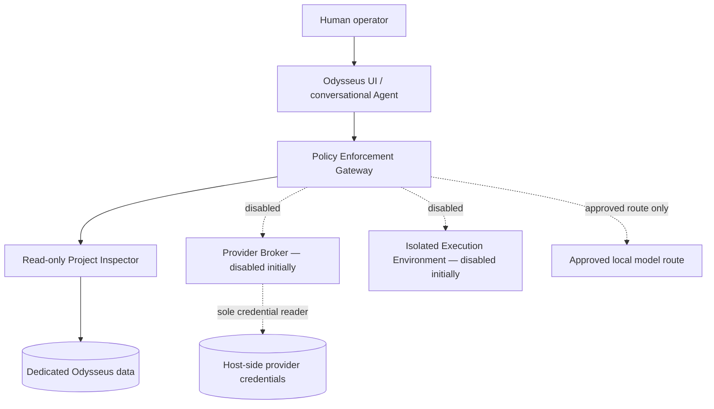
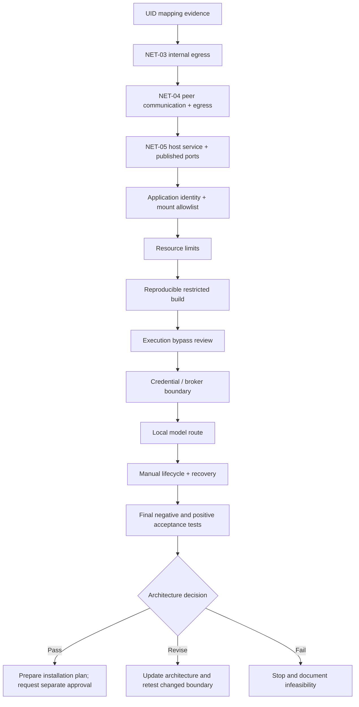

# ODYSSEUS — Phase 1.4 Deployment Feasibility & Security Audit

> **Canonical living audit · Second rebuild · ChatGPT continuity handoff**
>
> **Document ID:** ODYSSEUS-PHASE-1.4-AUDIT  
> **Version:** 3.20  
> **Record date:** 2026-11-08  
> **Status:** ACTIVE — AUDIT ONLY / NO INSTALLATION AUTHORIZED  
> **Canonical path:** `odysseus/docs/second.installation/2.audit/ODYSSEUS-PHASE-1.4-DEPLOYMENT-FEASIBILITY-AUDIT.md`

---

## 0. Read this first — mandatory continuation protocol

This is the authoritative, cumulative technical record for **Audit 2 / Phase 1.4** of the Odysseus second rebuild. It exists to survive long conversations, context-window loss, subscription limits and new ChatGPT sessions.

**A new ChatGPT conversation must begin by reading this document and the parent README. It must not begin from assumed memory, a partial chat summary, or a request that the user repeat already recorded diagnostics.**

### 0.1 Non-negotiable workflow

1. Read this canonical document from top to bottom before proposing audit work.
2. Read the parent [second.installation README](../README.md) and the closed [Phase 1.3 audit](../1.audit/archive/ODYSSEUS%20%E2%80%94%20Phase%201.3%20Reset%20%26%20Security%20Audit.md).
3. Read the archived source export relevant to the next test when its exact command or output is needed.
4. Identify the next **open dependency gate** in §12. Do not restart from generic groundwork.
5. Before any command, state:
   - the gate and test ID it serves;
   - the exact question it answers;
   - which prior evidence it relies on;
   - why it is not a repetition;
   - where it runs (SteamOS host, disposable container, application container, or client);
   - the risk, side effects, cleanup and approval boundary.
6. Diagnosis precedes modification. Read-only inspection is the default.
7. Obtain explicit approval before creating or changing host/container resources, downloading images, installing packages, changing networks, mounts, services, firewall rules, cgroups or persistent configuration.
8. After **every completed test**, update this canonical document immediately, including the exact command actually executed, relevant output, exit status, interpretation and cleanup. Do not move to another test first.
9. After every **five completed tests**, perform a consistency review and preserve an unchanged, versioned archive snapshot of the canonical document. Do not wait for a new chat.
10. Also preserve a snapshot before a major architecture/security decision, material restructuring, or a change that would make the previous state difficult to reconstruct.
11. A failed, partial, inconclusive or aborted test is still a test record. Never turn a failure into a pass by changing the wording.
12. Update the parent README whenever the canonical document, archive layout, audit status or continuation point changes.

### 0.2 Five-test checkpoint rule

The checkpoint is counted from the last completed documentation review, not from the start of a new conversation.

| Event | Required action |
|---|---|
| Test 1–4 after checkpoint | Update this document immediately after each test |
| Test 5 after checkpoint | Update the test record, then review all five records and cross-references |
| Five-test review | Check status consistency, exact commands, output, exit codes, cleanup, conclusions and next gate |
| Snapshot | Copy the reviewed canonical content unchanged to `archive/YYYY-MM-DD/ODYSSEUS-PHASE-1.4-DEPLOYMENT-FEASIBILITY-AUDIT-vX.Y.md` |
| Post-snapshot | Increment the canonical version and record the snapshot in the change log |
| New conversation | Read the current canonical document; do not replay the five completed tests |

**No test may be recorded only in chat.** If the document cannot be updated immediately, stop the audit sequence and resume documentation before further testing.

### 0.3 Evidence and status vocabulary

| Status | Meaning |
|---|---|
| **CONFIRMED** | The specific proposition was directly demonstrated by recorded evidence |
| **PASS** | A defined test met its stated acceptance criterion |
| **FAIL** | A defined test did not meet its acceptance criterion |
| **PARTIAL** | Some but not all required behavior was demonstrated |
| **INCONCLUSIVE** | Evidence is ambiguous, incomplete, conflicting or insufficient |
| **NOT TESTED** | No execution evidence exists |
| **PROPOSED** | Suggested but not executed |
| **BLOCKED** | A prerequisite, safety boundary or technical limitation prevents the test |
| **SUPERSEDED** | A later test or decision replaces the earlier conclusion; historical record remains |

A host capability existing is not proof that a container can use it. A configuration option existing is not proof of enforcement. A successful test of one destination, identity or mount does not prove all destinations, identities or mounts safe.

### 0.4 Document role and evidence boundary

This document is:
- the active technical ledger and continuation handoff;
- the authoritative index of completed, failed and pending work;
- the place to record new decisions and architecture changes;
- the anti-repetition reference for future ChatGPT sessions.

This document is not:
- an installation guide;
- approval to install Odysseus, LXC, packages, images or services;
- proof that a proposed architecture is secure;
- a replacement for the original chronological source exports preserved in the archive;
- a substitute for revalidation after a relevant kernel, SteamOS, Podman, runtime or application-source change.

---

## 1. Mission, scope and current verdict

### 1.1 Mission

Determine whether the second Odysseus rebuild can be deployed on SteamOS with enforceable security boundaries, least privilege, manual lifecycle and no collateral impact on existing projects.

The objective is not merely to make the application run. The objective is to establish whether the application can be made to act only through narrowly authorized interfaces, even when the model, prompt, user role or external content is hostile or mistaken.

> **Odysseus may reason broadly, but it must act narrowly.**

### 1.2 Current verdict

**Audit remains active. Installation is not authorized.**

The existing rootless Podman foundation has useful controls, but testing has identified important limitations and distinctions:

- Default rootless Podman UID mapping maps container UID/GID 0 to host UID/GID 1000 (`deck`). This is not acceptable as the preferred application boundary.
- Podman `--userns=auto` failed because the available subordinate ID allocation was insufficient for the requested automatic mapping. Both the default and explicit size-1024 attempts failed. Do not retry without a materially different supported configuration and a documented reason.
- `--userns=nomap` successfully mapped container UID/GID 0 to host ID 1 in the tested namespace map.
- A narrowly scoped bind-mount test demonstrated that the tested `nomap` container root could not read a host-owned mode-700 directory or create a file in it.
- `--network=none` blocked the tested host SSH, router DNS and public HTTPS destinations.
- The default rootless Podman bridge allowed tested access to the router DNS service and public HTTPS; DNS name resolution also worked. The default bridge is therefore not an acceptable security boundary for an Agent that must have no general LAN or Internet access.
- A dedicated Podman `--internal` network was runtime-tested in NET-03. It blocked the tested host SSH, router DNS, public HTTPS and DNS-name-resolution attempts. NET-04 subsequently confirmed bidirectional peer DNS/TCP communication between two disposable containers on a dedicated internal bridge; both peers remained blocked from the named external probes.
- AppArmor and SELinux are disabled on the inspected host. Seccomp is enabled. Do not claim mandatory access-control protection that is not active.
- No Odysseus application container, LXC container or production network has been created.

These results support continued bounded feasibility work. They do **not** establish that the proposed architecture is ready to install.

### 1.3 Decision outcomes

The audit must finish with one explicit outcome:

| Outcome | Meaning | Permitted next step |
|---|---|---|
| **PROCEED — conditional** | Required controls have been demonstrated for a specific deployment profile | Prepare a reviewed installation plan; still obtain installation approval |
| **REVISE** | Security is plausible but architecture, runtime or policy must change | Update architecture and test the changed boundary |
| **STOP — infeasible** | Required security cannot be established without unacceptable privilege or host changes | Document the reason and close the audit without installation |

A successful container start is never, by itself, a proceed decision.

---

## 2. Relationship to Audit 1 — Phase 1.3

**Audit 1 is closed as a source-level security audit. Audit 2 is a separate deployment/runtime feasibility audit.**

Primary record: [ODYSSEUS — Phase 1.3 Reset & Security Audit](../1.audit/archive/ODYSSEUS%20%E2%80%94%20Phase%201.3%20Reset%20%26%20Security%20Audit.md)

### 2.1 What Audit 1 established

The Phase 1.3 source audit examined authentication and roles, Agent tool schemas and dispatch, shell and Python execution, filesystem tools, MCP, internal APIs, integrations, credentials, browser execution, background jobs and scheduling.

It found that upstream Odysseus contains powerful execution and integration paths. Prompt instructions and a non-admin role alone are not sufficient security boundaries. The intended rebuild therefore requires default-deny tool policy and external enforcement.

The audited source baseline was:

| Field | Recorded value |
|---|---|
| Repository | `odysseus-dev/odysseus-current` |
| Branch | `dev` |
| Commit | `142b93ad86073efb24981df385423f58fe5376b1` |
| Signature | Unsigned |
| Audit 1 result | Source-level audit closed; runtime validation not performed |

**Historical Phase 1.3 source-lineage discrepancy — preserved, with Phase 1.4 authority now resolved.** The closed Phase 1.3 audit records an earlier installation-baseline candidate in `odysseus-dev/odysseus@03d25943ee4a35f6f0535112976123a721cff5cb`, while its final Authority Matrix and the original Phase 1.4 review used `odysseus-dev/odysseus-current@142b93ad86073efb24981df385423f58fe5376b1`. Those are distinct repositories and commits with materially different Dockerfile and application-source blobs. On 2026-11-08, the user explicitly selected the maintained upstream repository `odysseus-dev/odysseus` following the documented recommendation. The Phase 1.4 authority is now pinned to the exact `dev` head `1c1509094963f9eb9445928d57f2856296057cf4` (commit message `fix(calendar): render multi-day events within their day cells (#6948)`, authored/committed 2026-11-08 02:44:56 UTC; GitHub reports the commit signature as verified). The historical Phase 1.3 record remains unchanged; this Phase 1.4 decision does not retroactively rewrite it. No build or runtime experiment is authorized by this source decision. Never silently follow a moving branch.

### 2.2 What Audit 1 did not establish

It did not prove runtime isolation, safe UID mapping, mount permissions, network enforcement, cgroup enforcement, credential separation or application behavior inside the final deployment. Those questions belong to Audit 2.

### 2.3 Separation rule

Do not retroactively rewrite Audit 1 to include runtime evidence. Do not treat Audit 1's source-level conclusions as runtime test results. Keep the two audit verdicts independent.

---

## 3. User environment, protected resources and safety boundary

### 3.1 Known host baseline

Values below are historical observations from the 2026-11-06 audit. They are not guaranteed current after a system update.

| Field | Recorded value |
|---|---|
| Device | Steam Deck OLED |
| Host account | `deck` |
| Hostname | `Laco` |
| Host LAN address | `192.168.1.161` |
| SteamOS kernel | `7.2.7-valve2-2-neptune-72` |
| Podman | `6.0.2` |
| Rootless Podman | Yes |
| Network backend | Netavark `2.0.0` |
| OCI runtime | crun `1.28` (one later info output identified `1.28-dirty`) |
| Cgroups | v2 |
| Cgroup manager | systemd |
| Seccomp | Enabled |
| AppArmor | Disabled |
| SELinux | Disabled |
| Storage driver | overlay |
| Graph root | `/home/deck/.local/share/containers/storage` |
| Rootless runtime directory | `/run/user/1000/containers` |

### 3.2 Protected resources — strict exclusion

The following are outside the Odysseus audit's operational authority:

| Resource | Protection rule |
|---|---|
| Pi-hole Distrobox `pihole-box` | Do not stop, start, modify, recreate or inspect internals |
| Pi-hole container `pihole` | Do not stop, start, modify, recreate or inspect internals |
| Stable Diffusion Distrobox `Stable-box` | Do not stop, start, modify, recreate or inspect internals |
| LocalAI Distrobox `localai-box` | Do not stop, start, modify, recreate or inspect internals |
| LocalAI service / model data | Do not start, stop, modify or use as an unapproved test target |
| SSH configuration and recovery | Do not alter or weaken |
| Existing project data and credentials | Do not mount, read, copy, expose or modify |

Global Podman metadata listings may be used when needed to verify resource inventory, but avoid querying protected container internals. Do not use broad cleanup commands such as `podman system prune`.

### 3.3 Credentials

The existing Groq key is preserved outside the project at:

`/home/deck/.config/odysseus/providers/groq/odysseus-groq.key`

Its previously verified metadata was owner `deck:deck`, mode `0600`. **Never read, print, copy, hash, mount or otherwise access its contents during this audit.** Credential metadata may be checked only when necessary and approved; the key itself is not a test fixture.

Do not expose provider secrets in command output, logs, screenshots, GitHub, documentation or chat.

### 3.4 Host modification rules

- Do not disable SteamOS read-only/immutable mode.
- Do not modify host firewall, routing, DNS, systemd delegation, cgroups, kernel parameters or security settings without explicit approval.
- Do not enable boot autostart or persistent services.
- Do not install packages or download images without approval.
- Do not delete/reinstall/reset anything without explicit approval.
- Use temporary, uniquely named test resources and verify cleanup.
- Do not use privileged containers, host networking, host PID/IPC namespaces, broad host mounts or the Podman socket as shortcuts.

---

## 4. Target security architecture — proposed, not deployed

### 4.1 Logical architecture



This diagram expresses the target trust boundaries. It is not evidence that the components exist or that the boundaries are enforced.

### 4.2 Component authority matrix

| Component | Intended authority | Explicitly denied |
|---|---|---|
| UI / Agent | Conversation, planning, bounded session state | Host shell, Python, arbitrary filesystem, Podman, SSH, credentials, arbitrary network |
| Policy Gateway | Authenticate and authorize narrowly defined operations | Arbitrary command execution; implicit privilege escalation |
| Project Inspector | Read-only, allowlisted project metadata/files | Writes, deletes, traversal, unrelated home data, secrets |
| Provider Broker | Specific approved provider operations and secret retrieval | Agent-visible raw keys, arbitrary URLs, general shell |
| Execution environment | Disabled in initial profile; later separately designed | Host namespaces, host socket, broad mounts, ambient credentials |
| Human operator | Explicitly approves operations outside Agent policy | No automatic transfer of human admin authority to the Agent |

### 4.3 Initial Agent capability policy

| Capability | Initial policy |
|---|---|
| Conversation and reasoning | Allow |
| Read own sessions | Allow within application policy |
| Read approved project metadata | Through Inspector only |
| Read approved project files | Through Inspector only |
| Write or delete project files | Deny |
| Bash / shell | Deny |
| Arbitrary Python | Deny |
| Arbitrary filesystem | Deny |
| SSH | Deny |
| Podman / Docker API | Deny |
| MCP | Disabled |
| Email | Disabled |
| Browser automation | Disabled |
| Downloads / arbitrary URL fetch | Disabled |
| Scheduler / background jobs | Disabled |
| Provider API calls | Disabled until separately authorized |
| Host administration | Deny |

**Administrator login status must not grant the conversational Agent unrestricted execution authority.**

### 4.4 Credential flow

```text
Agent request
    |
    v
Policy Gateway validates operation + user approval
    |
    v
Provider Broker accepts a fixed provider/operation identifier
    |
    v
Broker retrieves secret without returning it to Agent
    |
    v
Broker performs the approved request
    |
    v
Sanitized response returned to Gateway / Agent
    |
    v
Logs contain metadata, never raw credential material
```

No key in Agent environment, prompt, logs, Compose, source tree or UI container. No arbitrary URL chosen by the Agent. No silent cloud fallback.

---

## 5. Runtime choices — terminology and architecture comparison

The audit must distinguish container managers, container formats, namespaces and virtual machines. They are not interchangeable security guarantees.

### 5.1 Podman

Podman is a container engine and lifecycle manager. It can run OCI containers rootlessly, configure namespaces, capabilities, seccomp, cgroups, mounts and networks.

**Advantages for this project**
- Already present and rootless on this Steam Deck.
- OCI image workflow and explicit per-container configuration.
- Supports `--userns=nomap`, `--network=none`, capability dropping and internal networks.
- Fits the existing audit evidence and proposed component separation.

**Limitations**
- Rootless does not mean every container process is mapped to an unprivileged subordinate host ID; the default mapping observed here maps container root to `deck`.
- Network defaults may allow LAN and Internet egress.
- Host security mechanisms remain those actually enabled by SteamOS.
- A container shares the host kernel; it is not a VM.

### 5.2 Distrobox

Distrobox is a convenience layer for creating integrated development environments using a container engine (commonly Podman). It intentionally integrates containers with the host desktop and user environment.

**Why it is not the preferred Odysseus security boundary**
- Typical configurations expose the host home directory, runtime sockets, devices and host integration.
- Processes can run with the host user's identity.
- Convenience integration increases the number of host interfaces to audit.
- The previous Odysseus deployment was removed after excessive privileges, host networking and broad mounts were identified.

Distrobox remains useful for development or maintenance, but its convenience defaults must not be mistaken for a hardened application sandbox.

### 5.3 LXC

LXC (Linux Containers) is a low-level userspace interface to Linux kernel container features: namespaces, cgroups, capabilities, mounts, devices and related controls. It is not itself a VM and it does not provide a separate kernel.

**LXC is not automatically more secure than Podman.** Its security depends on the exact user-namespace mapping, cgroup delegation, AppArmor/SELinux availability, seccomp policy, device access, mount configuration, network setup and lifecycle integration.

Typical LXC concepts:
- **Unprivileged container:** container root maps to an unprivileged host UID/GID range.
- **Privileged container:** container root has a much more direct relationship to host root; avoid for this project.
- **ID maps:** define how container UID/GID ranges map to host IDs.
- **Cgroup v2 delegation:** the container manager needs an appropriately delegated writable cgroup subtree for resource control and nested cgroup operations.
- **LXC configuration:** controls namespaces, mounts, devices, capabilities, security profiles and networking.
- **Lifecycle:** `lxc-create`, `lxc-start`, `lxc-info`, `lxc-stop`, `lxc-destroy` and related tools.

LXC can be launched directly on the host, or nested inside another container. These are materially different architectures.

#### LXC architecture alternatives

| Option | Topology | Main concern | Audit status |
|---|---|---|---|
| A. Rootless Podman only | SteamOS → Podman containers | Must prove UID, mount, network and cgroup boundaries | Partially tested |
| B. Direct host-level unprivileged LXC | SteamOS → unprivileged LXC | Host cgroup delegation, device access, security profile and package impact | Not tested; no LXC install |
| C. LXC nested inside rootless Podman | SteamOS → Podman → LXC | Requires nested namespace/device/cgroup behavior and outer boundary support | Not proven |
| D. LXC inside a privileged outer container | SteamOS → privileged container → LXC | Excessive authority and weak isolation assumptions | Rejected as a default approach |
| E. Virtual machine | SteamOS → VM → guest containers/application | Higher resource and operational cost; independent guest kernel | Not evaluated |

**Important distinction:** a read-only cgroup mount observed inside a rootless Podman container is evidence about that outer Podman boundary. It does not prove that direct host-level unprivileged LXC is impossible. Conversely, `Delegate=yes` on the user's systemd service is not proof that a particular LXC process has a writable delegated subtree.

LXC must not be installed merely to “see what happens.” First establish the exact host-level test, package source/version, required permissions, cgroup path, device access, service behavior, rollback and cleanup. Obtain approval for that bounded plan.

### 5.4 LXD and Incus

LXD and Incus are higher-level container/VM managers built around system-container and VM workflows. They provide management APIs, profiles, images, storage pools, networks and lifecycle automation.

They are not simply alternate names for LXC:
- LXC is the lower-level container runtime/library/tooling.
- LXD and Incus provide a management layer and broader system.
- Their daemon/API and default profile/network/storage behavior introduce additional authority and services to audit.

Neither should be introduced into this project without a specific demonstrated need. A management daemon is not a substitute for a security model.

### 5.5 Docker / Compose

Docker Engine and Compose provide container lifecycle and application orchestration. Compose is a declarative configuration format/tool, not an isolation boundary. A secure-looking YAML file does not prove runtime enforcement.

For this project, any OCI/Compose configuration must be reviewed for:
- `privileged`, added capabilities and devices;
- host PID/IPC/network namespaces;
- bind mounts and named volumes;
- socket mounts, especially `/run/podman/podman.sock` or Docker socket;
- published ports and network attachments;
- user, UID/GID mapping and entrypoint behavior;
- environment variables and credential inheritance;
- restart policies and service dependencies;
- health checks and hidden helper containers.

### 5.6 Runtime selection rule

Do not choose LXC, Podman, Distrobox, Incus, LXD or a VM based on familiarity or the apparent simplicity of installation. Choose only after the target architecture's security requirements are mapped to tested enforcement mechanisms.

---

## 6. Rootless Podman and host baseline — recorded evidence

### 6.1 Identity and subordinate ID configuration

Recorded host identity:

```text
uid=1000(deck) gid=1000(deck) groups=1000(deck),973,998
/etc/subuid: deck:100000:65536
/etc/subgid: deck:100000:65536
user.max_user_namespaces = 59068
newuidmap and newgidmap available
```

### 6.2 Mapping comparison

**Default rootless mapping observed:**

```text
         0       1000          1
         1     100000      65536
```

This means container UID 0 maps to host UID 1000 (`deck`). It does not satisfy the preferred separation for a sensitive application process.

**`--userns=nomap` test observed:**

```text
uid=0(root) gid=0(root)
UID map:
         0          1      65536
GID map:
         0          1      65536
```

In this test, container UID/GID 0 mapped to host ID 1, not host UID/GID 1000. This is positive evidence for the specific test configuration. It does not automatically establish compatibility with the upstream application's expected UID 1000, file ownership, volumes or entrypoint.

**`--userns=auto` attempts:** failed with insufficient unused IDs. Do not repeat without a documented change in subordinate-ID allocation or Podman behavior.

### 6.3 Runtime and security capabilities

Recorded:
- Podman 6.0.2, rootless.
- Netavark 2.0.0, pasta and rootlessport available.
- OCI runtime crun 1.28 / 1.28-dirty.
- Seccomp enabled; profile at `/usr/share/containers/seccomp.json`.
- AppArmor disabled; SELinux disabled.
- cgroup v2; systemd manager; user service reports `Delegate=yes`.
- User-level controllers reported: `cpu memory pids dmem`.
- Overlay graph driver; graphroot under `/home/deck/.local/share/containers/storage`.
- `fuse-overlayfs` available; storage reports shifting support.

Host-level controller presence is not proof of per-container writable delegation or resource enforcement. Test actual limits on the exact candidate configuration before relying on them.

### 6.4 Existing default network

```text
name: podman
driver: bridge
subnet: 10.88.0.0/16
gateway: 10.88.0.1
IPv6: disabled
DNS enabled: false
internal: false
containers at inspection: none
```

Do not reuse the default `podman` network as the Odysseus isolation boundary.

---

## 7. Mount and filesystem isolation evidence

### 7.1 Host path metadata observed

| Path | Recorded mode / owner |
|---|---|
| `/home/deck` | `0700` |
| `/home/deck/.local` | `0755` |
| `/home/deck/.local/share` | `0755` |
| `/home/deck/.local/share/containers` | `0700` |
| `/home/deck/.local/share/containers/storage` | `0700` |

Host filesystem was ext4, mounted read-write.

### 7.2 Completed private-directory bind-mount test

The user explicitly approved a temporary directory:

`/home/deck/Odysseus-mount-test`

The test used:
- a host-owned private directory (mode 0700);
- a sentinel file (mode 0600);
- rootless Podman with `--userns=nomap`;
- `--network=none`;
- all capabilities dropped;
- `no-new-privileges`;
- a single narrow bind mount to `/probe:rw`.

Inside the container, UID/GID 0 saw the mounted directory as UID/GID 65534, mode 0700. It could not read the sentinel and could not create the test file.

Host verification confirmed:
- the sentinel remained unchanged;
- no container-created file existed;
- the four protected project containers were unchanged;
- the temporary test directory was removed after explicit cleanup approval.

**Conclusion:** PASS for the tested host-owned private directory, mapping and mount configuration.

**Limit:** this does not prove all host paths, devices, sockets, mount options, symlink traversal, volumes or future application mounts safe. Every production mount requires its own allowlist and review.

### 7.3 Mount policy for any future deployment

- No `/home/deck`, `/home`, `/etc`, `/run`, `/var`, host root or project-wide mounts.
- No provider credential directory or SSH key/config mounts.
- No Podman/Docker socket.
- No broad `/dev`, `/sys` or runtime directory mounts.
- Prefer a dedicated, narrowly scoped data directory with explicit ownership and mode.
- Prefer read-only mounts for Inspector inputs.
- Do not assume file mode alone protects secrets from processes sharing the same host UID.
- Record every mount source, destination, read/write mode, ownership mapping and purpose.

---

## 8. Network isolation evidence and target policy

### 8.1 Host network baseline

Recorded:
- wired interface `enp4s0f3u1u4` up, address `192.168.1.161/24`;
- default route via `192.168.1.254`;
- local LAN `192.168.1.0/24`;
- global IPv6 addresses present;
- Wi-Fi interface down at inspection;
- DNS settings included Quad9 and link-specific Cloudflare/Google resolvers.

These are historical observations. Refresh only if the host network changes or a specific test requires current values.

### 8.2 Completed connectivity tests

The temporary container used the cached `python:3-alpine` image, `--userns=nomap`, no host mounts, dropped capabilities and no-new-privileges. No image download was performed.

| Destination / operation | `--network=none` | Default Podman bridge |
|---|---|---|
| Host SSH `192.168.1.161:22` | Blocked; socket error | Connection refused; destination was reached but port refused |
| Router DNS `192.168.1.254:53` | Blocked | TCP connection succeeded |
| Public HTTPS `1.1.1.1:443` | Blocked | TCP connection succeeded |
| Resolve `example.com` | Failed | Name resolved to `104.20.23.154` |

No temporary test containers remained after verification.

**Interpretation:** `--network=none` blocked the tested destinations. The default bridge permitted tested router/LAN and public Internet connectivity. The host SSH refusal is not proof of host unreachability. Name resolution success does not by itself identify the exact DNS transport or resolver path.

### 8.3 Target network policy

| Component | Required initial policy |
|---|---|
| UI | Reachable only from explicitly trusted LAN clients on the intended published port |
| Gateway | Internal component communication only |
| Inspector | Internal only; no general egress |
| Provider Broker | Disabled until separately approved; later only provider-specific egress |
| Execution environment | No network by default |
| Local model | Only a specifically approved route; no broad host-network access |
| Public Internet | Deny by default for Agent and Inspector |
| Arbitrary private LAN | Deny |
| SSH | Deny |
| Podman/Docker API | Deny |
| MCP servers | Deny initially |

A Podman `--internal` network is a candidate for private component communication, not a complete policy by itself. Published ports, host services, additional network attachments, DNS, IPv6, routing and container-to-container communication must be examined.

### 8.4 NET-05 result — host-service and published-port boundary

**Status: COMPLETED — scoped result; cleanup independently verified.** NET-05 used a temporary Podman network marked `internal: true` and one disposable listener container. The published listener was bound only to host loopback (`127.0.0.1:18085`), targeting container TCP port `18080`. The exact stage-by-stage evidence, limitations and cleanup record are in §11 under NET-05.

The test demonstrated a host-to-container HTTP path through the loopback-published port while the same published port was not reachable through the host LAN address. It did not demonstrate general host/container connectivity or establish the underlying causes of the internal-IP timeout and gateway connection refusals. The next network dependency is IPv6 and DNS behavior (§12).

---


### 8.5 NET-06 host preflight — Stage A (read-only; not a completed test)

**Execution date:** 2026-11-07  
**Execution location:** SteamOS host, user shell `deck@Laco`.  
**Status:** PREFLIGHT COMPLETE — no test network/container created; no host state changed. This preflight is not counted as a completed NET-06 test for the five-test checkpoint.

The user executed the read-only NET-06 Stage A command covering Podman version/backend/network inventory, host IPv6 addresses/routes/kernel switches, resolver configuration/status, DNS listeners, supported Podman network options and temporary resource-name availability.

Relevant exact observations:

| Probe | Observed output / result |
|---|---|
| `hostname` | `-bash: hostname: command not found`; the command sequence continued. Hostname must be read from `/etc/hostname` in a later read-only check if needed. |
| Podman | Client/engine `6.0.2`; API `6.0.2`; backend `netavark`. |
| Existing network | Only `podman`; bridge `podman0`; IPv4 subnet `10.88.0.0/16`, gateway `10.88.0.1`; `ipv6_enabled: false`, `internal: false`, `dns_enabled: false`; no attached containers reported. |
| Host IPv6 | `enp4s0f3u1u4` UP with global addresses `2001:861:3013:b730:36b5:6919:aa3d:9e94/64` and `2001:861:3013:b730:9e86:f740:ab73:ae13/64`, plus link-local address. |
| IPv6 routes | Connected prefix `2001:861:3013:b730::/64`; default route via `fe80::b292:4aff:fe4f:f855` on `enp4s0f3u1u4`. |
| Public IPv6 route lookup | `ip -6 route get 2606:4700:4700::1111` selected the default route and source `2001:861:3013:b730:36b5:6919:aa3d:9e94`. This proves route selection only, not packet delivery or public reachability. |
| IPv6 kernel switches | `net.ipv6.conf.all.disable_ipv6=0`, `default.disable_ipv6=0`, and `enp4s0f3u1u4.disable_ipv6=0`. |
| Host resolver | `/etc/resolv.conf` is the systemd-resolved stub configuration; nameserver `127.0.0.53`. |
| Active uplink DNS | `resolvectl status`: global current server `9.9.9.9`; wired link current server `1.1.1.1`; link DNS servers include `1.1.1.1`, `8.8.8.8`, `2606:4700:4700::1111`, `2001:4860:4860::8888`. Fallback list also includes Quad9, Cloudflare and Google IPv4/IPv6 resolvers. |
| Host DNS listeners | UDP/TCP port 53 listeners include `192.168.1.161:53` owned by `passt.avx2`, and local stubs `127.0.0.53:53` and `127.0.0.54:53`. Ownership/function of the `passt.avx2` listener is not inferred from this output. |
| Podman options | Help output confirms `--ipv6`, `--subnet`, `--internal` and `--disable-dns` options exist. This is capability discovery, not enforcement evidence. |
| Temporary names | `odysseus-net06-ipv6-dns-test` and `odysseus-net06-probe` both reported available. |

**Interpretation and constraints**

1. The SteamOS host has active IPv6 addressing and a selected default IPv6 route. Actual IPv6 egress remains untested.
2. The existing default Podman bridge has IPv6 disabled. NET-06 must use a separate temporary network and must not modify the default bridge.
3. Podman/Netavark exposes the option to enable IPv6 on a network. This does not yet prove address allocation, container routing, DNS behavior or enforcement.
4. Host DNS is not a blank slate: systemd-resolved stubs and a separate listener on `192.168.1.161:53` are already present. NET-06 must not bind to, stop, inspect protected service internals, or alter host port 53, resolver configuration, Pi-hole, or DNS forwarding.
5. Do not infer that the `passt.avx2` listener is Pi-hole or any other named service from the process name alone.
6. The route lookup is not an IPv6 connectivity test. DNS resolution is not a substitute for direct numeric-address TCP/UDP probes.
7. No resource was created, no image was pulled, and no host/container configuration was changed. No cleanup was required.

**Next:** define and request explicit approval for a temporary IPv6-enabled internal Podman network and one disposable probe container. Use the cached image only (`--pull=never`); do not use host networking, published ports, mounts, or host DNS changes. The next stage must separately test assigned IPv6 configuration, DNS resolver behavior and direct IPv6 egress.  

### 8.6 NET-06 Stage B — temporary IPv6 internal network and probe container

**Execution date:** 2026-11-07  
**Execution location:** SteamOS host, `deck@Laco`.  
**Status:** SETUP COMPLETED — temporary resources currently exist; NET-06 connectivity/DNS tests remain pending.

The user explicitly approved the exact temporary setup. The exact command executed was:

```bash
set -e

NETWORK="odysseus-net06-ipv6-dns-test"
CONTAINER="odysseus-net06-probe"
IMAGE="docker.io/library/python:3-alpine"

echo "===== NET-06 STAGE B: PRE-CREATION GUARDS ====="

echo
echo "===== 1. VERIFY CACHED IMAGE ====="
if ! podman image exists "$IMAGE"; then
    echo "STOP: exact cached image is unavailable."
    echo "No image will be pulled and no resources will be created."
    exit 1
fi
echo "PASS: cached image exists: $IMAGE"

echo
echo "===== 2. VERIFY RESOURCE NAMES ====="
if podman network exists "$NETWORK"; then
    echo "STOP: network name already exists: $NETWORK"
    exit 1
fi

if podman container exists "$CONTAINER"; then
    echo "STOP: container name already exists: $CONTAINER"
    exit 1
fi
echo "PASS: both resource names are available"

echo
echo "===== 3. CREATE DEDICATED INTERNAL IPV6 NETWORK ====="
podman network create --internal --ipv6 "$NETWORK"

echo
echo "===== 4. INSPECT CREATED NETWORK ====="
podman network inspect "$NETWORK"

echo
echo "===== 5. CREATE RESTRICTED PROBE CONTAINER ====="
podman run \
    --detach \
    --name "$CONTAINER" \
    --pull=never \
    --userns=nomap \
    --network "$NETWORK" \
    --read-only \
    --cap-drop=all \
    --security-opt=no-new-privileges \
    --memory=128m \
    --pids-limit=64 \
    --restart=no \
    "$IMAGE" \
    python -c 'import time; time.sleep(3600)'

echo
echo "===== 6. INSPECT PROBE CONTAINER ====="
podman inspect "$CONTAINER"

echo
echo "===== 7. VERIFY RUNNING STATE ====="
podman ps --filter "name=$CONTAINER"

echo
echo "===== NET-06 STAGE B SETUP COMPLETE ====="
```

**Observed output and interpretation**

- Pre-creation guards passed: exact cached image `docker.io/library/python:3-alpine` existed and both temporary names were available.
- Network creation returned `odysseus-net06-ipv6-dns-test`.
- Network ID: `81399d6e87d709e5f878450099bc0c9ff36fa8299419e99d4e461f981a489988`.
- Network interface: `podman1`; driver: `bridge`.
- IPv4 subnet/gateway: `10.89.0.0/24` / `10.89.0.1`.
- IPv6 subnet/gateway: `fdba:b7cb:d144:4e86::/64` / `fdba:b7cb:d144:4e86::1`.
- Network inspection: `ipv6_enabled: true`, `internal: true`, `dns_enabled: true`.
- Container ID: `15474ed0963e6ebf8d94a27bce770cdf8235fbed24e28f7f5fbc67559f7a4fec`; image: cached `docker.io/library/python:3-alpine`; state: `running`.
- Container IPv4: `10.89.0.2/24`; IPv6: `fdba:b7cb:d144:4e86::2/64`; IPv4 gateway: `10.89.0.1`; IPv6 gateway: `fdba:b7cb:d144:4e86::1`.
- The assigned IPv6 subnet is ULA space. Address allocation is confirmed; public IPv6 reachability is not.
- Inspection reported `Mounts: []`, `PortBindings: {}`, `ReadonlyRootfs: true`, `Memory: 134217728`, `PidsLimit: 64`, `RestartPolicy.Name: no`, and UID/GID maps `0:1:65536`.
- `CapDrop` lists the capabilities dropped by Podman; `EffectiveCaps` and `BoundingCaps` were null in this inspect output. Do not treat the latter as an independent proof of runtime capability state.
- `SecurityOpt` reported `no-new-privileges`.
- The command completed through `NET-06 STAGE B SETUP COMPLETE`; no command error was shown. The shell used `set -e`, so a failing command would have aborted the sequence.
- No image was pulled; no host mounts, published ports, host networking, default-network changes, DNS changes or host route changes were made.
- Cleanup has not yet been performed; both named temporary resources are intentionally retained for the approved Stage C probes.

**Evidence boundary:** Stage B proves that the configured network and container were created and that Podman assigned IPv4 and ULA IPv6 addresses. It does not prove DNS resolution, DNS forwarding, IPv6 packet delivery, IPv6 egress blocking, or the effective runtime capability set. Those are separate Stage C questions.

### 8.7 NET-06 Stage C1 — container resolver and DNS query behavior

**Execution date:** 2026-11-07  
**Execution location:** SteamOS host invoking the temporary `odysseus-net06-probe` container.  
**Status:** PARTIAL — internal DNS gateway answered queries, but the tested external name did not resolve; direct public DNS probes were network-unreachable. The temporary resources remain in place.

**Exact command executed**

```bash
echo "===== NET-06 STAGE C1: CONTAINER DNS CONFIGURATION ====="

echo
echo "===== 1. CONTAINER RESOLVER CONFIGURATION ====="
podman exec odysseus-net06-probe cat /etc/resolv.conf

echo
echo "===== 2. CONTAINER DNS AND RESOLVER PROBES ====="

podman exec -i odysseus-net06-probe python - <<'PY'
import socket
import struct

NAME = "example.com"
PORT = 53
TIMEOUT = 3

def dns_packet(qname, qtype):
    ident = 0x4e06
    header = struct.pack("!HHHHHH", ident, 0x0100, 1, 0, 0, 0)
    encoded = b"".join(
        bytes([len(label)]) + label.encode("ascii")
        for label in qname.split(".")
    ) + b"\\x00"
    question = encoded + struct.pack("!HH", qtype, 1)
    return ident, header + question

def read_exact(sock, length):
    data = b""
    while len(data) < length:
        part = sock.recv(length - len(data))
        if not part:
            raise RuntimeError("connection closed before full DNS response")
        data += part
    return data

def query(server, qtype, transport):
    family = socket.AF_INET6 if ":" in server else socket.AF_INET
    ident, packet = dns_packet(NAME, qtype)
    sock = socket.socket(family, socket.SOCK_DGRAM if transport == "UDP" else socket.SOCK_STREAM)
    sock.settimeout(TIMEOUT)

    try:
        if transport == "UDP":
            sock.sendto(packet, (server, PORT))
            response, _ = sock.recvfrom(4096)
        else:
            sock.connect((server, PORT))
            sock.sendall(struct.pack("!H", len(packet)) + packet)
            size = struct.unpack("!H", read_exact(sock, 2))[0]
            response = read_exact(sock, size)

        if len(response) < 12:
            raise RuntimeError("short DNS response")

        rid, flags, questions, answers, authority, additional = struct.unpack(
            "!HHHHHH", response[:12]
        )
        if rid != ident:
            raise RuntimeError("DNS transaction ID mismatch")

        rcode = flags & 0x000F
        print(
            f"{transport:3} {server:39} "
            f"{'A' if qtype == 1 else 'AAAA':4} "
            f"rcode={rcode} answers={answers} "
            f"response_bytes={len(response)}"
        )
    except Exception as exc:
        print(
            f"{transport:3} {server:39} "
            f"{'A' if qtype == 1 else 'AAAA':4} "
            f"FAILED: {type(exc).__name__}: {exc}"
        )
    finally:
        sock.close()

print("----- System resolver getaddrinfo -----")
for family_name, family in (("IPv4", socket.AF_INET), ("IPv6", socket.AF_INET6)):
    try:
        results = socket.getaddrinfo(NAME, 443, family, socket.SOCK_STREAM)
        addresses = sorted({item[4][0] for item in results})
        print(f"{family_name}: SUCCESS {addresses}")
    except Exception as exc:
        print(f"{family_name}: FAILED {type(exc).__name__}: {exc}")

print()
print("----- Explicit DNS server probes -----")

with open("/etc/resolv.conf", encoding="utf-8") as f:
    configured = [
        line.split()[1]
        for line in f
        if line.strip().startswith("nameserver ")
    ]

servers = list(dict.fromkeys(
    configured + [
        "10.89.0.1",
        "fdba:b7cb:d144:4e86::1",
        "1.1.1.1",
        "2606:4700:4700::1111",
    ]
))

for server in servers:
    print(f"\\nDNS server: {server}")
    for qtype in (1, 28):
        for transport in ("UDP", "TCP"):
            query(server, qtype, transport)

print("\\nNET-06 STAGE C1 PROBES COMPLETE")
PY

echo
echo "===== NET-06 STAGE C1 COMPLETE ====="
```

**Actual output**

```text
===== NET-06 STAGE C1: CONTAINER DNS CONFIGURATION =====

===== 1. CONTAINER RESOLVER CONFIGURATION =====
search dns.podman .
nameserver 10.89.0.1
nameserver fdba:b7cb:d144:4e86::1

===== 2. CONTAINER DNS AND RESOLVER PROBES =====
----- System resolver getaddrinfo -----
IPv4: FAILED gaierror: [Errno -2] Name does not resolve
IPv6: FAILED gaierror: [Errno -2] Name does not resolve

----- Explicit DNS server probes -----

DNS server: 10.89.0.1
UDP 10.89.0.1                               A    rcode=3 answers=0 response_bytes=29
TCP 10.89.0.1                               A    rcode=3 answers=0 response_bytes=29
UDP 10.89.0.1                               AAAA rcode=3 answers=0 response_bytes=29
TCP 10.89.0.1                               AAAA rcode=3 answers=0 response_bytes=29

DNS server: fdba:b7cb:d144:4e86::1
UDP fdba:b7cb:d144:4e86::1                  A    rcode=3 answers=0 response_bytes=29
TCP fdba:b7cb:d144:4e86::1                  A    rcode=3 answers=0 response_bytes=29
UDP fdba:b7cb:d144:4e86::1                  AAAA rcode=3 answers=0 response_bytes=29
TCP fdba:b7cb:d144:4e86::1                  AAAA rcode=3 answers=0 response_bytes=29

DNS server: 1.1.1.1
UDP 1.1.1.1                                 A    FAILED: OSError: [Errno 101] Network unreachable
TCP 1.1.1.1                                 A    FAILED: OSError: [Errno 101] Network unreachable
UDP 1.1.1.1                                 AAAA FAILED: OSError: [Errno 101] Network unreachable
TCP 1.1.1.1                                 AAAA FAILED: OSError: [Errno 101] Network unreachable

DNS server: 2606:4700:4700::1111
UDP 2606:4700:4700::1111                    A    FAILED: OSError: [Errno 101] Network unreachable
TCP 2606:4700:4700::1111                    A    FAILED: OSError: [Errno 101] Network unreachable
UDP 2606:4700:4700::1111                    AAAA FAILED: OSError: [Errno 101] Network unreachable
TCP 2606:4700:4700::1111                    AAAA FAILED: OSError: [Errno 101] Network unreachable

NET-06 STAGE C1 PROBES COMPLETE

===== NET-06 STAGE C1 COMPLETE =====
```

**Observed result and interpretation**

- Container resolver configuration lists both internal network gateways: IPv4 `10.89.0.1` and IPv6 `fdba:b7cb:d144:4e86::1`.
- Normal `socket.getaddrinfo("example.com")` failed for both requested address families with `gaierror: [Errno -2] Name does not resolve`.
- Both internal gateway addresses answered the four explicit DNS queries (A and AAAA over UDP and TCP), each with DNS RCODE 3 (NXDOMAIN) and zero answers.
- Direct queries to public DNS endpoints `1.1.1.1` and `2606:4700:4700::1111` failed for both transports and query types with `OSError: [Errno 101] Network unreachable`.
- No DNS settings, host listeners, routes, or network configuration were changed.

**What this proves:** in this test, the container's configured internal DNS gateways responded, but did not resolve the tested external name; direct public DNS endpoints were unreachable from the container.

**What this does not prove:** whether NXDOMAIN is specific to `example.com` or general to external names; whether Podman DNS forwards any external names; whether the internal resolver's behavior is caused solely by `internal: true`; or whether IPv6 packets can reach any non-DNS destination. This is one test name and one query implementation, not a comprehensive DNS conformance test.

**Cleanup:** not performed; the approved temporary network and probe container are retained for the next read-only Stage C probe. No cleanup failure or resource leak is implied.

### 8.8 NET-06 Stage C2 — numeric IPv4/IPv6 routes and connectivity

**Execution date:** 2026-11-07  
**Execution location:** SteamOS host invoking the existing temporary `odysseus-net06-probe` container.  
**Status:** COMPLETED — the container had no default route in either address family; direct numeric public TCP probes were network-unreachable. Both internal DNS gateway TCP port-53 probes connected.

**Exact command executed**

```bash
echo "===== NET-06 STAGE C2: ROUTE AND NUMERIC CONNECTIVITY ====="

podman exec -i odysseus-net06-probe python - <<'PY'
import socket

print("===== 1. INTERFACES =====")
for index, name in socket.if_nameindex():
    print(f"{index}: {name}")

print()
print("===== 2. IPV4 ROUTE TABLE =====")
try:
    with open("/proc/net/route") as f:
        print(f.read())
except Exception as exc:
    print(f"ERROR: {exc}")

print()
print("===== 3. IPV6 ROUTE TABLE =====")
try:
    with open("/proc/net/ipv6_route") as f:
        print(f.read())
except Exception as exc:
    print(f"ERROR: {exc}")

def tcp_probe(label, family, address, port=443):
    sock = socket.socket(family, socket.SOCK_STREAM)
    sock.settimeout(3)
    try:
        result = sock.connect_ex((address, port))
        print(f"{label}: connect_ex={result}")
    except Exception as exc:
        print(f"{label}: FAILED {type(exc).__name__}: {exc}")
    finally:
        sock.close()

print()
print("===== 4. DIRECT NUMERIC TCP PROBES =====")

tcp_probe("IPv4 public 1.1.1.1:443", socket.AF_INET, "1.1.1.1")
tcp_probe(
    "IPv6 public 2606:4700:4700::1111:443",
    socket.AF_INET6,
    "2606:4700:4700::1111"
)

print()
print("===== 5. INTERNAL DNS GATEWAY TCP REACHABILITY =====")

tcp_probe("IPv4 gateway 10.89.0.1:53", socket.AF_INET, "10.89.0.1", 53)
tcp_probe(
    "IPv6 gateway fdba:b7cb:d144:4e86::1:53",
    socket.AF_INET6,
    "fdba:b7cb:d144:4e86::1",
    53
)

print()
print("NET-06 STAGE C2 PROBES COMPLETE")
PY

echo
echo "===== NET-06 STAGE C2 COMPLETE ====="
```

**Actual output**

```text
===== NET-06 STAGE C2: ROUTE AND NUMERIC CONNECTIVITY =====
===== 1. INTERFACES =====
1: lo
2: eth0

===== 2. IPV4 ROUTE TABLE =====
Iface   Destination     Gateway         Flags   RefCnt  Use     Metric  Mask            MTU     Window  IRTT            
eth0    0000590A        00000000        0001    0       0       0       00FFFFFF        0       0       0               

===== 3. IPV6 ROUTE TABLE =====
fdbab7cbd1444e860000000000000000 40 00000000000000000000000000000000 00 00000000000000000000000000000000 00000100 00000005 00000000 00000001     eth0
fe800000000000000000000000000000 40 00000000000000000000000000000000 00 00000000000000000000000000000000 00000100 00000001 00000000 00000001     eth0
00000000000000000000000000000000 00 00000000000000000000000000000000 00 00000000000000000000000000000000 ffffffff 00000001 00000000 00200200       lo
00000000000000000000000000000001 80 00000000000000000000000000000000 00 00000000000000000000000000000000 00000000 00000002 00000000 80200001       lo
fdbab7cbd1444e860000000000000002 80 00000000000000000000000000000000 00 00000000000000000000000000000000 00000000 00000006 00000000 80200001     eth0
fe800000000000002c8071fffe73ed62 80 00000000000000000000000000000000 00 00000000000000000000000000000000 00000000 00000003 00000000 80200001     eth0
ff000000000000000000000000000000 08 00000000000000000000000000000000 00 00000000000000000000000000000000 00000100 00000004 00000000 00000001     eth0
00000000000000000000000000000000 00 00000000000000000000000000000000 00 00000000000000000000000000000000 ffffffff 00000001 00000000 00200200       lo

===== 4. DIRECT NUMERIC TCP PROBES =====
IPv4 public 1.1.1.1:443: connect_ex=101
IPv6 public 2606:4700:4700::1111:443: connect_ex=101

===== 5. INTERNAL DNS GATEWAY TCP REACHABILITY =====
IPv4 gateway 10.89.0.1:53: connect_ex=0
IPv6 gateway fdba:b7cb:d144:4e86::1:53: connect_ex=0

NET-06 STAGE C2 PROBES COMPLETE

===== NET-06 STAGE C2 COMPLETE =====
```

**Observed result and interpretation**

- Interfaces visible in the container: loopback `lo` and `eth0`.
- IPv4 route table contains the connected route only; no default route is present.
- IPv6 route table contains the connected ULA prefix, link-local and local/multicast entries; no IPv6 default route is present.
- Direct TCP connect to public numeric IPv4 `1.1.1.1:443` returned `connect_ex=101` (`Network is unreachable`).
- Direct TCP connect to public numeric IPv6 `2606:4700:4700::1111:443` returned `connect_ex=101` (`Network is unreachable`).
- TCP connect to IPv4 internal gateway `10.89.0.1:53` returned `connect_ex=0`.
- TCP connect to IPv6 internal gateway `fdba:b7cb:d144:4e86::1:53` returned `connect_ex=0`.
- These numeric tests bypass DNS. They independently corroborate that public IPv4 and IPv6 destinations tested are unroutable from this container, while both internal DNS gateways are reachable.
- Combined with Stage C1, this explains why the internal DNS gateway can answer the container but cannot provide successful external-name resolution in this isolated network. The Stage C1 NXDOMAIN response remains an observed resolver result; the test does not establish the internal DNS proxy's implementation or all possible query-name behavior.
- No host or container routes, DNS settings, firewall rules, or network configuration were modified.

**What this proves:** no default IPv4 or IPv6 route was present in the inspected container tables; the two selected public numeric TCP destinations were unreachable; both internal DNS gateway TCP listeners were reachable.

**What this does not prove:** every public destination/port is unreachable under every possible configuration; all Podman internal networks behave identically; or the host itself lacks IPv6 connectivity. The host preflight had a default IPv6 route; this test is specifically the isolated container namespace.

**Cleanup:** completed by the user after Stage C2. The exact scoped cleanup command and actual output are recorded in §8.9. Podman escalated from SIGTERM to SIGKILL after the 10-second grace period; container and network removal then succeeded and independent absence checks passed.


### 8.9 NET-06 Stage D — scoped cleanup and independent absence verification

**Execution date:** 2026-11-07  
**Execution location:** SteamOS host, user shell `deck@Laco`.  
**Status:** **COMPLETED — cleanup PASS.** Both temporary resources were removed and independently verified absent. The stop operation required SIGKILL escalation after the 10-second SIGTERM timeout.

**Exact command executed**
 
```bash
set -e

NETWORK="odysseus-net06-ipv6-dns-test"
CONTAINER="odysseus-net06-probe"

echo "===== NET-06: SCOPED CLEANUP ====="

echo
echo "===== 1. VERIFY TARGET CONTAINER IDENTITY ====="
podman inspect "$CONTAINER" \
  --format 'Name={{.Name}} ID={{.Id}} Image={{.ImageName}}'

echo
echo "===== 2. STOP ONLY THE TEST CONTAINER ====="
podman stop --time 10 "$CONTAINER"

echo
echo "===== 3. REMOVE ONLY THE TEST CONTAINER ====="
podman rm "$CONTAINER"

echo
echo "===== 4. REMOVE ONLY THE TEST NETWORK ====="
podman network rm "$NETWORK"

echo
echo "===== 5. INDEPENDENT ABSENCE VERIFICATION ====="

if podman container exists "$CONTAINER"; then
    echo "FAIL: test container still exists"
    exit 1
else
    echo "PASS: test container absent"
fi

if podman network exists "$NETWORK"; then
    echo "FAIL: test network still exists"
    exit 1
else
    echo "PASS: test network absent"
fi

echo
echo "===== NET-06 CLEANUP COMPLETE ====="
```

**Actual output**
 
```text
===== NET-06: SCOPED CLEANUP =====

===== 1. VERIFY TARGET CONTAINER IDENTITY =====
Name=odysseus-net06-probe ID=15474ed0963e6ebf8d94a27bce770cdf8235fbed24e28f7f5fbc67559f7a4fec Image=docker.io/library/python:3-alpine

===== 2. STOP ONLY THE TEST CONTAINER =====
WARN[0010] StopSignal SIGTERM failed to stop container odysseus-net06-probe in 10 seconds, resorting to SIGKILL
odysseus-net06-probe

===== 3. REMOVE ONLY THE TEST CONTAINER =====
odysseus-net06-probe

===== 4. REMOVE ONLY THE TEST NETWORK =====
odysseus-net06-ipv6-dns-test

===== 5. INDEPENDENT ABSENCE VERIFICATION =====
PASS: test container absent
PASS: test network absent

===== NET-06 CLEANUP COMPLETE =====
```

**Exit status:** The command completed through the final marker and returned to the shell prompt. Because the script began with `set -e`, no command in the sequence returned a non-zero status.

**Interpretation**
 
1. The inspected container identity matched the exact NET-06 disposable probe: name `odysseus-net06-probe`, ID `15474ed0963e6ebf8d94a27bce770cdf8235fbed24e28f7f5fbc67559f7a4fec`, image `docker.io/library/python:3-alpine`.
2. Podman could not stop the process with SIGTERM within 10 seconds and escalated to SIGKILL. The stop command nevertheless completed successfully.
3. The named test container and named test network were both removed successfully.
4. Independent `podman container exists` and `podman network exists` checks both returned false, producing the two explicit PASS messages.
5. No image-removal command was issued. No default Podman network, unrelated container, host DNS listener, host route, firewall or persistent configuration was targeted.

**Cleanup verdict: PASS.** NET-06 is complete. The SIGTERM timeout/SIGKILL escalation is retained as a lifecycle caveat, not misclassified as a cleanup failure.

**NET-06 overall evidence boundary:** The test demonstrated that this specific temporary IPv6-enabled internal network allocated IPv4 and ULA IPv6 addresses, exposed reachable internal DNS gateways that returned NXDOMAIN for the tested external name, and provided no default IPv4 or IPv6 route in the probe container. The selected public numeric IPv4/IPv6 TCP destinations and direct public DNS endpoints were network-unreachable. This does not prove all destinations, protocols, resolver names or future configurations behave identically, nor does it test host IPv6 egress. The temporary resources are now absent.

## 9. Cgroups, resource controls and host security

### 9.1 Recorded host observations

- Unified cgroup v2 hierarchy.
- systemd cgroup manager.
- `user@1000.service` reported `Delegate=yes`.
- Available user-level controllers reported: `cpu`, `memory`, `pids`, `dmem`.
- Podman uses crun.
- Seccomp enabled.
- AppArmor and SELinux disabled.

### 9.2 Interpretation

Cgroup v2 and delegated controllers make resource management plausible. They do not establish that every candidate container has a writable subtree or that configured limits are enforced.

The cgroup inspection performed inside a disposable rootless Podman container found a read-only cgroup mount, empty subtree control and no demonstrated writable child delegation. A later host-level read-only query identified the Podman systemd manager and runtime but did not change the container mount result.

### 9.3 Resource policy

Before any application component is launched, define and verify:
- CPU quota/weight;
- memory maximum and swap behavior;
- PID maximum;
- storage budget;
- log growth/rotation;
- bounded startup/health-check behavior.

Do not guess limits or run resource-heavy workloads without approval. The Steam Deck remains a general-purpose/gaming device.

---

## 10. Audit journey — completed stages and evidence index

The original 1.4.0–1.4.14 source exports have been moved unchanged into `archive/2026-11-06/source-exports/`. They are chronological evidence, not the active handoff. This section summarizes the sequence so a new ChatGPT session can navigate without replaying it.

| Source record | Scope | Result / durable finding |
|---|---|---|
| 1.4.0 | Initial rebuild security architecture and installation principles | Established pinned source, restricted Agent identity, default deny, brokered credentials and manual lifecycle as target requirements |
| 1.4.1 | Consolidated read-only host/environment inventory | Collected SteamOS, hardware, Podman, Distrobox, Odysseus remnants and credential metadata; no credential contents read |
| 1.4.2 | Environment results and recovery inventory | Confirmed no active Odysseus deployment; identified Pi-hole and recovery material as protected; corrected source-repository chronology |
| 1.4.3 | Recovery analysis | Preserved historical documentation/scripts as reference only; no old environment or script assumed reusable |
| 1.4.4 | Recovery scripts and launcher review | Legacy START/STOP scripts not reusable as-is; host Podman control and broad binding were unsafe for Agent authority |
| 1.4.5 | CheckBox and recovery review | CheckBox has protective intent but remains a trusted host-admin tool, not an Agent permission model; user later stated CheckBox work is out of scope until Odysseus is complete |
| 1.4.6 | Pinned upstream source and execution-path review | Confirmed source SHA; found shell/Python subprocesses, detached jobs, MCP and other independent execution paths |
| 1.4.7 | Application execution and background mechanisms | Continued source-level review; exact findings and commands retained in archived export |
| 1.4.8 | Security-first deployment architecture | Defined UI, Gateway, Inspector, Broker and disabled execution boundary; specified network, credential, lifecycle and acceptance policies |
| 1.4.9 | Gate A preparation | Defined rootless Podman and isolation prerequisites; no installation authorization |
| 1.4.10 | Host/runtime capability inspection | Recorded namespace, runtime, storage and security capability baseline |
| 1.4.11 | UID/GID and cgroup preparation | Collected subordinate-ID and cgroup/runtime evidence; exact historical output retained in archive |
| 1.4.12 | Cgroup and runtime findings | Confirmed cgroup v2/systemd delegation at host level; correctly distinguished host support from actual container-level enforcement |
| 1.4.13 | Gate A capability assessment | Conditional pass at capability level only; explicitly left UID, mounts, network and runtime bypass validation open |
| 1.4.14 | Gate A.2 test authorization and initial image selection | Defined isolated UID/GID test constraints; subsequent completed tests are recorded below |

### 10.1 Source-export policy

The archived TXT records are preserved unchanged. When a future session needs an exact historical command, output, correction or chronology:
1. open the relevant archived source export;
2. copy only the exact relevant record;
3. compare it with the current test ledger;
4. do not re-execute it unless the repeat criteria in §15 are met.

Do not infer missing output from a summary.

---

## 11. Detailed runtime test ledger — confirmed evidence

The following entries consolidate actual results recorded in the audit journey and the continuation chat. They distinguish test scope from architecture conclusions.

### UID-01 — Default rootless UID/GID mapping

- **Status:** CONFIRMED — unsuitable as preferred isolation mapping
- **Environment:** SteamOS host / Podman rootless
- **Question:** Does container root map directly to the host `deck` user under the default mapping?
- **Result:** Yes. Container UID/GID 0 mapped to host UID/GID 1000.
- **Evidence:**
  ```text
           0       1000          1
           1     100000      65536
  ```
- **Conclusion:** Do not accept this default mapping as the preferred Odysseus application boundary.
- **Repeat policy:** Only after relevant Podman, subordinate-ID or host configuration change.

### UID-02 — Podman automatic user namespace mapping

- **Status:** FAIL — requested mapping unavailable
- **Environment:** SteamOS host / rootless Podman
- **Question:** Can `--userns=auto` allocate a distinct subordinate range?
- **Result:** Both default `--userns=auto` and explicit `--userns=auto:size=1024` failed with `not enough unused IDs in user namespace`.
- **Conclusion:** Do not retry as generic groundwork. Revisit only if the subordinate-ID allocation or Podman implementation materially changes and the exact supported plan is documented.
- **Repeat policy:** No repeat under unchanged conditions.

### UID-03 — Podman `nomap` identity

- **Status:** PASS for mapping observation
- **Environment:** Disposable rootless Podman container, cached `python:3-alpine`
- **Question:** Does `--userns=nomap` keep container root outside host UID 1000?
- **Result:** Container UID/GID 0 mapped to host ID 1 in the recorded mapping.
- **Conclusion:** Positive identity separation for this tested invocation. Application UID compatibility and all mounted data ownership still require separate verification.
- **Repeat policy:** Only after mapping/runtime configuration changes.


### UID-04 preflight — pinned candidate application identity and entrypoint review (read-only; not a completed runtime test)

**Review date:** 2026-11-08  
**Review location:** GitHub source at the exact Phase 1.4 pinned commit; no Steam Deck host or container commands executed for this source review.  
**Status:** SOURCE REVIEW COMPLETE — runtime compatibility remains NOT TESTED. This review does not increment the five-test counter and creates no test resources.

**Candidate source identity used for this review**

- Repository: `odysseus-dev/odysseus-current`
- Branch recorded by Phase 1.4: `dev`
- Pinned commit: `142b93ad86073efb24981df385423f58fe5376b1`
- This is the source baseline recorded in Phase 1.4 and the 1.4.8 architecture export. Phase 1.3 also records an earlier, separate repository/commit (`odysseus-dev/odysseus`, `03d25943ee4a35f6f0535112976123a721cff5cb)); the historical discrepancy remains visible and must be reconciled at the source/build reproducibility gate before any build. This Gate 5 review does not silently resolve it.

**Pinned files retrieved**

| File | Git blob SHA | Relevant evidence |
|---|---|---|
| [`Dockerfile`](https://github.com/odysseus-dev/odysseus-current/blob/142b93ad86073efb24981df385423f58fe5376b1/Dockerfile) | `3732d20a6cb5b25ee98a338b650f7e82939eb166` | Uses `docker/entrypoint.sh` as ENTRYPOINT and Uvicorn as CMD; no Dockerfile `USER` directive appears before it. |
| [`docker/entrypoint.sh`](https://github.com/odysseus-dev/odysseus-current/blob/142b93ad86073efb24981df385423f58fe5376b1/docker/entrypoint.sh) | `aec3b8eec57f1540c340415917f6a4b57584a605` | Defaults `PUID=1000`, `PGID=1000`; creates/reuses numeric group/user; performs ownership-repair operations; runs setup through `gosu`; finally execs the application through `gosu` as the application account. |
| [`docker-compose.yml`](https://github.com/odysseus-dev/odysseus-current/blob/142b93ad86073efb24981df385423f58fe5376b1/docker-compose.yml) | `b1f2c37ee64c3108bcbb0a3f68f4c79027c1e199` | Sets default `PUID=1000` and `PGID=1000`; declares writable bind mounts for `/app/data`, `/app/logs`, `/app/.ssh`, `/app/.cache/huggingface` and `/app/.local`. |

**Exact source behavior relevant to Gate 5**

1. The Dockerfile does not set a non-root `USER`; the image's default root process starts the entrypoint.
2. The entrypoint uses `PUID` and `PGID`, defaulting both to 1000. It creates the group/user if the numeric IDs are not already present.
3. It recursively repairs ownership under application paths and separately attempts ownership repair for the five writable mount paths listed above. Several `chown`/repair errors are explicitly suppressed with `|| true`; an unsuccessful repair therefore does not necessarily stop startup.
4. It runs `/app/setup.py` as the application account (also allowing setup failure) and then uses `exec gosu "$ODY_USER" "$@"` to start Uvicorn as that account.
5. Therefore the upstream default application process identity is **numeric UID 1000 / GID 1000**, after a root-started ownership-preparation phase. The values are configurable, but 1000:1000 is the candidate default being evaluated here.

**Prior evidence and unresolved compatibility question**

- UID-03 established the recorded `--userns=nomap` container-root mapping, not the mapping of application UID/GID 1000.
- MOUNT-01 found that a host-owned mode-700 test directory appeared inside the tested `nomap` container as UID/GID 65534 and was inaccessible to container root. That test did not execute an ownership repair or test a process running as UID/GID 1000.
- The recorded `nomap` map and the observed mount ownership do not, by themselves, prove that the upstream entrypoint can change a host-owned bind mount to UID/GID 1000 or that the resulting application process can write it.
- The upstream entrypoint suppresses ownership-repair failures. A successful container start would not prove persistent data is writable.

**Interpretation:** The candidate default identity is now source-grounded as UID/GID 1000, but its mapping and writable-volume compatibility with `--userns=nomap` remain unproven. Do not infer that container UID 1000 maps to host UID 1000, or to any particular subordinate host ID, without runtime evidence.

**Proposed next runtime test — UID-04**

- **Question:** Under the recorded rootless `--userns=nomap` configuration, what host UID/GID correspond to a process running as container UID/GID 1000, and can the root-started ownership-repair step change one disposable host-owned scratch bind mount to 1000:1000 so that the application identity can create a file?
- **Prior evidence:** UID-03 and MOUNT-01.
- **Why new:** UID-03 measured container root only; MOUNT-01 measured container-root access without exercising ownership repair or the final UID/GID 1000 process. UID-04 tests both the previously untested application identity and the relevant ownership transition.
- **Execution location:** SteamOS host invoking one disposable rootless Podman container based only on the already cached `docker.io/library/python:3-alpine` test image; no upstream application image build.
- **Proposed resource boundary:** one uniquely named temporary container; one fresh scratch directory under `/home/deck` mounted only at `/probe`; `--network=none`; `--pull=never`; no ports, credentials, sockets, protected project paths or other host mounts; read-only container root; only `CHOWN` and `DAC_OVERRIDE` added to an otherwise dropped capability set for the ownership-repair phase; no-new-privileges; bounded memory/PIDs; restart disabled.
- **Probe sequence:** record root and application-process `/proc/self/uid_map` and `gid_map`; record mount ownership; as container root attempt the same numeric `chown -R 1000:1000` behavior used by the entrypoint; then execute a write probe as numeric UID/GID 1000:1000; inspect resulting host-side ownership and file state; remove only the named test container and scratch directory; independently verify absence.
- **Evidence limitation:** this is a focused numeric identity/ownership compatibility probe, not execution of the upstream entrypoint, not an application image test, and not approval for any production mount.
- **Approval:** NOT YET GRANTED. No test container or scratch directory may be created until the user explicitly approves the exact test and command.


### UID-04 — Rootless `nomap` application identity and ownership-repair probe

- **Date:** 2026-11-08
- **Status:** **FAIL — the tested `nomap` configuration does not support the candidate ownership-repair/write sequence on this host-owned scratch bind mount.** Experiment execution and cleanup completed.
- **Environment:** SteamOS host; rootless Podman 6.0.2; cached `docker.io/library/python:3-alpine`; `--userns=nomap`; `--network=none`.
- **Question:** Can a root-started process change a host-owned disposable bind mount to numeric container UID/GID 1000:1000, then permit a process with that identity to write?
- **Prior evidence:** UID-03 measured container root mapping only. MOUNT-01 found a host-owned mode-700 mount appeared as 65534:65534 and was inaccessible to container root, without attempting ownership repair or testing the application identity.
- **Why new:** UID-04 exercised both the ownership transition and the numeric application identity in one disposable probe; it is not a repeat of UID-03 or MOUNT-01.

**Exact resources and execution boundary**

- Created only `$HOME/Odysseus-uid04-test` (mode 0700) and container `odysseus-uid04-app-identity-test`.
- Used the already cached image with `--pull=never`; no image pull/build occurred.
- Container settings: `--userns=nomap`, `--network=none`, `--read-only`, `--cap-drop=all`, `--cap-add=CHOWN`, `--security-opt=no-new-privileges`, 256 MiB memory, 64 PID limit, restart disabled, and one writable bind mount at `/probe`.
- No production path, other host mount, port, credential, socket, host configuration, service or protected project was accessed or changed.

**Executed probe and exact results**

| Probe | Output | Assessment |
|---|---|---|
| Container creation | Container ID `c559518a6b7e406023a0952978cef6efe5b1009709b6f2f9436ebe28a1e92cc0` | PASS |
| Root identity | effective UID 0, GID 0 | Confirmed |
| Root `uid_map` / `gid_map` | `0 1 65536` for each | Recorded; do not infer a host UID directly from this one namespace-relative map |
| Initial `/probe` ownership | UID 65534, GID 65534, mode 0700 | Confirmed |
| Ownership repair | `CHOWN_RESULT=failure`; errno 1, `Operation not permitted`; resulting owner remained 65534:65534 | **FAIL** |
| Application identity | effective UID 1000, GID 1000; same displayed maps | Confirmed |
| Application write | `WRITE_RESULT=failure`; errno 13, `Permission denied` | **FAIL** |
| Host-visible file | `uid1000-write-test` absent; scratch directory remained host-owned 1000:1000, mode 0700 | Consistent with write failure |

The ownership operation actually executed was Python `os.chown("/probe", 1000, 1000)` on the freshly created, empty mount directory. It was not a recursive `chown -R`. The executed container had only `CHOWN` added; `DAC_OVERRIDE` was not added. These differences from the broader proposed source-behavior probe are recorded rather than silently normalized. Because the target was an empty directory, the direct directory ownership transition tests the relevant mount-root ownership change, but it does not test recursive traversal or file-by-file repair.

**Interpretation and limits**

1. In this exact invocation, container root's `CHOWN` capability did not permit changing the mounted directory to container UID/GID 1000:1000. The kernel returned EPERM.
2. The directory therefore remained inaccessible to the application process under its observed mode/ownership; the UID/GID 1000:1000 write returned EACCES.
3. This is a **scoped incompatibility finding** for the tested rootless Podman `nomap` mapping, bind mount and capability set. It does not establish that every `nomap` mount or every ownership strategy fails.
4. The displayed `uid_map` / `gid_map` are namespace-relative. Do not state that container UID 1000 maps to host UID 1001 based solely on the displayed line; the nested rootless mapping must be considered. The observed mount owner 65534:65534 is the direct evidence relevant to this probe.
5. The upstream entrypoint suppresses some ownership-repair errors. A successful startup could therefore conceal a non-writable persistent mount. UID-04 demonstrates why startup alone is not an adequate acceptance test.
6. This probe did not execute the upstream entrypoint, recurse through mount contents, test the other four production mount paths, or authorize a production mount design.

**Cleanup**

- `podman rm -f odysseus-uid04-app-identity-test` removed the exact temporary container.
- Podman warned that SIGTERM did not stop the sleep process within 10 seconds and escalated to SIGKILL; removal then succeeded.
- `rm -rf -- "$HOME/Odysseus-uid04-test"` removed the exact disposable scratch directory.
- Independent verification: `PASS: container absent`; `PASS: scratch path absent`.
- No temporary container or scratch directory remains.

**Conclusion:** UID-04 is complete and **FAILS the tested ownership-repair/application-write sequence**. The current `nomap` + root-owned entrypoint repair assumption is not validated for the candidate default UID/GID 1000:1000. Do not proceed to production mount testing or installation on the assumption that this boundary works. A design review must first identify a different, explicitly bounded ownership/mount strategy and its security trade-offs. Any changed strategy requires a newly scoped test and separate approval.

### DR-01 — Named-volume / non-root storage architecture review

- **Date:** 2026-11-08
- **Status:** DESIGN REVIEW ACCEPTED — source validation pending; no runtime validation
- **Decision owner:** USER approved the proposed direction; assistant recommendation recorded below.
- **Decision:** Pursue Podman-managed named volumes with a fixed non-root application identity as the first candidate storage architecture. Keep the design explicitly **PROPOSED** until read-only source review confirms that the pinned application can operate under the proposed storage contract.
- **Evidence:** UID-04 (scoped FAIL); UID-03; MOUNT-01; Phase 1.4 pinned source review of Dockerfile, `docker/entrypoint.sh` and `docker-compose.yml`.
- **Reason:** UID-04 showed that the tested rootless `--userns=nomap` + host-owned mode-0700 bind mount + runtime ownership repair sequence fails: `chown` returned EPERM and application UID/GID 1000:1000 could not write (EACCES). The deployment must not depend on successful runtime ownership repair.
- **Preferred candidate:** Separate Podman-managed named volumes for only the application paths shown by source review to be necessary. Start the application directly as a fixed non-root identity. The runtime must not need to repair ownership of host bind mounts.
- **Fallback:** Host-prepared, narrowly scoped bind mounts only where source evidence establishes a genuine requirement, after the complete nested UID/GID mapping and host-side ownership plan are understood. Explicit custom UID/GID mapping remains a secondary fallback if necessary and separately justified.
- **Rejected for initial profile:** Mapping the application directly to host UID 1000; broad host-home mounts; mounting `/app/.ssh`; retaining all upstream Compose mounts without requirement analysis; running the application as container root merely to avoid UID mismatch.
- **Storage candidates to review:** `/app/data` (likely persistent application data); `/app/logs` (consider bounded stdout/stderr logging); `/app/.ssh` (omit); `/app/.cache/huggingface` (omit unless a required feature needs a dedicated cache); `/app/.local` (retain only if source proves necessary).
- **Required source questions:** Identify which paths are read/written during startup and normal operation; determine whether SSH/cache/local state is optional; determine whether logs can go to stdout/stderr; identify all startup code that assumes root, calls `chown`, creates users/groups or drops privileges; establish whether a deployment-specific entrypoint can run directly as non-root without breaking required behavior.
- **Security requirements:** No host `deck` application identity; no host-root mapping; fixed documented non-root identity; explicit minimal writable-path allowlist; no SSH/credential mounts; read-only root filesystem where compatible; no Agent shell, Podman socket or arbitrary host filesystem access.
- **Evidence boundary:** This is a design decision to investigate, not proof that named volumes work or that the application can run without the upstream root-started entrypoint. No volume, container, directory, image, package, service or host configuration was created or changed.
- **Next action:** Read-only review of the exact pinned source files and relevant application code to produce a storage/identity contract. No runtime experiment or installation is authorized by this decision.
- **Repeat / approval rule:** Any later volume or mapping test must have a distinct test ID, exact disposable boundary, cleanup plan and separate explicit user approval.

### DR-02 — Pinned-source storage and non-root startup review

- **Date:** 2026-11-08
- **Status:** READ-ONLY SOURCE REVIEW — FIRST PASS COMPLETE; detailed feature/write-path closure remains open
- **Review baseline:** Repository `odysseus-dev/odysseus-current`, commit `142b93ad86073efb24981df385423f58fe5376b1`. All source files below were fetched at this exact commit; no moving branch was used.
- **Resources changed:** None. No host commands, image builds, containers, volumes, directories, packages or services were created or changed.
- **Relationship to DR-01:** This review validates the *shape* of the proposed named-volume contract, but does not prove runtime volume permissions or prove the entire application can run with the proposed reduced feature set.

**Pinned source files reviewed**

| File | Blob SHA | Finding |
|---|---|---|
| `Dockerfile` | `3732d20a6cb5b25ee98a338b650f7e82939eb166` | No `USER` directive; image installs `gosu`; creates `/app/data`, `/app/logs`; runs the root-started entrypoint. |
| `docker/entrypoint.sh` | `aec3b8eec57f1540c340415917f6a4b57584a605` | Creates group/user at runtime; repairs ownership on five paths; runs `setup.py` as app user with failure suppressed; then `gosu` execs the app. |
| `docker-compose.yml` | `b1f2c37ee64c3108bcbb0a3f68f4c79027c1e199` | Declares five app bind mounts; sets `DATABASE_URL=sqlite:///./data/app.db`; persists ChromaDB separately; host-Docker access is an optional overlay. |
| `setup.py` | `5b4eadcb58dbc5b4de2f8928bc423d49708daaed` | Creates data subdirectories and `/app/logs`; initializes DB; creates `data/auth.json`; attempts to copy `.env.example` to `/app/.env`. |
| `src/constants.py` | `584494290b2103e2e9954d52455c6203ae7d9d6a` | `DATA_DIR` is `ODYSSEUS_DATA_DIR` or default app-root `data/`; database, auth, vault, key, uploads, caches and other state paths derive from it. |
| `src/runtime_paths.py` | `9a8ffe7f972cb31fdd69078ec00100a3c47ca517` | Normal source-run data directory is `<app-root>/data`; frozen builds use a separate user-data path. |
| `core/constants.py` | `d71bb0aed69d7c73480265be7f43e4d5ff98a469` | Compatibility shim re-exports `src.constants`; no separate path policy. |
| `core/database.py` | `a9ad90b8b741fc496c52548467ca42541db32573` | Creates `DATA_DIR` before SQLite connects; default DB is `DATA_DIR/app.db`; schema initialization occurs in module startup path. |
| `app.py` | `e740ad5180043dc751a8e868ae29e18603bf594f` | Primary file logger writes `DATA_DIR/logs/app.log` with 5 MiB rotation and three backups, plus console logging. |
| `src/secret_storage.py` | `c4a08be1d803aaf1e4e704bf7e33b5c0f5694915` | Encryption key is `DATA_DIR/.app_key`; created on demand and chmod 0600; access to the data volume includes access to the key. |
| `src/tool_execution.py` | `44001ad69cf094db5459053c3219c4c2880a1fa0` | Agent subprocess working directory is `DATA_DIR`; default read/write tool roots include `DATA_DIR`. |
| `docs/setup.md` | `53a6fb28cff4a84ac9af434a5d5a8a2731d902b2` | Documents Hugging Face cache, installed Python CLI/serve-engine persistence, remote SSH key use and host-Docker opt-in. |
| `docs/backup-restore.md` | `902c9e6837c32eab064101192e7e4b45738720dd` | Backup includes `.app_key`, vault, sessions and provider/API tokens; ChromaDB Compose volume is separate from `data/`. |
| `.dockerignore` | `eca6c8fe88f10943d3b1ae8a778014527ac54218` | Excludes `.env` and host `data/` / `logs/` from build context; does not exclude `.env.example`. |
| `services/search/cache.py` | `222682c7b611644f3efe4aae0c67ff4cca8006be` | Creates the active search/content disk caches under `DATA_DIR/cache/search` and `DATA_DIR/cache/content`; gracefully disables disk cache if unwritable. |
| `THREAT_MODEL.md` | `48665a61d7fc9f58d3af23cebfc99827e2976167` | Explicitly documents no shell/filesystem sandbox for the Agent; admin shell and file tools run as the app process user. |
| `src/chroma_client.py` | `3a0a80caaa68dc5bdce09b06f27fdee131cf5c8b` | Uses a standalone ChromaDB HTTP service; client dependency and vector integrations are optional. |
| `src/memory_vector.py` | `5b57f38d7a6d5bea38564ae8af19537e43937317` | Memory vector initialization catches Chroma/embedding failures and marks the vector store unhealthy rather than aborting construction. |
| `src/rag_vector.py` | `0e967bd874b02cfdc213d6b38f648d1a439b69af` | RAG vector initialization catches failures and marks the vector subsystem unhealthy. |
| `routes/auth_routes.py` | `5c7a4e04abf35771b7232baf9536c845daa9ac42` | Exposes a first-run `POST /api/auth/setup` route only while no accounts exist; rate-limited and creates the first admin through AuthManager. |
| `core/auth.py` | `4bc9a70ddb6ea8cba19bac12a7a31799137be741` | Missing `auth.json` loads as an empty configuration; AuthManager can create the first admin and persist auth state. |
| `src/config.py` | `fa8b17ce5d25ceb0bf4b2b761bb85d8bac7f12b7` | Import-time configuration validation creates data directories under `DATA_DIR`. |
| `src/app_initializer.py` | `1b29f06d2631830c2e048e9b382c8a06be1f31a2` | Creates core data directories and initializes managers; memory-vector failure is caught and reported as degraded. |
| `src/readiness.py` | `9c5baa04c4d08e26a025d3821fbfa288e3a4eb4d` | Readiness probe creates and removes a temporary file under `DATA_DIR`, requiring it to be writable. |
| `services/search/analytics.py` | `b5602bae48952ff7203f49346ce6799d8c58be29` | Search error log and analytics JSON are stored under `DATA_DIR/logs`. |
| `src/builtin_mcp.py` | `f64ae0e82c7d623b609dd7cffab68c93e27177d6` | Built-in MCP is enabled by default; browser MCP may run `npx -y` and install on first start unless disabled/cache-gated. |
| `routes/font_routes.py` | `3451db8c72e19e1607f0545aa2f7484702ca0619` | Custom fonts are served from `static/fonts/custom` in the image/source tree, not `DATA_DIR`; adding fonts requires modifying that path. |

**Storage findings**

1. **One primary sensitive state volume is required.** `DATA_DIR` contains SQLite databases, sessions, auth state, user preferences, settings, integrations, contacts, vault, provider/model endpoint data, OAuth state, uploads, personal documents, RAG/memory state, and other application state.
2. **The encryption key is in that same volume.** `data/.app_key` is mode 0600, but the application process that can read the volume can also read the key and decrypt stored secrets. The named volume must be treated as highly sensitive. It must not be mounted into Inspector, Agent helper, or unrelated containers. Backup access must be separately designed.
3. **The data volume is not an Agent isolation boundary.** Upstream `src/tool_execution.py` sets the Agent subprocess working directory to `DATA_DIR` and includes `DATA_DIR` in the default file-tool allowed roots. The pinned `THREAT_MODEL.md` also explicitly states that there is no shell/filesystem sandbox: admin bash and file tools run as the application process user. A named volume alone therefore does not prevent upstream Agent tools from reaching application data. The planned Gateway/tool-policy enforcement or removal of those upstream tools remains mandatory; do not claim the volume protects secrets from a compromised application process or unrestricted Agent tools.
4. **SQLite default path alignment:** `src.constants` defaults `DATA_DIR` to `/app/data`, and `core/database.py` defaults SQLite there. However Compose explicitly injects `DATABASE_URL=sqlite:///./data/app.db`; a future custom `ODYSSEUS_DATA_DIR` must be accompanied by a matching database URL or the DB may remain outside the intended volume. The simplest candidate is to mount the primary named volume at `/app/data` and preserve the default path, subject to separate validation.
5. **Logs:** `app.py` writes its active rotating log to `DATA_DIR/logs/app.log`, so it belongs inside the primary data volume under the current code. `setup.py` separately creates `/app/logs`, and Compose mounts a separate host path there; the reviewed primary logger does not use that separate mount. Do not create a second persistent logs volume without identifying an actual writer that needs it.
6. **First-run bootstrap alternative:** The pinned `routes/auth_routes.py` exposes `POST /api/auth/setup`, which is accepted only while `AuthManager.is_configured` is false, is rate-limited (3 attempts per 300 seconds), and creates the first admin through `AuthManager.setup`. `core/auth.py` loads a missing `auth.json` as an empty configuration. The app can therefore use an explicit first-run HTTP bootstrap instead of invoking `setup.py`, provided the service is loopback-only and not exposed to LAN/other containers until the operator creates the initial admin and verifies authentication. `core/database.py` also invokes schema initialization on import, so the separate `setup.py` database-init step is not the only initialization path. This is source evidence, not a runtime confirmation.
7. **Setup side effect under non-root/read-only root:** `.dockerignore` excludes `.env` but keeps `.env.example`; the Dockerfile copies the build context into root-owned `/app` and creates `/app/logs`. The current entrypoint runs `setup.py` as the non-root user. `setup.py` calls `create_env()`, which attempts to copy `/app/.env.example` to `/app/.env` if the latter does not exist. In a non-root image with root-owned, non-writable `/app` (especially a read-only root filesystem), this can fail. Because the entrypoint invokes setup with `|| true`, this failure can silently skip later setup steps, including initial admin creation. A deployment-specific setup path must avoid runtime writes to the image tree and must explicitly handle first-run admin provisioning.
8. **Root-started entrypoint cannot simply be retained.** It uses `groupadd`/`useradd` and runtime ownership repair before `gosu`. A genuine non-root process model requires the application UID/GID to exist in the image at build time (or an equivalently reviewed immutable identity mechanism) and a deployment-specific entrypoint that does not depend on root or `chown`.
9. **`/app/.ssh`:** Used for Cookbook remote-server SSH identity/key material. Excluding the mount means remote SSH/Cookbook server functionality is intentionally unavailable in the initial profile. This aligns with the project's initial SSH-deny policy; it is not a free omission if remote server features are later requested.
10. **`/app/.cache/huggingface`:** Used for persistent local model downloads/cache. It can be omitted only if local model download/serving features are disabled or accepted as ephemeral/unavailable. If later enabled, use a dedicated volume with a separate policy, not a broad home mount.
11. **`/app/.local`:** Used for Cookbook-installed Python CLIs and serving engines (including packages installed with `pip install --user`). This is executable, mutable software state, not merely inert cache. Omit initially with Cookbook package-install/serve-engine features disabled. Reconsider only with a separate threat review.
12. **`/app/logs` mount:** Setup creates the directory, but the reviewed primary application logger writes under `DATA_DIR/logs`. Its continued need is not established; omit from the initial storage allowlist unless a further source trace identifies a writer.
13. **ChromaDB:** Compose uses a separate named volume for the standalone ChromaDB HTTP service; it is not included in the app's `DATA_DIR` backup. `src/chroma_client.py` describes the dependency as optional for RAG and memory vectors. `MemoryVectorStore` and `VectorRAG` catch initialization failures and mark their vector functions unhealthy, rather than allowing those initialization errors to abort their constructors. Therefore ChromaDB can be excluded from a minimal initial profile only if semantic memory/vector RAG are explicitly accepted as unavailable/degraded. If retained, it requires a separate service, dedicated volume and independent backup policy; never share the app data volume.
14. **Remaining startup/runtime writes:** `src/config.py` and `src/app_initializer.py` create directories under `DATA_DIR`; `src/readiness.py` creates/removes a probe file under `DATA_DIR`; search analytics/error logs are under `DATA_DIR/logs`. These are compatible with a single writable data volume. Shell/background-job state and MCP OAuth state are also rooted under `DATA_DIR` by the central constants, but their features remain disabled in the initial profile.
15. **Built-in MCP must be explicitly disabled.** The pinned `src/builtin_mcp.py` enables built-in MCP by default. Its browser MCP can invoke `npx -y @playwright/mcp@latest` and install on first startup unless cache-gated; the default cache gate is false. The source documentation's cache-only startup description is therefore stale relative to this pinned code. Set `ODYSSEUS_DISABLE_MCP=1` in the initial profile to prevent built-in MCP subprocesses and implicit npm downloads. This also avoids reliance on the default npm cache under the app user's home (outside `DATA_DIR`).
16. **Custom fonts are an optional source-tree write path.** `routes/font_routes.py` uses `static/fonts/custom`, and the pinned tree contains that directory. Listing existing fonts can work read-only, but adding custom fonts requires writing into the image/source tree and is incompatible with a read-only root filesystem. Disable custom-font additions initially or redesign the path to use data storage.


**DR-02 extension — source-integrity and deployment-contract discrepancy register (read-only; no runtime changes)**

A second targeted scan of the same pinned source commit confirmed the four discrepancies raised before this review and identified additional deployment-contract issues. This is a source/documentation review, not a runtime test. No image, container, volume, package, directory, service or host resource was created or changed.

| ID | Finding | Evidence / impact | Disposition |
|---|---|---|---|
| SRC-01 | Phase 1.3 / Phase 1.4 source-authority discrepancy | User confirmed `odysseus-dev/odysseus`; exact `dev` head pinned to `1c1509094963f9eb9445928d57f2856296057cf4`. The older Phase 1.3 source pin remains a historical record and is not silently rewritten. | **RESOLVED for Phase 1.4 source authority.** Build remains blocked by source-contract/security gates and separate authorization; this resolution alone does not permit a build. |
| SRC-02 | Dockerfile pre-creates an apparently unused search-cache path | At the selected commit, Dockerfile line 159 creates `/app/services/cache/search`; `services/search/cache.py` sets `CACHE_DIR = Path(DATA_DIR) / "cache"`, and `src/constants.py` derives persistent paths from `ODYSSEUS_DATA_DIR`. | **CONFIRMED at selected pin:** Dockerfile-created path is not the active cache location identified by the reviewed cache implementation. |
| SRC-03 | Built-in MCP can invoke a mutable browser package at startup | At the selected commit, `src/builtin_mcp.py` defines `@playwright/mcp@latest`; `ODYSSEUS_DISABLE_MCP` defaults false, and `ODYSSEUS_BROWSER_MCP_REQUIRE_CACHE` also defaults false. | **CONFIRMED at selected pin:** initial profile must explicitly disable built-in MCP; package invocation is mutable and may download on first startup. |
| SRC-04 | Setup/bootstrap is not compatible with an unchanged read-only-root/non-root profile | `setup.py` copies `.env.example` to `/app/.env`; `docker/entrypoint.sh` invokes `/app/setup.py` with `|| true`, so setup failure may be suppressed. | **CONFIRMED at selected pin:** replace with an explicit fail-closed bootstrap; do not rely on the stock setup path. |
| SRC-05 | Disabling built-in MCP does not remove other MCP or execution routes | `ODYSSEUS_DISABLE_MCP` only causes `register_builtin_servers` to return. `app.py` still creates `McpManager`, includes the custom MCP router, registers shell routes, and registers Cookbook routes. | **CONFIRMED at selected pin:** the initial profile needs explicit removal/disablement or external denial for custom MCP and native shell/Cookbook execution surfaces. |
| SRC-06 | Stock entrypoint mutates identity and writable paths at startup | `docker/entrypoint.sh` uses `groupadd`/`useradd`, runs multiple `chown` ownership-repair operations, invokes setup, and then drops privileges using `gosu`. | **CONFIRMED at selected pin:** unchanged entrypoint is incompatible with fixed non-root and read-only-root constraints. |
| SRC-07 | Custom-font route has an image-tree write path | `routes/font_routes.py` sets `CUSTOM_FONTS_DIR = "static/fonts/custom"` and calls `os.makedirs(..., exist_ok=True)` when listing fonts; that path is outside `DATA_DIR`. | **CONFIRMED at selected pin:** ensure directory exists in the image and deny font additions, or redesign the feature to use the data volume. |
| SRC-08 | `DATA_DIR` and `DATABASE_URL` can diverge | `src/constants.py` reads `ODYSSEUS_DATA_DIR` independently; Compose defaults `DATABASE_URL` to `sqlite:///./data/app.db`. | **CONFIRMED at selected pin:** preserve the default path relationship or enforce one consistent storage path explicitly. |
| SRC-09 | First-admin HTTP bootstrap has a local race/trust boundary | `routes/auth_routes.py` exposes `POST /api/auth/setup` while no account is configured, with a 3-attempt/300-second limiter and an `is_configured` guard; `app.py` marks `/api/auth/setup` auth-exempt while auth is enabled. | **CONFIRMED at selected pin:** loopback-only publishing does not prevent other local processes from racing to create the first administrator; bootstrap remains a design gate. |
| SRC-10 | Build inputs are not fully immutable | Dockerfile uses `FROM python:3.14.9-slim` without a digest and installs main `requirements.txt` without `--require-hashes`; Compose defaults the app image to mutable `ghcr.io/odysseus-dev/odysseus:latest` and includes local build fallback. ChromaDB, SearXNG and ntfy images are digest-pinned in this commit. | **CONFIRMED, REVISED at selected pin:** do not claim reproducibility; pin the base and app images, hash-lock main Python dependencies, control OS-package inputs and record final image provenance. The prior `chromadb:latest` observation does not apply to this selected Compose file. |

**Important MCP distinction:** `ODYSSEUS_DISABLE_MCP=1` is a built-in-MCP switch, not a global capability boundary. The application still initializes and mounts its custom MCP router. It also registers native shell and Cookbook routes in `app.py`; disabling MCP does not disable those non-MCP execution surfaces. The initial security profile must explicitly remove, disable or externally deny every such route/tool path. The upstream threat model's lack of a shell/filesystem sandbox remains applicable.

**First-admin bootstrap qualification:** the rate-limited first-run route is a potential bootstrap mechanism, not an approved one. Loopback-only publication limits network reachability but any local process with access to the host loopback endpoint may race to create the first administrator. A bootstrap design must establish how the intended operator is authenticated/authorized before enabling the route, and must keep the service unavailable to LAN/peer networks until admin setup and authentication verification are complete.

**Build provenance qualification:** pinning the Git commit is necessary but insufficient. A reproducibility record must also capture immutable base-image digests, controlled OS package repositories/versions, locked Python dependencies, any npm/npx packages, all service-image digests, and the final image digest/build provenance. The two historical Dockerfile snapshots must not be combined or treated as interchangeable.

### SRC-01 — source authority decision and exact upstream pin (2026-11-08)

The user accepted the recommendation to use the maintained upstream repository `odysseus-dev/odysseus`. Read-only GitHub inspection then resolved the exact `dev` branch head and reviewed relevant files at that immutable commit. No repository or branch was changed.

| Field | Verified value |
|---|---|
| Repository | `odysseus-dev/odysseus` |
| Repository ID | `1255180606` |
| Default branch | `dev` |
| Exact commit | `1c1509094963f9eb9445928d57f2856296057cf4` |
| Commit title | `fix(calendar): render multi-day events within their day cells (#6948)` |
| Commit date | `2026-11-08T02:44:56Z` |
| Signature | GitHub commit response reports `verified: true`, reason `valid` |
| Commit URL | https://github.com/odysseus-dev/odysseus/commit/1c1509094963f9eb9445928d57f2856296057cf4 |
| Tree SHA | `91d0d6833980a368b98ebbdf2d370fc3a2d58477` |

The commit is the observed `dev` branch head, not a floating branch instruction for future builds. Any later source refresh must record a new exact commit and repeat the relevant review before use.

#### Pinned source file identity

| File | Blob SHA at the chosen commit | Review observation |
|---|---|
| `Dockerfile` | `fe6a6792fb0d706bfe944a17e33ab8c58d0b8781` | Uses `python:3.14.9-slim` by tag, not digest; installs main requirements without `--require-hashes`; bootstrap wheel requirements do use hash enforcement. |
| `docker/entrypoint.sh` | `5ad824a5af98e7693ee648772d57353e9c39e7c0` | Creates groups/users, performs ownership repair, invokes `setup.py` with errors suppressed, then drops privileges with `gosu`; incompatible with an unchanged fixed-non-root/read-only-root startup design. |
| `docker-compose.yml` | `cd31f2c5438d144c83749cba5d3792163ec434b4` | Defaults app image to mutable `:latest`, includes local build fallback, and mounts data, logs, SSH, Hugging Face cache and local CLI state. ChromaDB, SearXNG and ntfy service images are pinned by digest in this commit. |
| `requirements.txt` | `415b4b50369645f33b842484598fcf5bba19ccd2` | Main dependency list is not a fully hash-locked requirements file. |
| `app.py` | `ae859a5793a00d5b7969e3c7a5a287b45d285131` | Same blob as the historical `odysseus` candidate recorded in the earlier lineage investigation. |
| `src/builtin_mcp.py` | `1e38d9fb9127c9c98126ca43ecbb62502db6538a` | Contains built-in MCP subprocess/`npx` discovery paths; exact activation and package-version behavior remain under targeted review. |
| `setup.py` | `8c4934a827d2b27970efb524362288a899748dbb` | Attempts to create `.env` from `.env.example`; startup still must not rely on a swallowed setup failure. |
| `src/constants.py` | `6868e4549c3bb01a4c8ae87ce1c19243ee164b82` | Reads `ODYSSEUS_DATA_DIR` into `DATA_DIR`; persistent application paths derive from that constant. |
| `THREAT_MODEL.md` | `27131390f315ff6ad4bf5d61415f3d248ed7b8fc` | Explicitly acknowledges no shell/filesystem sandbox for Agent shell and file tools; the Agent process has no general network egress or filesystem confinement in the upstream design. |

The selected upstream's current Dockerfile and entrypoint blob SHAs match the earlier `odysseus-dev/odysseus@03d259…` candidate's recorded blobs, while its current Compose file and several other paths require pin-specific review. This does not erase the fact that the prior Phase 1.4 review was performed against `odysseus-current`; findings from that snapshot must not automatically be treated as fully revalidated against this new baseline.

#### SRC-01 disposition

**RESOLVED for Phase 1.4 source authority.** The user chose the maintained upstream and the exact commit is now recorded. The historical discrepancy in Phase 1.3 remains documented as history, not as an unresolved user-intent question. No build, dependency download, image pull, container, volume, package, service or host change was performed.

**Next dependency:** finish the DR-02 deployment contract and threat-boundary review against the selected commit. SRC-02–SRC-10 have been revalidated as source findings, but they are not runtime proofs. The key remaining design gates are a fixed non-root startup/bootstrap path, a consistent private data/database layout, explicit removal or external denial of shell/Cookbook/custom-MCP execution paths, and a reproducible build-input contract. These are read-only design/source-review tasks; they do not authorize building or running the application.

### SRC-02–SRC-10 — revalidation against the user-confirmed source pin (2026-11-08)

The following targeted source checks were performed against `odysseus-dev/odysseus@1c1509094963f9eb9445928d57f2856296057cf4`, not against `odysseus-current`. They were read-only GitHub file inspections; no source was changed and no application was built or run.

- **SRC-02–SRC-09: confirmed at this pin**, with the exact paths and implications recorded in the register above. The `ODYSSEUS_DISABLE_MCP=1` switch is limited to built-in MCP registration; `app.py` still includes custom MCP management routes and native shell/Cookbook routes. `THREAT_MODEL.md` explicitly acknowledges the missing shell/filesystem sandbox. This remains an architectural security gate, not merely a startup configuration issue.
- **SRC-10: confirmed with an important correction.** The selected Compose file pins ChromaDB (`chromadb:1.5.9`), SearXNG and ntfy images by digest; the prior `chromadb:latest` observation belongs to a different source snapshot and is superseded for this pin. Reproducibility is still incomplete because the Python base image is tag-pinned but not digest-pinned, the application image defaults to `:latest`, main Python requirements are not hash-locked, and OS package inputs/final image provenance still need control.
- The selected `Dockerfile`, `docker/entrypoint.sh`, `app.py` and `requirements.txt` blob SHAs match those recorded for the historical `odysseus-dev/odysseus@03d259…` candidate. This supports continuity with that earlier candidate for these files only; it does not make the older `odysseus-current` audit interchangeable with the chosen source.
- These source findings do not establish runtime enforcement. The proposed named-volume/non-root profile remains **PROPOSED**. No build, dependency download, image pull, container, volume, package, service or host change is authorized.

**DR-02 assessment**

The first source pass supports a minimal initial storage contract of **one dedicated, sensitive application-data volume mounted at `/app/data`**, with no separate `/app/logs`, `/app/.ssh`, `/app/.cache/huggingface` or `/app/.local` mounts in the initial profile. This is a candidate contract only.

It also identifies required deployment-source adaptations before that contract can be considered operationally complete:

- predefine the fixed non-root UID/GID in the image at build time;
- replace/bypass the root-dependent upstream entrypoint and all runtime ownership repair;
- use a deployment-specific bootstrap path; preferably do not run upstream `setup.py` as the container user, and if using `/api/auth/setup`, keep the app loopback-only until the first admin is created and verified;
- ensure the first-run setup does not try to write `/app/.env` or other image-tree paths as non-root;
- explicitly provision initial admin/auth state without exposing a generated password in uncontrolled logs;
- keep the data volume private to the application and enforce the separate Agent/Gateway policy because upstream Agent tools can access `DATA_DIR`;
- decide whether separate ChromaDB is in the initial service profile and define its independent backup policy.

**Open source-review questions (not runtime tests)**

- Continue tracing any remaining direct writes outside `DATA_DIR`. The targeted search found that Dockerfile pre-creates `/app/services/cache/search`, but the active `services/search/cache.py` implementation writes its disk caches under `DATA_DIR/cache/search` and `DATA_DIR/cache/content`; the Dockerfile path appears unused by the reviewed implementation. The only located `/app/logs` reference outside Compose/entrypoint/Dockerfile is setup directory creation; the primary app logger writes under `DATA_DIR/logs`.
- Complete the initial disabled-feature set: disable built-in MCP with `ODYSSEUS_DISABLE_MCP=1` (the pinned code can install the browser MCP via npx by default); disable Cookbook/local model downloads and serve-engine installation; omit SSH key integration and custom-font writes to the image tree.
- Confirm whether the application can initialize auth/database and start with a pre-created data volume and a deployment-specific non-root entrypoint.
- Decide whether the initial profile needs semantic memory/vector RAG. The pinned source shows these features use a separate ChromaDB HTTP service and degrade to unhealthy when initialization fails; if enabled, retain a separate ChromaDB service/volume and independent backup plan.
- Complete the DR-02 deployment contract and threat-boundary review against the user-confirmed exact source pin `odysseus-dev/odysseus@1c1509094963f9eb9445928d57f2856296057cf4`; SRC-02–SRC-10 are source-confirmed but not runtime-proven. No build until design gates and separate authorization are resolved.
- Trace custom MCP route activation separately from the built-in MCP switch; audit shell, Cookbook and other native execution routes independently.
- Define an operator-controlled first-admin bootstrap that addresses local-process race risk; loopback-only publication alone is not sufficient.
- Define immutable build inputs (base-image digest, OS package source/version set, Python and npm dependencies, ChromaDB image digest and final image provenance).
- Enforce a consistent `DATA_DIR` / `DATABASE_URL` storage location and close the conditional custom-font write path.
- Replace the stock root-started ownership-repair entrypoint and upstream `setup.py` invocation with a fail-closed non-root startup/bootstrap contract.

**Next action:** Source authority is resolved: the user selected `odysseus-dev/odysseus@1c1509094963f9eb9445928d57f2856296057cf4`. SRC-02–SRC-10 have been revalidated as source findings at this pin. Continue the read-only DR-02 design review for remaining writable paths and startup dependencies, then produce a final storage/identity contract. Do not build or run the application until design gates are resolved and separate build/runtime authorization is granted. A targeted trace now confirms the search disk cache is under `DATA_DIR/cache/`; the Dockerfile's `services/cache/search` pre-created directory appears unused by the reviewed search-cache implementation. The pinned threat model explicitly acknowledges no shell/filesystem sandbox for admin Agent tools. The source review also confirms ChromaDB is a separate optional HTTP service for vector memory/RAG; those features can be unavailable/degraded if omitted, and any retained ChromaDB store requires its own volume and backup. Do not create a volume or container. No runtime test or installation is authorized.

### DR-02 continuation — fixed identity, bootstrap and Agent execution boundary (2026-11-08)

**Review status:** READ-ONLY SOURCE REVIEW — design contract refined; runtime behavior remains NOT TESTED.  
**Source baseline:** `odysseus-dev/odysseus@1c1509094963f9eb9445928d57f2856296057cf4`.  
**Source identities checked:** `app.py` blob `ae859a5793a00d5b7969e3c7a5a287b45d285131`; `src/tool_execution.py` blob `f31728e9706478d62cf6fd21a7bdb8a9095b6f1b`; `src/constants.py` blob `6868e4549c3bb01a4c8ae87ce1c19243ee164b82`; `docker-compose.yml` blob `cd31f2c5438d144c83749cba5d3792163ec434b4`; `THREAT_MODEL.md` blob `27131390f315ff6ad4bf5d61415f3d248ed7b8fc`. These are identities from the exact pinned commit, not a moving branch.

#### Findings added by this continuation

1. **Fixed non-root identity is a build-time requirement, not a startup action.** The selected `app.py` registers native shell routes, Cookbook routes and the custom MCP router. The stock entrypoint's runtime user/group creation and ownership repair therefore cannot be retained in a fixed non-root profile. The image must define a fixed numeric application UID/GID at build time, and a replacement entrypoint must fail closed without `useradd`, `groupadd`, `chown`, `gosu` or suppressed setup errors. The exact numeric identity and volume-ownership provisioning method remain undecided because UID-04 showed that the tested `--userns=nomap` plus host-owned scratch bind mount was not writable by the application identity. Do not assume a named volume solves this until its ownership/mapping behavior is separately demonstrated.

2. **One storage root, one database path.** `src/constants.py` derives application state from `ODYSSEUS_DATA_DIR` and defaults to `/app/data` in the container; `APP_DB` is also derived from `DATA_DIR`. Compose separately sets `DATABASE_URL=sqlite:///./data/app.db`. The deployment contract must not permit those settings to diverge. Candidate contract: mount the one dedicated sensitive state volume at `/app/data`, keep `ODYSSEUS_DATA_DIR=/app/data`, and explicitly align the database URL to that same absolute path (candidate SQLAlchemy URL: `sqlite:////app/data/app.db`). Verify the pinned application's exact database URL parsing before implementation. Do not add separate log, SSH, Hugging Face or `.local` volumes to the initial profile.

3. **The first-admin HTTP route is not a sufficient bootstrap boundary.** The source registers `POST /api/auth/setup` while no account exists, but a loopback-only listener does not prevent another local process from racing the intended operator. Preferred design direction is a one-shot operator-controlled bootstrap that completes before any network listener is exposed, then verifies that an administrator exists and authentication works. Whether this can safely use the project's own auth primitives without invoking the stock `setup.py` remains a source-review item. If an HTTP bootstrap is retained, it needs an additional one-time authorization mechanism, a strict loopback-only phase, and an explicit shutdown/disable transition; loopback-only alone is insufficient. Never expose first-run setup to LAN or peer containers.

4. **Disabling built-in MCP is not an Agent execution policy.** `ODYSSEUS_DISABLE_MCP=1` only addresses built-in MCP registration. `app.py` still registers `routes.shell_routes`, `routes.cookbook_routes` and the custom MCP router. `src/tool_execution.py` contains application-level path/tool policy code and workspace-specific helpers, but these are not OS-enforced filesystem or network confinement. The pinned `THREAT_MODEL.md` explicitly states there is no general shell/filesystem sandbox for Agent shell and file tools. Initial-profile requirement: remove or hard-disable shell, arbitrary Python, Cookbook install/serve, custom MCP, background execution and other execution routes at both API registration and Agent tool dispatch/policy layers; use an external deny layer as defense in depth, not as a substitute for removing callable tools. Keep provider calls, browser automation, downloads and scheduler/background jobs disabled. Any exception requires a separate threat review.

5. **Read-only root requires a feature/write-path allowlist.** Keep the sole intended persistent write root at `/app/data`. Disable custom-font additions because the route writes under `static/fonts/custom` in the image tree. Do not run upstream `setup.py` on startup: its `.env` creation attempts to write to `/app/.env` and the stock entrypoint can suppress the failure. Built-in MCP must be explicitly disabled to avoid the browser `npx` install path. Omit `/app/.ssh`, `/app/.cache/huggingface`, `/app/.local` and the separate `/app/logs` mount from the initial profile. ChromaDB remains a separate optional service; omit it only if semantic memory/vector RAG degradation is explicitly accepted.

#### Proposed deployment contract — still not approved for build

- **Identity:** one fixed non-root numeric UID/GID baked into the image; no runtime identity creation or ownership repair. Exact IDs and data-volume ownership mapping are unresolved.
- **Filesystem:** read-only image/root tree where compatible; one dedicated, sensitive writable volume at `/app/data`; no credential, host-home, Podman socket, SSH-key, model-cache or executable-user-package mounts.
- **Database:** `DATA_DIR`, `APP_DB` and `DATABASE_URL` must resolve to the same database file under `/app/data`; verify exact URL semantics from the pinned code.
- **Startup:** a deployment-specific, fail-closed entrypoint; no upstream `setup.py`; no runtime downloads; readiness must fail if required state/bootstrap is incomplete.
- **Bootstrap:** operator-controlled one-shot setup before network exposure; authenticate the administrator and verify auth before opening any intended interface; no raceable unauthenticated setup endpoint.
- **Agent authority:** remove shell/Python/Cookbook/custom-MCP and background execution from both exposed API routes and tool dispatch; do not represent application-level checks as an OS sandbox.
- **Build provenance:** before any build proposal, pin the base-image digest, control OS package versions/sources, hash-lock Python dependencies, eliminate mutable npm/npx execution, pin all service images and record final image digest/provenance.
- **Evidence boundary:** every item above is a source/design recommendation. None has been implemented or runtime-tested. The build, image pull, dependency download, container, volume and host changes remain unauthorized.

#### Targeted source follow-up — database path normalization and bootstrap primitive

A targeted read-only fetch of `core/database.py`, `core/auth.py`, `routes/auth_routes.py` and `setup.py` resolved two source-level questions:

- **Database URL parsing:** `core/database.py` normalizes relative SQLite paths against `get_app_root()`; Compose's `sqlite:///./data/app.db` therefore resolves against the app root (expected `/app/data/app.db` in the container). The default URL is derived from `DATA_DIR`. However, setting `ODYSSEUS_DATA_DIR` independently while retaining a different `DATABASE_URL` can still split application state and the database. The implementation contract should set `ODYSSEUS_DATA_DIR=/app/data` and explicitly use `sqlite:////app/data/app.db`, or leave `DATABASE_URL` unset and verify the derived default; do not rely on two independently configured paths. This conclusion is source-derived and has not been exercised in a container.
- **Offline bootstrap candidate:** `AuthManager.setup(username, password)` validates the first-user condition and writes the application's normal auth configuration; its `_setup_lock` protects concurrent setup calls within one process, not across separate processes. The HTTP route checks `is_configured` before calling that method, so multiple processes can still race. A better candidate is a one-shot operator-controlled bootstrap process that invokes the application's own auth primitive while the server is not listening, obtains the password interactively without placing it in an environment variable or command line, verifies successful auth-file creation without printing secrets, exits, and only then permits the server to start. The unauthenticated HTTP setup route should be removed or made unavailable in the hardened build. This is a design candidate only; no bootstrap code was written or executed.

The candidate is preferable to upstream `setup.py`, which has separate directory, environment-file and initial-admin behavior and may print a generated temporary password. The exact bootstrap script, safe failure behavior, file mode/ownership, and restart/idempotency rules still require source review and later explicit approval before implementation.

#### Next gate

Consolidate DR-02 into an implementation checklist covering the fixed UID/GID and volume mapping, single `/app/data` state root, non-root startup, offline first-admin bootstrap, removal of Agent execution routes/tools, disabled-feature list, and immutable build inputs. The source review can now specify a candidate contract, but it does not authorize implementation, build or runtime testing. Do not begin a build or runtime test until the source/design gates are reviewed and separate explicit approval is obtained. Completed runtime-test count remains **3/5**; this source-review continuation is not a runtime test and does not trigger an archive snapshot.

### MOUNT-01 — Private host directory bind-mount isolation

- **Status:** PASS for the tested path/configuration
- **Environment:** SteamOS host + disposable rootless Podman container
- **Question:** Can container root read/write a host-owned mode-700 directory when using `nomap`?
- **Test boundary:** Temporary `/home/deck/Odysseus-mount-test`, sentinel file, single bind mount to `/probe:rw`; no network, no capabilities, no-new-privileges.
- **Observed:** Container root saw directory owner as UID/GID 65534, mode 700; could not read sentinel or create a file.
- **Host verification:** Sentinel unchanged; no test-created file; protected project containers unchanged.
- **Cleanup:** Temporary sentinel and directory removed after explicit approval; absence verified.
- **Conclusion:** Tested mount did not grant container root access to this host-private directory.
- **Limit:** Not a universal mount/device/symlink/volume audit.
- **Repeat policy:** Only for a different mount class or changed UID/mount configuration.

### NET-01 — Network namespace none-mode baseline

- **Status:** PASS for tested destinations
- **Environment:** Disposable rootless Podman container using `--network=none`
- **Targets:** Host SSH `192.168.1.161:22`, router DNS `192.168.1.254:53`, public HTTPS `1.1.1.1:443`, DNS resolution of `example.com`.
- **Result:** All tested connectivity/name-resolution attempts were blocked or failed.
- **Conclusion:** The tested none-mode container had no working route to those targets.
- **Limit:** Does not prove every possible interface or kernel communication path is unavailable.
- **Repeat policy:** No repeat unless configuration/runtime changes or a new target path is introduced.

### NET-02 — Default Podman bridge connectivity

- **Status:** FAIL for the intended no-egress security policy
- **Environment:** Disposable rootless Podman container on default `podman` bridge
- **Targets:** Same as NET-01.
- **Result:** Router DNS TCP and public HTTPS TCP connections succeeded; `example.com` resolved to `104.20.23.154`; host SSH returned connection refused.
- **Conclusion:** Default bridge allows tested LAN/router and public Internet access. It is not acceptable as the Agent/Inspector isolation network.
- **Limit:** Host SSH connection refusal means the destination was reached but the port refused; it is not evidence of host unreachability.
- **Cleanup:** No test containers remained after verification.
- **Repeat policy:** Do not repeat the default bridge test merely to reconfirm the same behavior.

### NET-03 — Dedicated internal network

- **Date/time:** 2026-11-07 local time (network creation timestamp: 2026-11-06T23:14:46.865335263Z)
- **Status:** PARTIAL — tested external egress probes blocked; peer-to-peer communication not tested
- **Environment:** SteamOS host created/inspected/removed the network; disposable rootless Podman container performed the probes
- **Runtime/image:** Podman bridge network; cached `docker.io/library/python:3-alpine`; `--pull=never`
- **Prerequisites:** NET-01 and NET-02; explicit user approval for this exact temporary network/container test
- **Question:** Does a dedicated Podman `--internal` network block the tested host, router and public Internet destinations and DNS resolution?
- **Acceptance criterion:** All named external probes fail because no route is available; network inspection confirms `internal: true`; temporary resources are removed without changing the default network.
- **Why this test is new:** NET-01 tested `--network=none`; NET-02 tested the default bridge. Neither tested a dedicated bridge marked internal.
- **Repeat policy:** Do not repeat unless Podman/Netavark/network behavior or the tested configuration changes, or a corrected harness is required.
- **Approval:** Explicit approval received for creating, probing and removing `odysseus-gate-a-internal-test` and disposable container `odysseus-gate-a-net03`.
- **Risk and side-effect boundary:** One temporary internal bridge and one disposable container only. No host firewall, route, DNS, default-network or protected-project changes.
- **Resources:** Network `odysseus-gate-a-internal-test`; container `odysseus-gate-a-net03` (automatically removed by `--rm`).

**Exact commands executed**

Network creation:
```bash
podman network create --internal odysseus-gate-a-internal-test
```

Disposable probe (command reconstructed from the supplied terminal transcript; line continuations retained):
```bash
podman run --rm \
  --pull=never \
  --name odysseus-gate-a-net03 \
  --network odysseus-gate-a-internal-test \
  --userns=nomap \
  --cap-drop=all \
  --security-opt=no-new-privileges \
  --pids-limit=64 \
  --memory=128m \
  docker.io/library/python:3-alpine \
  python -c 'import socket; print("=== ROUTES ==="); print(open("/proc/net/route").read()); print("=== RESOLVER ==="); print(open("/etc/resolv.conf").read()); tests=[("host SSH","192.168.1.161",22),("router DNS","192.168.1.254",53),("public HTTPS","1.1.1.1",443)]; print("=== TCP PROBES ==="); [(lambda s: (print(name, "CONNECTED" if s else "BLOCKED/FAILED")))(None) for name,host,port in []]; \
for name,host,port in tests: \
 try: \
  s=socket.create_connection((host,port),timeout=3); s.close(); print(name+": CONNECTED") \
 except Exception as e: print(name+": BLOCKED/FAILED ("+type(e).__name__+": "+str(e)+")") \
print("=== DNS LOOKUP ===") \
try: print("example.com:",socket.getaddrinfo("example.com",443)) \
except Exception as e: print("DNS FAILED:",type(e).__name__,str(e))'
```

Network inspection:
```bash
podman network inspect odysseus-gate-a-internal-test
```

Cleanup:
```bash
podman network rm odysseus-gate-a-internal-test
```

**Actual output**

Network creation:
```text
odysseus-gate-a-internal-test
```

Container route table and resolver:
```text
=== ROUTES ===
Iface   Destination     Gateway         Flags   RefCnt  Use     Metric  Mask            MTU     Window  IRTT
eth0    0000590A        00000000        0001    0       0       0       00FFFFFF        0       0       0

=== RESOLVER ===
search dns.podman .
nameserver 10.89.0.1
```

Connectivity and DNS probes:
```text
=== TCP PROBES ===
host SSH: BLOCKED/FAILED (OSError: [Errno 101] Network unreachable)
router DNS: BLOCKED/FAILED (OSError: [Errno 101] Network unreachable)
public HTTPS: BLOCKED/FAILED (OSError: [Errno 101] Network unreachable)
=== DNS LOOKUP ===
DNS FAILED: gaierror [Errno -2] Name does not resolve
```

Network inspection (relevant fields):
```json
{
  "name": "odysseus-gate-a-internal-test",
  "id": "7ae382cd01dff697c94fb64d5439ad39ab195409c529d2beaa7077152e93c48a",
  "driver": "bridge",
  "network_interface": "podman1",
  "created": "2026-11-06T23:14:46.865335263Z",
  "subnets": [{"subnet": "10.89.0.0/24", "gateway": "10.89.0.1"}],
  "ipv6_enabled": false,
  "internal": true,
  "dns_enabled": true,
  "containers": {}
}
```

Cleanup output:
```text
odysseus-gate-a-internal-test
```

**Observed result**
- The container had a directly connected `10.89.0.0/24` route and no default route in the displayed IPv4 route table.
- All three TCP connection attempts failed with `Network unreachable`.
- DNS lookup of `example.com` failed with `Name does not resolve`; the configured resolver was `10.89.0.1`.
- Network inspection confirmed `internal: true`, IPv6 disabled, DNS enabled, and an empty attached-container inventory at inspection time.
- Numeric exit codes were not separately captured in the supplied transcript; do not infer them from the printed output.
- The disposable container was run with `--rm` and exited before the network inspection. No separate post-run `podman ps -a` verification was supplied.

**Interpretation**
- **Confirmed for this configuration:** the dedicated internal bridge blocked the tested host SSH, router DNS, public HTTPS and DNS name-resolution paths.
- `Network unreachable` indicates that the tested container had no usable route to those destinations; this differs from a reachable destination refusing a connection.
- The network inspection independently confirms that Podman marked this bridge as internal.
- **Not established:** peer-to-peer communication between two containers; host-to-container access; published-port behavior; IPv6 egress (IPv6 was disabled on this test network); every possible host/LAN path; DNS behavior under other resolver/network configurations; or enforcement under a production component topology.
- This establishes only the named outcomes under this recorded configuration, not universal network isolation.

**Cleanup**
- `podman network rm odysseus-gate-a-internal-test` returned the expected network name.
- The container used `--rm` and had exited before the network inspection.
- No explicit post-cleanup inventory output was supplied. Cleanup is supported by the successful removal output and `--rm`, but a separate final inventory check was not recorded.
- No evidence indicates that the existing default `podman` network or protected containers were changed.

**Conclusion**
- **PASS for tested external egress isolation behavior.**
- **PARTIAL for the broader NET-03 gate:** peer-to-peer communication was intentionally not part of this first disposable-container probe and remains untested.
- Do not yet select the internal network as a complete production boundary.
- **Next test:** NET-04 — two-container internal communication and egress boundary (proposed; approval required).


### NET-04 — Two-container internal communication and egress boundary

- **Date/time:** 2026-11-07 local time (network creation: 2026-11-07T02:16:57.937434467Z UTC)
- **Status:** PASS for the tested internal peer communication and external-egress criteria; lifecycle caveat recorded
- **Environment:** SteamOS host / rootless Podman; two disposable containers on a temporary dedicated internal bridge
- **Runtime/image:** Cached `docker.io/library/python:3-alpine`; image check exit code 0; both runs used `--pull=never`
- **Prerequisites:** NET-03; explicit user approval for the complete NET-04 Stages A–I
- **Question:** Can two containers communicate bidirectionally on a dedicated `--internal` bridge while both remain unable to reach the tested host, router and public destinations?
- **Acceptance:** Peer DNS and TCP communication succeeds in both directions; host SSH, router DNS, public HTTPS and public DNS lookup fail from both peers; network inspection confirms internal status and both peers; cleanup is independently verified.
- **Why new:** NET-03 tested a single container's external-egress behavior. It did not test whether two containers on the internal bridge could communicate.
- **Approval:** Explicit approval received for the complete proposed NET-04 sequence, Stages A–I.
- **Resources:** Network `odysseus-net04-internal-test`; containers `odysseus-net04-peer-a` and `odysseus-net04-peer-b`; image `docker.io/library/python:3-alpine`.
- **Network identity:** ID `92b3a0ae13c820bba492af15c4b92c75909503b95d1387695eb0fd2f06863e6c`; bridge interface `podman1`; subnet `10.89.0.0/24`; gateway `10.89.0.1`; IPv6 disabled; DNS enabled; `internal: true`.

**Preflight output**
```text
Image check exit code: 0
NETWORK ID  NAME        DRIVER

CONTAINER ID  IMAGE       COMMAND     CREATED     STATUS      PORTS       NAMES
```
No network or container name collision was present. The cached image was available.

**Container startup and readiness**
Both `podman run -d --rm --pull=never` commands returned container IDs:
- Peer A: `ac6cc474e59501e5ad5e6061ae1e05e9b87846bfba701dbbf6a6cd33de1ce528`
- Peer B: `f48c40056520ae49e1ca8d0eabf415fca45d2ce1cb614bb6a4c643d3c1d5b461`

Logs:
```text
NET04 PEER A READY
NET04 PEER B READY
```

**Bidirectional peer communication**
Peer A resolved `net04-peer-b` to `10.89.0.3`, connected to TCP port 18080 and received the expected response:
```text
=== A -> B ===
DNS: [(<AddressFamily.AF_INET: 2>, <SocketKind.SOCK_STREAM: 1>, 6, 'net04-peer-b.dns.podman', ('10.89.0.3', 18080))]
TCP: CONNECTED
RESPONSE: NET04 RESPONSE FROM PEER B
```

Peer B resolved `net04-peer-a` to `10.89.0.2`, connected to TCP port 18080 and received the expected response:
```text
=== B -> A ===
DNS: [(<AddressFamily.AF_INET: 2>, <SocketKind.SOCK_STREAM: 1>, 6, 'net04-peer-a.dns.podman', ('10.89.0.2', 18080))]
TCP: CONNECTED
RESPONSE: NET04 RESPONSE FROM PEER A
```

**External-egress probes from both peers**

Both peers displayed the same IPv4 route and resolver:
```text
Iface   Destination     Gateway         Flags   RefCnt  Use     Metric  Mask
eth0    0000590A        00000000        0001    0       0       0       00FFFFFF

search dns.podman .
nameserver 10.89.0.1
```

Peer A:
```text
Host SSH: BLOCKED/FAILED (OSError: [Errno 101] Network unreachable)
Router DNS: BLOCKED/FAILED (OSError: [Errno 101] Network unreachable)
Public HTTPS: BLOCKED/FAILED (OSError: [Errno 101] Network unreachable)
DNS FAILED: gaierror [Errno -2] Name does not resolve
```

Peer B:
```text
Host SSH: BLOCKED/FAILED (OSError: [Errno 101] Network unreachable)
Router DNS: BLOCKED/FAILED (OSError: [Errno 101] Network unreachable)
Public HTTPS: BLOCKED/FAILED (OSError: [Errno 101] Network unreachable)
DNS FAILED: gaierror [Errno -2] Name does not resolve
```

Targets were:
- Host SSH: `192.168.1.161:22`
- Router DNS: `192.168.1.254:53`
- Public HTTPS: `1.1.1.1:443`
- DNS name: `example.com`

**Network and container inspection**

Network inspection confirmed:
```json
{
  "name": "odysseus-net04-internal-test",
  "id": "92b3a0ae13c820bba492af15c4b92c75909503b95d1387695eb0fd2f06863e6c",
  "driver": "bridge",
  "network_interface": "podman1",
  "subnets": [{"subnet": "10.89.0.0/24", "gateway": "10.89.0.1"}],
  "ipv6_enabled": false,
  "internal": true,
  "dns_enabled": true,
  "containers": {
    "ac6cc474e59501e5ad5e6061ae1e05e9b87846bfba701dbbf6a6cd33de1ce528": {
      "name": "odysseus-net04-peer-a",
      "ip": "10.89.0.2/24"
    },
    "f48c40056520ae49e1ca8d0eabf415fca45d2ce1cb614bb6a4c643d3c1d5b461": {
      "name": "odysseus-net04-peer-b",
      "ip": "10.89.0.3/24"
    }
  }
}
```

Both `podman inspect` outputs showed:
- `Mounts: []` and no bind mounts.
- `PortBindings: {}`, `PublishAllPorts: false`, and `Ports: {}`.
- `CapAdd: []`; `CapDrop` included all capabilities.
- `SecurityOpt: ["no-new-privileges"]`.
- `UsernsMode: "private"` with UID/GID map `0:1:65536` (the invocation used `--userns=nomap`).
- `Memory: 134217728`; `PidsLimit: 64`.
- `RestartPolicy: {"Name":"no"}`; `AutoRemove: true`.
- Both containers were running at inspection time with no reported startup error.

**Cleanup and lifecycle observation**

The cleanup loop stopped both named containers and removed the named network. Podman emitted:
```text
WARN[0010] StopSignal SIGTERM failed to stop container odysseus-net04-peer-a in 10 seconds, resorting to SIGKILL
odysseus-net04-peer-a
WARN[0010] StopSignal SIGTERM failed to stop container odysseus-net04-peer-b in 10 seconds, resorting to SIGKILL
odysseus-net04-peer-b

odysseus-net04-internal-test
```

The independent verification reported:
```text
OK: odysseus-net04-peer-a ABSENT
OK: odysseus-net04-peer-b ABSENT
OK: NET-04 NETWORK ABSENT
```

The listeners did not terminate within Podman's 10-second SIGTERM grace period; Podman escalated to SIGKILL. This is a lifecycle/termination caveat to investigate before selecting a production process model. It did not prevent final cleanup: both containers and the network were independently confirmed absent.

**Interpretation**
- **PASS:** Peer DNS discovery and TCP communication worked in both directions on the internal bridge.
- **PASS:** Both peers were unable to reach the tested host SSH, router DNS and public HTTPS targets; both public DNS lookups failed with the expected no-route/name-resolution errors.
- **PASS:** Network inspection confirmed `internal: true`, the expected two attached peers, IPv6 disabled and no other attached container.
- **PASS:** Container inspection confirmed no host mounts or published ports, no added capabilities, no-new-privileges, resource limits and no restart policy.
- **PASS:** Cleanup was independently verified for both named containers and the temporary network.
- **CAVEAT:** Both `podman stop` operations required SIGKILL after the 10-second SIGTERM timeout. The reason was not diagnosed in this test; do not infer a specific runtime defect.
- **Limits:** This does not test host-to-container access, published-port behavior (none were published), IPv6 egress (disabled), arbitrary LAN targets beyond the named probes, UDP behavior, or the final production topology. It does not prove universal network isolation.

**Conclusion**
NET-04 **passes its defined two-peer internal communication and named external-egress criteria**. The temporary resources were removed and their absence verified. Preserve the SIGTERM-to-SIGKILL observation as an open lifecycle concern. The next dependency is NET-05 — host-service and published-port boundary. No production network or Odysseus deployment is authorized.

**Exact commands executed**

Read-only preflight:
```bash
echo "===== NET-04 READ-ONLY PREFLIGHT ====="
echo
echo "===== CACHED IMAGE ====="
podman image exists docker.io/library/python:3-alpine
echo "Image check exit code: $?"
echo
echo "===== NETWORK NAME COLLISION CHECK ====="
podman network ls --filter name=odysseus-net04-internal-test
echo
echo "===== CONTAINER NAME COLLISION CHECK ====="
podman ps -a \
  --filter name=odysseus-net04-peer-a \
  --filter name=odysseus-net04-peer-b
```

Network creation:
```bash
podman network create --internal odysseus-net04-internal-test
```

Peer A listener:
```bash
podman run -d --rm --pull=never \
  --name odysseus-net04-peer-a \
  --network odysseus-net04-internal-test \
  --network-alias net04-peer-a \
  --userns=nomap \
  --cap-drop=all \
  --security-opt=no-new-privileges \
  --pids-limit=64 \
  --memory=128m \
  docker.io/library/python:3-alpine \
  python -u -c '
import socket
s = socket.socket()
s.setsockopt(socket.SOL_SOCKET, socket.SO_REUSEADDR, 1)
s.bind(("0.0.0.0", 18080))
s.listen(8)
print("NET04 PEER A READY", flush=True)
while True:
    conn, addr = s.accept()
    print("Peer A received connection from:", addr, flush=True)
    conn.sendall(b"NET04 RESPONSE FROM PEER A")
    conn.close()
'
```

Peer B listener (same command with B identity and response):
```bash
podman run -d --rm --pull=never \
  --name odysseus-net04-peer-b \
  --network odysseus-net04-internal-test \
  --network-alias net04-peer-b \
  --userns=nomap \
  --cap-drop=all \
  --security-opt=no-new-privileges \
  --pids-limit=64 \
  --memory=128m \
  docker.io/library/python:3-alpine \
  python -u -c '
import socket
s = socket.socket()
s.setsockopt(socket.SOL_SOCKET, socket.SO_REUSEADDR, 1)
s.bind(("0.0.0.0", 18080))
s.listen(8)
print("NET04 PEER B READY", flush=True)
while True:
    conn, addr = s.accept()
    print("Peer B received connection from:", addr, flush=True)
    conn.sendall(b"NET04 RESPONSE FROM PEER B")
    conn.close()
'
```

Readiness logs:
```bash
echo "===== PEER A LOG ====="
podman logs odysseus-net04-peer-a
echo
echo "===== PEER B LOG ====="
podman logs odysseus-net04-peer-b
```

Peer A to B:
```bash
podman exec -i odysseus-net04-peer-a python - <<'PY'
import socket
target = "net04-peer-b"
port = 18080
print("=== A -> B ===")
try:
    addresses = socket.getaddrinfo(target, port, type=socket.SOCK_STREAM)
    print("DNS:", addresses)
    with socket.create_connection((target, port), timeout=3) as s:
        print("TCP: CONNECTED")
        print("RESPONSE:", s.recv(1024).decode())
except Exception as e:
    print("FAILED:", type(e).__name__, str(e))
PY
```

Peer B to A:
```bash
podman exec -i odysseus-net04-peer-b python - <<'PY'
import socket
target = "net04-peer-a"
port = 18080
print("=== B -> A ===")
try:
    addresses = socket.getaddrinfo(target, port, type=socket.SOCK_STREAM)
    print("DNS:", addresses)
    with socket.create_connection((target, port), timeout=3) as s:
        print("TCP: CONNECTED")
        print("RESPONSE:", s.recv(1024).decode())
except Exception as e:
    print("FAILED:", type(e).__name__, str(e))
PY
```

External probes were run separately in each peer with the same Python body and different display labels. The executed Peer A command:
```bash
podman exec -i odysseus-net04-peer-a python - <<'PY'
import socket
print("=== PEER A: ROUTES ===")
print(open("/proc/net/route").read())
print("=== PEER A: RESOLVER ===")
print(open("/etc/resolv.conf").read())
targets = [
    ("Host SSH", "192.168.1.161", 22),
    ("Router DNS", "192.168.1.254", 53),
    ("Public HTTPS", "1.1.1.1", 443),
]
print("=== PEER A: TCP PROBES ===")
for name, host, port in targets:
    try:
        with socket.create_connection((host, port), timeout=3):
            print(name + ": CONNECTED")
    except Exception as e:
        print(name + ": BLOCKED/FAILED (" +
              type(e).__name__ + ": " + str(e) + ")")
print("=== PEER A: DNS LOOKUP ===")
try:
    print("example.com:", socket.getaddrinfo("example.com", 443))
except Exception as e:
    print("DNS FAILED:", type(e).__name__, str(e))
PY
```

Peer B used the identical body with `odysseus-net04-peer-b` and the `PEER B` labels:
```bash
podman exec -i odysseus-net04-peer-b python - <<'PY'
import socket
print("=== PEER B: ROUTES ===")
print(open("/proc/net/route").read())
print("=== PEER B: RESOLVER ===")
print(open("/etc/resolv.conf").read())
targets = [
    ("Host SSH", "192.168.1.161", 22),
    ("Router DNS", "192.168.1.254", 53),
    ("Public HTTPS", "1.1.1.1", 443),
]
print("=== PEER B: TCP PROBES ===")
for name, host, port in targets:
    try:
        with socket.create_connection((host, port), timeout=3):
            print(name + ": CONNECTED")
    except Exception as e:
        print(name + ": BLOCKED/FAILED (" +
              type(e).__name__ + ": " + str(e) + ")")
print("=== PEER B: DNS LOOKUP ===")
try:
    print("example.com:", socket.getaddrinfo("example.com", 443))
except Exception as e:
    print("DNS FAILED:", type(e).__name__, str(e))
PY
```

Inspection:
```bash
echo "===== NET-04 NETWORK INSPECTION ====="
podman network inspect odysseus-net04-internal-test
echo
echo "===== NET-04 PEER A INSPECTION ====="
podman inspect odysseus-net04-peer-a
echo
echo "===== NET-04 PEER B INSPECTION ====="
podman inspect odysseus-net04-peer-b
```

Cleanup:
```bash
echo "===== STOP NET-04 PEERS ====="
for name in \
  odysseus-net04-peer-a \
  odysseus-net04-peer-b
do
  if podman container exists "$name"; then
    podman stop "$name"
  else
    echo "$name already absent"
  fi
done
echo
echo "===== REMOVE NET-04 NETWORK ====="
if podman network exists odysseus-net04-internal-test; then
  podman network rm odysseus-net04-internal-test
else
  echo "NET-04 network already absent"
fi
```

Independent cleanup verification:
```bash
echo "===== VERIFY NET-04 CONTAINER CLEANUP ====="
for name in \
  odysseus-net04-peer-a \
  odysseus-net04-peer-b
do
  if podman container exists "$name"; then
    echo "ERROR: $name STILL EXISTS"
  else
    echo "OK: $name ABSENT"
  fi
done
echo
echo "===== VERIFY NET-04 NETWORK CLEANUP ====="
if podman network exists odysseus-net04-internal-test; then
  echo "ERROR: NET-04 NETWORK STILL EXISTS"
else
  echo "OK: NET-04 NETWORK ABSENT"
fi
```

No numeric shell exit codes were captured for every stage; do not infer them.

---

---

### NET-05 — Host-service and published-port boundary

**Objective:** Determine whether a listener on a dedicated Podman internal network can be reached from the host through a loopback-only published port, whether that published listener is exposed through the host LAN address, and whether the container can use the tested gateway/host paths.

**Status: COMPLETED — scoped findings recorded; cleanup PASS.**  
**Execution date:** 2026-11-07.  
**Temporary resources:** `odysseus-net05-internal-test`, `odysseus-net05-listener`.  
**Cached image:** `docker.io/library/python:3-alpine`; Stage A confirmed it was already cached. No image download was required.  
**No production resources:** No Odysseus application container, permanent network, mount, service or host configuration was created or changed.

#### NET-05.1 — Preflight (Stage A)

Recorded preflight findings:
- Podman version: `6.0.2`.
- Cached test image: `docker.io/library/python:3-alpine`.
- No listener was present on host TCP port `18085`.
- The only pre-existing Podman network reported in the preflight was the default `podman` network.
- The temporary resource names were available before creation (the name-availability probe returned exit status 1, consistent with the resources not existing at that time).

The exact Stage A command transcript was not present in the continuation evidence available when this revision was prepared. It is deliberately not reconstructed.

#### NET-05.2 — Temporary setup (Stage B)

A dedicated Podman network named `odysseus-net05-internal-test` was created with `internal=true`. The recorded network subnet was `10.89.0.0/24`, with gateway `10.89.0.1`.

A disposable listener named `odysseus-net05-listener` was created on that network. Its recorded address was `10.89.0.2`. The host published mapping was:

```text
127.0.0.1:18085 -> container:18080/tcp
```

The listener was running during the connectivity probes. The inspected configuration included a read-only root filesystem and restart policy `no`. No host mounts were reported for this test.

The exact Stage B creation command transcript was not present in the continuation evidence available for this revision and is not reconstructed.

#### NET-05.3 — Connectivity probes (Stages C1 and C2)

| Probe | Recorded result | Interpretation boundary |
|---|---|---|
| Host → container internal address | Timeout | The direct internal-IP probe did not complete; this alone does not identify why |
| Host → published loopback port `127.0.0.1:18085` | HTTP 200; response `NET05-OK` | Confirms the tested host-to-container path through the published loopback listener |
| Host → published port via host LAN address | Connection refused | The listener was not reachable through this tested LAN-address path |
| Container → gateway address, published port `18085` | Connection refused | A distinct result; do not equate it with host loopback success |
| Container → gateway SSH, port `22` | Connection refused | The tested gateway SSH port refused the connection |
| Container → host LAN SSH | Network unreachable | The tested route/path was unavailable from the container |

These are destination- and protocol-specific observations. They do not prove universal isolation, nor do they establish the implementation cause of each timeout, refusal or unreachable result.

The exact Stage C1/C2 probe command transcript was not present in the continuation evidence available for this revision and is not reconstructed. The HTTP status/body and outcomes above are preserved from the recorded stage findings.

#### NET-05.4 — Final configuration inspection (Stage C3)

The final inspection confirmed:

- Published mapping exactly `127.0.0.1:18085 → container:18080/tcp`.
- `rootlessport` listened on `127.0.0.1:18085`, not `0.0.0.0` or the host LAN address.
- The listener container remained running and its listener had initialized successfully.
- The network remained `internal=true`, with the expected gateway and container address.
- Read-only root filesystem, `no-new-privileges`, 128 MiB memory limit, 64 PID limit and restart policy `no` were confirmed.
- The inspect output represented `CapDrop` as a normalized list rather than the literal `ALL` argument. This record does not claim that this output independently proves the literal argument.

The exact Stage C3 command and raw output were not present in the continuation evidence available for this revision. The findings above reproduce the contemporaneous inspection summary without fabricating a transcript.

#### NET-05.5 — Consolidated result

| Test | Result |
|---|---|
| Host → container internal IP | Timeout |
| Host → published loopback port | Successful HTTP 200 |
| Host → published port via LAN IP | Connection refused |
| Container → gateway published port | Connection refused |
| Container → gateway SSH | Connection refused |
| Container → host LAN SSH | Network unreachable |

**Conclusion:** Loopback-only port publishing provided a working host-to-container path for the host itself in this test, without exposing that published listener through the host's LAN address. This did not establish general bidirectional host/container connectivity. The internal-IP timeout and gateway connection refusals remain separate observations; this test did not determine their underlying implementation causes.

#### NET-05.6 — Cleanup (Stage D)

The user executed the following cleanup command on the SteamOS host. It targets only the two NET-05 resources and the dedicated NET-05 network:

```bash
echo "===== NET-05 STAGE D: CLEANUP ====="

echo
echo "===== 1. STOP TEMPORARY LISTENER ====="
if podman container exists odysseus-net05-listener; then
    podman stop --time 10 odysseus-net05-listener
    echo "Stop exit code: $?"
else
    echo "Listener container is already absent."
fi

echo
echo "===== 2. REMOVE TEMPORARY LISTENER ====="
if podman container exists odysseus-net05-listener; then
    podman rm odysseus-net05-listener
    echo "Remove exit code: $?"
else
    echo "Listener container is already absent."
fi

echo
echo "===== 3. REMOVE TEMPORARY NETWORK ====="
if podman network exists odysseus-net05-internal-test; then
    podman network rm odysseus-net05-internal-test
    echo "Network removal exit code: $?"
else
    echo "Test network is already absent."
fi

echo
echo "===== 4. INDEPENDENT ABSENCE VERIFICATION ====="

if podman container exists odysseus-net05-listener; then
    echo "FAIL: test container still exists"
else
    echo "PASS: test container absent"
fi

if podman network exists odysseus-net05-internal-test; then
    echo "FAIL: test network still exists"
else
    echo "PASS: test network absent"
fi

echo
echo "===== 5. HOST PORT VERIFICATION ====="
ss -H -ltn 'sport = :18085'

echo
echo "===== NET-05 STAGE D COMPLETE ====="
```

**Observed output (relevant lines, preserving the warning and exit statuses):**

```text
===== 1. STOP TEMPORARY LISTENER =====
WARN[0010] StopSignal SIGTERM failed to stop container odysseus-net05-listener in 10 seconds, resorting to SIGKILL
odysseus-net05-listener
Stop exit code: 0

===== 2. REMOVE TEMPORARY LISTENER =====
odysseus-net05-listener
Remove exit code: 0

===== 3. REMOVE TEMPORARY NETWORK =====
odysseus-net05-internal-test
Network removal exit code: 0

===== 4. INDEPENDENT ABSENCE VERIFICATION =====
PASS: test container absent
PASS: test network absent

===== 5. HOST PORT VERIFICATION =====

===== NET-05 STAGE D COMPLETE =====
```

The empty output from `ss -H -ltn 'sport = :18085'` confirms that no TCP listener remained on port `18085` at verification time.

**Lifecycle caveat:** The listener did not terminate within the 10-second SIGTERM grace period. Podman escalated to SIGKILL and returned exit code 0. The subsequent removal succeeded and both resources were independently verified absent. This is a graceful-shutdown observation, not a cleanup failure.

**Cleanup verdict: PASS.** The temporary listener container and network were absent, and the host port was released.

#### NET-05.7 — Evidence limitations and follow-up

The exact Stage A, B, C1, C2 and C3 command transcripts were not carried into the current continuation evidence. They have not been reconstructed. The result tables and inspection findings preserve the recorded observations, while the exact Stage D cleanup command and its output are retained verbatim. If the earlier chat transcript is later available as a source export, it may be added as a provenance supplement without changing these results.

NET-05 is complete. It does not establish general host/container connectivity or final network security. Proceed to IPv6 and DNS behavior, without repeating NET-03 through NET-05 absent a documented changed condition.

---


### VOL-05-MAP-F — explicit UID/GID map parser and runtime identity probe

- **Date:** 2026-11-08
- **Status:** PASS — explicit UID/GID mappings were accepted, persisted in container configuration, and applied at runtime.
- **Environment:** SteamOS host; rootless Podman 6.0.2; linux/amd64; cached Python image.
- **Prerequisites:** VOL-05-MAP-A through MAP-E; MAP-F Stage A read-only preflight.
- **Question:** Does the installed Podman accept the five proposed UID and GID map segments and create a private user namespace in which a process running as container UID/GID 1000:1000 sees the intended maps?
- **Acceptance criterion:** Container creation succeeds without --userns; inspection retains the intended mapping; runtime process reports UID/GID 1000:1000 and matching /proc/self/uid_map and gid_map; process exits successfully; exact disposable container is removed and independently verified absent.
- **Why this test is new:** MAP-D established arithmetic only and MAP-E established CLI option presence only. MAP-F directly tests parser/engine acceptance and actual runtime namespace contents on the installed Podman build. It does not test volume ownership or writes.
- **Approval:** User explicitly approved the exact staged MAP-F sequence, conditional on review of Stage A. Stage A passed and was reviewed before Stage B.
- **Risk and side-effect boundary:** One disposable container created from an already cached image with --pull=never, --network=none, read-only root, all capabilities dropped, no-new-privileges and user 1000:1000. No mounts, volumes, published ports, package/image downloads or host configuration changes. Exact container removed after runtime verification.
- **Resources:** Temporary container name odysseus-vol05-mapf-20261108; ID cdff61acbc90e336042b94f819583a77bde4bd33a94871a4d8f8d46620ca7fe4. No volume or network resource created.

#### Stage A — read-only preflight

Stage A is recorded in §18.5.5. It confirmed Podman 6.0.2, exact cached image ID sha256:b7d482700d83c15b2bcc100042762f32064728a74ff84abe9183d892690779a5 (linux/amd64), and an unused temporary name. It created no resources and did not pull an image. Stage A was not counted as a runtime test.

#### Stage B — create explicit-map probe

**Exact command executed:**
~~~bash
IMAGE_ID="sha256:b7d482700d83c15b2bcc100042762f32064728a74ff84abe9183d892690779a5"
CONTAINER_NAME="odysseus-vol05-mapf-20261108"

podman create \
  --pull=never \
  --name "$CONTAINER_NAME" \
  --uidmap 0:1:1 \
  --uidmap 1:2:998 \
  --uidmap 999:1001:1 \
  --uidmap 1000:1000:1 \
  --uidmap 1001:1002:64535 \
  --gidmap 0:1:1 \
  --gidmap 1:2:998 \
  --gidmap 999:1001:1 \
  --gidmap 1000:1000:1 \
  --gidmap 1001:1002:64535 \
  --network=none \
  --read-only \
  --cap-drop=ALL \
  --security-opt=no-new-privileges \
  --user=1000:1000 \
  "$IMAGE_ID" \
  python -c '
import os

print("===== PROCESS IDENTITY =====")
print("UID:", os.getuid())
print("GID:", os.getgid())

print()
print("===== UID MAP =====")
print(open("/proc/self/uid_map").read())

print("===== GID MAP =====")
print(open("/proc/self/gid_map").read())
'
~~~

**Actual output:**
~~~text
===== VOL-05-MAP-F: CREATE EXPLICIT-MAP PROBE =====
cdff61acbc90e336042b94f819583a77bde4bd33a94871a4d8f8d46620ca7fe4

===== CONTAINER CREATED =====
~~~

Podman returned the full container ID. This proves create-time acceptance and object creation, not runtime behavior.

#### Stage B2 — read-only post-create inspection

**Exact command executed:**
~~~bash
CONTAINER_NAME="odysseus-vol05-mapf-20261108"

podman container exists "$CONTAINER_NAME" \
  && echo "PASS: container exists" \
  || echo "FAIL: container missing"

podman inspect "$CONTAINER_NAME"

podman ps -a --filter "name=$CONTAINER_NAME" \
  --format 'ID={{.ID}} NAME={{.Names}} STATUS={{.Status}}'
~~~

**Observed output (relevant fields):**
~~~text
PASS: container exists
Id: cdff61acbc90e336042b94f819583a77bde4bd33a94871a4d8f8d46620ca7fe4
State.Status: created
State.Running: false
Image: b7d482700d83c15b2bcc100042762f32064728a74ff84abe9183d892690779a5
Config.User: 1000:1000
NetworkMode: none
ReadonlyRootfs: true
SecurityOpt: no-new-privileges
CapAdd: []
CapDrop: all listed capabilities
Mounts: []
UsernsMode: private
IDMappings.UidMap:
  0:1:999
  999:1001:1
  1000:1000:1
  1001:1002:64535
IDMappings.GidMap:
  0:1:999
  999:1001:1
  1000:1000:1
  1001:1002:64535
ID=cdff61acbc90 NAME=odysseus-vol05-mapf-20261108 STATUS=Created
~~~

Podman normalized the adjacent submitted segments 0:1:1 and 1:2:998 into 0:1:999 in its inspection representation. This is arithmetically equivalent. No container was running at the time of inspection.

#### Stage C — runtime namespace probe

**Exact command executed:**
~~~bash
CONTAINER_NAME="odysseus-vol05-mapf-20261108"

podman ps -a --filter "name=$CONTAINER_NAME" \
  --format 'ID={{.ID}} NAME={{.Names}} STATUS={{.Status}}'

set +e
podman start --attach "$CONTAINER_NAME"
PROBE_RC=$?
set -e

echo "PROBE_EXIT_CODE=$PROBE_RC"

podman ps -a --filter "name=$CONTAINER_NAME" \
  --format 'ID={{.ID}} NAME={{.Names}} STATUS={{.Status}}'
~~~

**Actual output:**
~~~text
===== 1. CONFIRM CREATED STATE =====
ID=cdff61acbc90 NAME=odysseus-vol05-mapf-20261108 STATUS=Created

===== PROCESS IDENTITY =====
UID: 1000
GID: 1000

===== UID MAP =====
         0          1        999
       999       1001          1
      1000       1000          1
      1001       1002      64535

===== GID MAP =====
         0          1        999
       999       1001          1
      1000       1000          1
      1001       1002      64535

PROBE_EXIT_CODE=0
ID=cdff61acbc90 NAME=odysseus-vol05-mapf-20261108 STATUS=Exited (0) Less than a second ago
~~~

**Runtime interpretation:**

1. Effective process identity was UID/GID 1000:1000.
2. The UID and GID maps matched each other and the intended candidate after Podman's normalization of the first two adjacent ranges.
3. Container ID 0 maps to parent namespace ID 1; under the recorded rootless parent map this resolves to host ID 100000, not host UID/GID 1000.
4. Container ID 1000 maps to parent namespace ID 1000; under the recorded parent map this resolves to host UID/GID 100999, consistent with the VOL-04 podman-unshare ownership arithmetic.
5. The process exited with code 0 and the container stopped normally.
6. The actual runtime map contains four rows because the first two submitted adjacent ranges were merged. This is semantically equivalent to the five submitted ranges.

**Evidence limits:** This establishes explicit-map parser acceptance, successful private namespace creation and the runtime process identity/maps for this exact Podman 6.0.2 invocation. It does not establish named-volume ownership as seen inside the container, volume write/readback, application image numeric ownership, supplementary groups, IDs above 65535, or suitability of the map for the Odysseus image. No volume or bind mount was attached.

#### Stage D — exact cleanup and independent absence verification

**Exact command executed:**
~~~bash
CONTAINER_NAME="odysseus-vol05-mapf-20261108"
EXPECTED_ID="cdff61acbc90e336042b94f819583a77bde4bd33a94871a4d8f8d46620ca7fe4"

ACTUAL_ID="$(podman inspect --format '{{.Id}}' "$CONTAINER_NAME")"
echo "EXPECTED_ID=$EXPECTED_ID"
echo "ACTUAL_ID=$ACTUAL_ID"

if [ "$ACTUAL_ID" != "$EXPECTED_ID" ]; then
  echo "STOP: container ID mismatch; nothing removed"
  exit 1
fi

podman rm "$CONTAINER_NAME"

if podman container exists "$CONTAINER_NAME"; then
  echo "FAIL: container still exists"
  exit 1
else
  echo "PASS: container name absent"
fi

if podman ps -a --no-trunc --format '{{.ID}}' | grep -Fxq "$EXPECTED_ID"; then
  echo "FAIL: container ID still exists"
  exit 1
else
  echo "PASS: container ID absent"
fi
~~~

**Actual output:**
~~~text
EXPECTED_ID=cdff61acbc90e336042b94f819583a77bde4bd33a94871a4d8f8d46620ca7fe4
ACTUAL_ID=cdff61acbc90e336042b94f819583a77bde4bd33a94871a4d8f8d46620ca7fe4

===== 2. REMOVE EXACT CONTAINER =====
odysseus-vol05-mapf-20261108

===== 3. VERIFY CONTAINER NAME ABSENT =====
PASS: container name absent

===== 4. VERIFY CONTAINER ID ABSENT =====
PASS: container ID absent

===== STAGE D COMPLETE =====
~~~

**Cleanup result:** PASS. Exact container ID was checked before removal; removal succeeded; independent name and full-ID absence checks passed. The cached image was retained. No volume, network, host setting, package, service or protected resource was changed.

**Overall result:** VOL-05-MAP-F COMPLETE — PASS for explicit UID/GID map acceptance and runtime identity/map behavior. The proposed map is now runtime-validated for this probe configuration. Named-volume ownership and write compatibility remain NOT TESTED.

**Five-test checkpoint:** This is the fifth completed runtime test since the v1.2 archive checkpoint (NET-05, NET-06, UID-04, VOL-04 and VOL-05-MAP-F). The count advances from 4/5 to 5/5. A consistency review and unchanged v3.20 archive snapshot are required before another runtime test.

**Next dependency:** Do not jump to the Odysseus image or pull mutable latest. The next useful experiment is a separately approved, disposable named-volume compatibility probe using the now runtime-validated explicit map, exact cached Python image, a new unique volume/container name, no network, read-only root, dropped capabilities, no-new-privileges and process UID/GID 1000:1000. It must verify container-visible ownership and a write/readback, inspect host ownership through podman unshare, and clean up both exact resources. This is a new behavior: VOL-04 never created a container and never tested application-identity writes. Obtain separate explicit approval before creating any volume or container.

## 12. Remaining audit gates — ordered dependency plan

The next test must be the earliest safe, useful, unclosed dependency. Do not skip ahead to application installation.

| Order | Gate / test family | Required evidence | Current status |
|---:|---|---|---|
| 0 | Source authority and lineage (SRC-01) | User-confirmed authoritative repository and immutable source commit | **RESOLVED for Phase 1.4: `odysseus-dev/odysseus@1c1509094963f9eb9445928d57f2856296057cf4`** |
| 1 | Dedicated Podman internal network (NET-03) | Named host/router/public/DNS egress probes blocked on a single-container internal network | **COMPLETED — scoped probe pass** |
| 2 | Internal component communication (NET-04) | Two peers communicate bidirectionally while both fail named external-egress probes; cleanup verified | **COMPLETED — PASS with SIGTERM/SIGKILL lifecycle caveat** |
| 3 | Host-service and published-port boundary (NET-05) | Verify host reachability and exposure behavior for candidate network/published-port configuration | **COMPLETED — scoped loopback-only publishing result; cleanup PASS** |
| 4 | IPv6 and DNS behavior (NET-06) | Establish whether IPv6, DNS forwarding or resolver configuration creates an unintended egress path | **COMPLETED — scoped isolation findings; cleanup PASS; SIGKILL lifecycle caveat** |
| 5 | Exact candidate UID/application identity and explicit namespace map | Validate the source-grounded application UID/GID 1000 and explicit rootless UID/GID map behavior | **UID-04 remains a scoped FAIL for the tested `nomap` ownership-repair/write sequence; VOL-05-MAP-F PASS confirms explicit-map runtime identity/maps. Named-volume compatibility remains open.** |
| 6 | Candidate mount allowlist | Test each proposed dedicated data mount and read-only Inspector mount | NOT TESTED |
| 7 | Resource enforcement | Demonstrate CPU, memory and PID limits on the exact candidate runtime | NOT TESTED |
| 8 | Source/build reproducibility | Reconfirm upstream commit, dependency lock, image digest and build-time downloads | NOT TESTED |
| 9 | Application execution bypass | Verify shell/Python/MCP/background paths are removed or externally denied in the actual build | NOT TESTED |
| 10 | Broker and credential isolation design | Prove Agent cannot read or inherit provider secrets; Broker is the only credential reader | NOT TESTED |
| 11 | Local model route | Determine whether a narrowly approved route can reach LocalAI without broad host/LAN access | NOT TESTED |
| 12 | Manual lifecycle | Prove no autostart, no hidden background workers, no duplicate instances, safe stop | NOT TESTED |
| 13 | Backup and recovery | Demonstrate backup/restore without provider secrets or protected project data | NOT TESTED |
| 14 | Final security acceptance | All allowed and denied operations, logs, network and collateral impact verified | NOT TESTED |
| 15 | Architecture decision | Proceed, revise or stop with evidence references and explicit user approval boundary | NOT REACHED |

### 12.1 Gate dependency map



Dependencies may be rearranged only when a documented reason shows that the proposed test does not rely on an unresolved prerequisite.

---

## 13. Exact test-record schema

Every new experiment must use this structure. Do not record only a green “PASS”.

### 13.1 Test record template

```markdown
### TEST-ID — Short objective

- **Date/time and timezone:**
- **Status:** CONFIRMED / PASS / FAIL / PARTIAL / INCONCLUSIVE / BLOCKED
- **Environment:** HOST / DISPOSABLE CONTAINER / CANDIDATE CONTAINER / CLIENT
- **Host build/kernel:**
- **Runtime/image/tag/digest:**
- **Prerequisite test IDs:**
- **Question being answered:**
- **Acceptance criterion:**
- **Why this test is new:**
- **Repeat policy:**
- **Approval:** exact approval scope, or not required (read-only)
- **Risk and side-effect boundary:**
- **Resources created or changed:**

**Exact command actually executed**
```bash
# Exact command; no reconstructed or proposed command presented as executed.
```

**Actual output**
```text
# Relevant unedited stdout/stderr, warnings and exit status.
```

**Observed result**
- What happened:
- Exit code:
- Before/after state:
- Files/devices/interfaces/processes/containers/networks created:
- Cleanup performed:
- Cleanup verification:

**Interpretation**
- What this proves:
- What this does not prove:
- Uncertainty or conflicting evidence:

**Decision**
- Continue / stop / revise:
- Next test ID:
- Canonical document updated at:
```

### 13.2 Evidence integrity rules

1. Preserve exact commands that were actually executed.
2. Label commands not yet executed as **PROPOSED**.
3. Preserve relevant stdout, stderr, warnings and exit status.
4. Record the execution location; host and container commands are not interchangeable.
5. Record image tags and digests when available.
6. Record whether an image was already cached; never hide a pull/download.
7. Record before/after state for all resource changes.
8. Record cleanup commands and independently verify absence.
9. Distinguish connection refused, timeout, unreachable route and DNS failure.
10. Distinguish host capability from container capability.
11. State both the positive result and its limits.
12. Never infer missing output from an interrupted or truncated transcript.
13. Do not paste secrets, credential contents, private keys or sensitive tokens.
14. If an experiment changes a condition, link the previous test and explain the changed variable.
15. If a script can mask an inner failure, verify and record the actual exit status.

### 13.3 Decision record template

```markdown
### DECISION-ID — Decision title

- **Date:**
- **Decision owner:** USER / ASSISTANT RECOMMENDATION / JOINTLY ACCEPTED
- **Status:** PROPOSED / ACCEPTED / REJECTED / SUPERSEDED
- **Decision:**
- **Reason:**
- **Evidence/test IDs:**
- **Alternatives considered:**
- **Security consequences:**
- **Operational consequences:**
- **Revisit condition:**
```

### 13.4 Environment refresh template

Refresh only when a relevant condition changes or a gate requires current evidence.

| Field | Value | Collected at | Source / command | Reason for refresh |
|---|---|---|---|---|
| SteamOS build | | | | |
| Kernel | | | | |
| Podman version | | | | |
| Netavark / network backend | | | | |
| OCI runtime | | | | |
| UID/GID mapping | | | | |
| cgroup version/manager | | | | |
| Seccomp / AppArmor / SELinux | | | | |
| Storage driver | | | | |
| Candidate image digest | | | | |

---

## 14. Command catalogue — historical, not a rerun checklist

This index helps future sessions recognize completed command families. It is not an instruction to rerun them.

| Command / family | Historical purpose | Repeat only if |
|---|---|---|
| `cat /etc/os-release`, `uname -r`, `id` | Host identity and kernel | OS/kernel changes |
| `podman version`, `podman info` | Podman/runtime baseline | Podman/runtime changes |
| `podman ps -a`, `podman images` | Global metadata inventory | New resource state must be checked |
| `podman network inspect` | Network baseline | Network config changes |
| `podman run --userns=auto` | Automatic UID allocation attempt | Subordinate-ID or Podman behavior changes; do not blindly retry |
| `podman run --userns=nomap` | Container identity map | Candidate identity/config changes |
| `/proc/self/uid_map`, `gid_map` | Namespace mapping | Mapping configuration changes |
| `stat`, `findmnt`, `namei` | Ownership and mount permissions | New mount/path introduced |
| `podman run --network=none` | None-mode connectivity baseline | Runtime/network behavior changes |
| Default bridge connectivity probes | Demonstrated default bridge egress | Do not repeat without changed configuration |
| cgroup v2 files / `systemctl show user@1000.service` | Host delegation and container cgroup boundary | Kernel/Podman/systemd configuration changes |
| `podman run --pull=never` | Disposable test container | Only for a new approved test |

When exact command text is needed, consult the archived 1.4.x source exports. Do not invent a command and label it historical.

---

## 15. Anti-repetition protocol and repeat criteria

Before proposing any inspection:

1. Search this document for the same question and test family.
2. Check the result and the limits of the previous evidence.
3. Confirm whether the host, kernel, Podman, runtime, network, image or configuration changed.
4. Explain the new variable or previously untested behavior.
5. If nothing relevant changed and the previous test was conclusive, do not repeat it.
6. Use the next open dependency in §12.
7. Do not ask the user to paste broad inventories already recorded here.
8. Do not use a new conversation as a reason to rerun completed groundwork.
9. Never present historical values as current without a timestamp.
10. Record new evidence before suggesting another test.

### 15.1 Already completed — do not repeat as generic groundwork

- Phase 1.3 source-level security audit and pinned source identity.
- Initial SteamOS, kernel, hardware, storage and rootless Podman inventory.
- Odysseus cleanup and protected project inventory.
- Recovery documentation and old operational script review.
- CheckBox authority review (out of scope until Odysseus is complete).
- Podman rootless runtime, network backend and storage baseline.
- Subordinate UID/GID configuration and default UID map.
- `--userns=auto` failure under the recorded conditions.
- `--userns=nomap` identity map.
- Host private directory bind-mount test and cleanup.
- `--network=none` connectivity baseline.
- Default Podman bridge LAN/router/Internet connectivity.
- Host cgroup v2/systemd delegation inspection and read-only container cgroup observation.
- Seccomp enabled / AppArmor disabled / SELinux disabled observation.

### 15.2 A repeat may be justified only when

- SteamOS build or kernel changes;
- Podman, Netavark, crun or cgroup manager changes;
- subordinate UID/GID allocation changes;
- the candidate image or its entrypoint changes;
- the exact security configuration changes;
- a prior test was partial and the new test reaches a previously untested operation;
- the previous test had a harness defect and the corrected test is explicitly linked;
- a new architecture (for example direct host-level LXC) answers a distinct question.

A repeat must state the old test ID, changed condition, expected new evidence and why the old result is no longer sufficient.

---

## 16. Stop conditions

Stop and report rather than widening permissions if:

- the only working architecture requires `--privileged`;
- container root must map directly to host root or the everyday `deck` identity without a justified exception;
- the only workable design requires broad host filesystem, runtime or device mounts;
- the Agent requires host Podman/Docker socket access;
- the Agent can bypass the Gateway through shell, Python, MCP, background tasks or direct APIs;
- network isolation requires unapproved host firewall, routing or DNS changes;
- the architecture depends on AppArmor or SELinux while those controls are unavailable;
- LXC requires unsafe cgroup delegation, privileged mode or broad device access;
- credential isolation cannot be demonstrated;
- the application starts autonomous jobs or services that cannot be reliably disabled;
- resource limits cannot be enforced or the workload threatens normal SteamOS use;
- cleanup cannot be independently verified;
- any test risks modifying Pi-hole, LocalAI, Stable Diffusion, SSH or another protected project.

A secure infeasibility finding is a valid and useful audit result.

---

## 17. Archive, provenance and source map

### 17.1 Audit 2 source exports

The original files `1.4.0` through `1.4.14` were moved unchanged from the active `2.audit/` root into:

`archive/2026-11-06/source-exports/`

These are historical source records. Do not edit them to reflect later results. The canonical Markdown file supersedes them as the active continuation record, but does not erase their chronology.

### 17.2 Audit 1 source

[Phase 1.3 Reset & Security Audit](../1.audit/archive/ODYSSEUS%20%E2%80%94%20Phase%201.3%20Reset%20%26%20Security%20Audit.md)

Audit 1 remains separate and closed.

### 17.3 Governing project references

- [Second rebuild README](../README.md)
- [Global Engineering & Security Standard](../../../../deck/docs/GLOBAL%20ENGINEERING%20%26%20SECURITY%20STANDARD.readme)
- [Waydroid project documentation protocol](../../../../waydroid/README.md)
- [Waydroid canonical living audit — continuity model](../../../../waydroid/1.audit/WAYDROID-SSH-LIVING-FEASIBILITY-AUDIT.md)

The Waydroid audit is a documentation-process reference, not evidence about Odysseus runtime behavior. Its immediate test recording, five-test review/snapshot cadence, canonical-handoff-first rule, test schema and anti-repetition protocol are adopted here.

### 17.4 Source review honesty

Only documents and outputs actually retrieved or recorded may be described as reviewed. A link in another document is not proof that its target was inspected. If a reference is unavailable, record that limitation and continue only if it is not material to the next test.

---

## 18. Current continuation handoff — start here next time

**Project:** Odysseus second rebuild — Audit 2 / Phase 1.4 deployment feasibility.

**Canonical version:** 3.20 (five-test checkpoint due; archive snapshot to be created from this exact reviewed content).  
**Audit status:** ACTIVE — no installation authorized.  
**Current Phase 1.4 source-review pin:** odysseus-dev/odysseus, branch dev, commit 1c1509094963f9eb9445928d57f2856296057cf4. SRC-01 is resolved for Phase 1.4; SRC-02–SRC-10 are recorded against this pin. DR-02 architecture and application-level enforcement remain open; no build is authorized.

**Latest runtime result — VOL-05-MAP-F PASS:** On Podman 6.0.2, the exact five submitted UID and five GID map segments were accepted without --userns. Podman created the private namespace and inspection persisted the expected mappings, normalizing the first two adjacent ranges into 0:1:999. Runtime process identity was UID/GID 1000:1000; both proc maps matched; exit code was 0. The exact disposable container was removed and name/full-ID absence independently verified. This establishes parser/engine acceptance and runtime mapping for this exact probe only. It does not prove volume ownership/write access or application-image numeric ownership. See §11 and §18.5.6.

**Current storage conclusion:** VOL-04 remains PARTIAL/INCONCLUSIVE: named-volume creation and unshare ownership inspection passed, but container creation failed when --userns=private was supplied without a mapping; no write test ran. MAP-F now proves an explicit mapping route, but it did not mount a volume. Named-volume container-visible ownership and UID/GID 1000 write/readback remain untested.

**Runtime-test accounting:** 5/5 completed since the v1.2 checkpoint. The five tests are NET-05, NET-06, UID-04, VOL-04 and VOL-05-MAP-F. Perform the consistency review and preserve an unchanged v3.20 archive snapshot before any further runtime test. After the snapshot, increment the canonical version and record the archive path.

**Next dependency:** Propose a separate disposable named-volume compatibility experiment using the validated explicit map, the exact cached Python image, and a new unique volume/container name. The test should inspect ownership inside the container and through podman unshare, perform a bounded write/readback as UID/GID 1000, and verify exact cleanup. This differs from VOL-04 because the previously failed create invocation omitted the ID maps and never reached the write test. Present the full preflight, exact command, failure handling and cleanup boundary for separate explicit approval before creating anything. Do not pull the Odysseus image or mutable latest. Installation remains unauthorized.


### 18.1 What is already established

1. Default rootless mapping places container root on host UID 1000; do not accept it as the preferred boundary.
2. `--userns=auto` failed due to insufficient unused subordinate IDs; do not retry unchanged.
3. `--userns=nomap` maps container root to host ID 1 in the recorded test.
4. The tested `nomap` bind mount could not read/write the tested host-owned private directory.
5. `--network=none` blocked tested host/router/public connectivity.
6. Default Podman bridge allowed tested router/LAN and Internet connectivity; do not use it as the Agent/Inspector isolation network.
7. cgroup v2 and user-level delegation exist, but writable nested cgroup delegation inside the disposable rootless container was not demonstrated.
8. AppArmor and SELinux are disabled.
9. NET-03 tested one container on a temporary Podman bridge marked `internal: true`; host SSH, router DNS, public HTTPS and DNS lookup probes failed.
10. NET-04 confirmed bidirectional DNS/TCP communication between two disposable peers on a new `internal: true` bridge. Both peers failed the same named host/router/public/DNS probes. The network inspection showed peers at `10.89.0.2` and `10.89.0.3`, with no published ports or mounts.
11. NET-04 cleanup independently confirmed both containers and the temporary network absent. Both containers required SIGKILL after Podman's 10-second SIGTERM timeout; investigate graceful shutdown as a separate lifecycle concern.
12. NET-05 confirmed a host-to-container HTTP 200 path through `127.0.0.1:18085` mapped to container port `18080/tcp`. The same published port was refused through the host LAN address. Container-to-gateway published-port and SSH probes were refused; container-to-host-LAN SSH was network-unreachable. A direct host-to-container-IP probe timed out. These are scoped observations, not a general connectivity conclusion.
13. NET-05 final inspection confirmed loopback-only rootlessport binding, internal network membership, read-only root filesystem, no-new-privileges, 128 MiB memory, 64 PID limit and restart policy `no`. The normalized CapDrop inspection output was not overstated as proof of the literal `ALL` argument.
14. NET-05 cleanup removed the listener and network and independently verified both absent; port `18085` had no remaining listener. SIGTERM exceeded 10 seconds and Podman escalated to SIGKILL; removal still succeeded.
15. No Odysseus container, LXC container or production network has been created.

### 18.2 DR-02 deployment implementation checklist — design only

**Status:** DESIGN CHECKLIST RECORDED — NOT APPROVED FOR IMPLEMENTATION.  
**Source:** `odysseus-dev/odysseus@1c1509094963f9eb9445928d57f2856296057cf4`.  
**Runtime count:** 3/5 since the v1.2 archive checkpoint. UID-04 remains a scoped FAIL for the tested `--userns=nomap` bind-mount ownership transition. This checklist is not a test.

Status meanings: **ESTABLISHED** = supported by current evidence; **PROPOSED** = intended design, not implemented; **UNRESOLVED** = decision/proof still missing.

#### A. Identity and storage

| ID | Requirement | Status / acceptance evidence |
|---|---|---|
| ID-01 | Bake one fixed numeric application UID/GID into the image. Upstream candidate is 1000:1000, but not yet approved for this isolated profile. | PROPOSED; record exact identity and prove its namespace mapping. |
| ID-02 | Run directly as non-root. No runtime user/group creation, ownership repair, recursive `chown`, `gosu` transition or privileged init wrapper. | REQUIRED; inspect entrypoint, process identity and capabilities. |
| ID-03 | Resolve a rootless Podman volume strategy compatible with the actual UID map. Do not assume named volumes, `nomap`, subordinate IDs or host pre-chown solve UID-04. | BLOCKING; separately approved disposable probe must prove intended write access and host-path isolation. Do not repeat UID-04 unchanged. |
| ID-04 | Prefer read-only image/root filesystem and one dedicated writable application state root at `/app/data`. | PROPOSED; verify mount flags and negative writes outside the data root. |
| ID-05 | Treat `/app/data` as sensitive state, not an Agent sandbox: it contains app key, auth/vault/database/user state, uploads and Agent workspace path. | ESTABLISHED; execution tools must be disabled independently. |
| ID-06 | Omit host-home, credentials, SSH keys, Podman socket, model cache and executable user-package mounts. Exclude upstream `/app/.ssh`, `/app/.cache/huggingface`, `/app/.local` and separate `/app/logs` from the initial profile. | REQUIRED; verify final mount inventory and negative access probes. |

#### B. Storage and database

| ID | Requirement | Status / acceptance evidence |
|---|---|---|
| DB-01 | Use one authoritative data root: `ODYSSEUS_DATA_DIR=/app/data`. | PROPOSED; verify environment and resolved constants. |
| DB-02 | Ensure SQLAlchemy `DATABASE_URL` resolves to exactly `/app/data/app.db`; candidate explicit URL: `sqlite:////app/data/app.db`. Leave it unset only if the pinned default is retained and verified. | REQUIRED; inspect engine URL and actual opened DB path; prove no duplicate DB. |
| DB-03 | Keep other persistent state under the same root unless a separately justified store is approved. | REQUIRED; enumerate constants and runtime write paths. |
| DB-04 | Do not invoke upstream `setup.py` during startup. | REQUIRED; inspect image and entrypoint. |
| DB-05 | Decide whether ChromaDB is omitted (accept degraded/unavailable vector memory and RAG) or retained as a separately secured service with its own volume, network and backup policy. | UNRESOLVED; record explicit feature decision. |
| DB-06 | Prefer stdout/stderr logging initially; verify actual logger destinations rather than assuming separate `/app/logs` is required. | PROPOSED; inspect and test log paths. |

#### C. Startup and first-admin bootstrap

| ID | Requirement | Status / acceptance evidence |
|---|---|---|
| ST-01 | Replace upstream entrypoint with a deployment-specific fail-closed entrypoint. No runtime identity creation, ownership repair, dependency download or suppressed mandatory setup failure. | REQUIRED; static review and negative startup tests. |
| ST-02 | Keep application listener stopped until offline bootstrap and verification finish. | REQUIRED; prove process/listener ordering. |
| ST-03 | Evaluate one-shot operator-controlled bootstrap using pinned `AuthManager.setup(username, password)`. Its lock is process-local; safety depends on one bootstrap process running while the server is stopped. | CANDIDATE; inspect serialization, validation, file permissions, key dependencies and idempotency. |
| ST-04 | Obtain password interactively or through approved secret input; never put it in argv, shell history, image layers, logs or ordinary environment variables. | REQUIRED; review secret handling. |
| ST-05 | Remove or hard-disable unauthenticated `POST /api/auth/setup`. Loopback-only exposure is not the primary race-control mechanism. | REQUIRED; verify route absent/unreachable. |
| ST-06 | Verify administrator record, successful authentication and mandatory state before listener start. Readiness fails closed if setup is incomplete. | REQUIRED; explicit success/failure-path tests. |

#### D. Agent execution and API attack surface

| ID | Capability | Initial-profile decision |
|---|---|---|
| EX-01 | Shell/Bash, host-shell bridge, arbitrary Python and equivalent code execution | DENY; remove routes and tool dispatch. |
| EX-02 | Cookbook installs, package management, model download/serve and remote SSH | DENY; remove routes, tools and background handlers. |
| EX-03 | Built-in/custom MCP, MCP OAuth and bridge execution | DENY; set `ODYSSEUS_DISABLE_MCP=1` only as defense in depth, not sole control. |
| EX-04 | Background jobs, scheduler/task execution, detached processes and persistent automation | DENY initially; remove/hard-disable routes and dispatch. |
| EX-05 | Browser automation, web fetch/search, downloads, integrations, webhooks, provider tools and internal HTTP routes | DEFAULT DENY; each retained capability needs a named allowlist and separate review. |
| EX-06 | Custom-font writes to `static/fonts/custom` and other image-tree write routes | DENY; preserve read-only root. |
| EX-07 | Agent file tools and application-state access | DENY initially unless a narrowly scoped workspace-only capability is designed and proven. `DATA_DIR` is not an Agent/secret boundary. |
| EX-08 | Podman socket, host shell, host filesystem and host credentials | NEVER MOUNT/EXPOSE. |
| EX-09 | Enforcement | Remove execution surfaces at both API registration and Agent dispatch. Application policy is not an OS sandbox; inspect every alternate bridge/dispatch path. |

#### E. Network and optional services

| ID | Requirement | Status / acceptance evidence |
|---|---|---|
| NW-01 | Do not use default Podman bridge as isolation boundary; it allowed tested LAN/router/public connectivity. | ESTABLISHED; select a dedicated topology. |
| NW-02 | Use a dedicated internal network only for explicitly required private service communication; internal networks still permit peer communication. | PROPOSED; define peer allowlist and test. |
| NW-03 | Publish no application port by default. Any UI/API listener requires explicit interface binding and LAN verification. | PROPOSED; inspect port mappings and reachability. |
| NW-04 | Default-deny outbound traffic until required model/provider destinations are documented. | UNRESOLVED; define destination/protocol allowlist and enforcement test. |
| NW-05 | Do not start ChromaDB, SearXNG, ntfy or other optional services solely because upstream Compose defines them. | REQUIRED; justify each service and its storage/network policy. |

#### F. Reproducible build and release controls

| ID | Requirement | Status / acceptance evidence |
|---|---|---|
| SB-01 | Pin Python base image by immutable digest and build from exact approved source commit. | REQUIRED; record source and image identities. |
| SB-02 | Pin OS package sources/versions and hash-lock Python dependencies. | REQUIRED; verify lockfiles and hash-enforced installation. |
| SB-03 | Eliminate mutable `:latest` references and runtime `npx`/implicit dependency downloads. | REQUIRED; inspect manifests and test without network. |
| SB-04 | Pin every retained service image by digest and record final image digests. | REQUIRED; inspect final deployment manifest. |
| SB-05 | Produce SBOM/build provenance; keep credentials out of build arguments and image layers. | REQUIRED; inspect artifacts and secret scan. |
| QA-01 | No build until A–F have no unresolved blocker and the user separately approves build scope. | RELEASE GATE. |
| QA-02 | No runtime experiment without separate approval defining resources, commands, limits, cleanup and rollback. | RELEASE GATE. |
| QA-03 | Back up persistent state before migrations/first real-data startup; verify restore with disposable data. | REQUIRED. |
| QA-04 | Define rollback for image and database/schema state; image rollback alone may not reverse migrations. | REQUIRED. |
| QA-05 | Independently verify temporary containers, networks, volumes, listeners and scratch paths are absent after each approved experiment. | REQUIRED. |

#### DR-02 checklist conclusion

The design is explicit enough to guide closure review, but **not implementation-ready**. Six blockers remain:

1. Rootless UID/GID mapping and writable-volume strategy without runtime ownership repair.
2. Exact offline bootstrap implementation, including auth-file, app-key, permission and idempotency dependencies.
3. Final API/tool/feature allowlist, including any browser, provider or integration capability.
4. ChromaDB/vector-memory decision and associated service/storage/network requirements.
5. Narrowly scoped network and outbound egress policy.
6. Immutable build inputs and tested rollback strategy.

**Next gate:** continue targeted read-only closure review. VOL-01 rootless Podman storage preflight is recorded in §18.2; proceed to VOL-02, a read-only review of Podman volume/user-namespace capabilities and the supported ownership mechanisms. No volume or container creation is authorized. No code changes, build, image pull, dependency download, package installation or host change is authorized by this checklist.


#### Targeted closure review 1 — bootstrap, secret-file permissions and database initialization

**Review type:** READ-ONLY SOURCE REVIEW.  
**Pinned source:** `odysseus-dev/odysseus@1c1509094963f9eb9445928d57f2856296057cf4`.  
**Relevant source blobs:** `core/auth.py` `582587f43d05dc082aa54f98e886b35b3c7c97ac`; `core/atomic_io.py` `f2f18b4093b176a993753b37562dd1b3501a0956`; `src/secret_storage.py` `c4a08be1d803aaf1e4e704bf7e33b5c0f5694915`; `src/api_key_manager.py` `3372041441073843b2c428ce0c015a98837627cc`; `core/database.py` `1c9fd2d98320d071a263f9b7ae1b29eca4847562`; `src/runtime_paths.py` `9a8ffe7f972cb31fdd69078ec00100a3c47ca517`; `specs/persistence.md` `50249841b99d83321f67518ec26f7e29c5b28c88`; `app.py` `ae859a5793a00d5b7969e3c7a5a287b45d285131`.

1. **Offline bootstrap can avoid importing the database module.** `core/auth.py` imports `core.atomic_io` and constants; its `AuthManager.setup()` path does not itself import `core.database`. This supports a small standalone bootstrap utility that imports only the auth module, not `app.py` or `core.database`. This is a source-level import-path observation, not an executed bootstrap test.

2. **Auth and session JSON files do not receive explicit restrictive modes in the reviewed write helper.** `AuthManager._save()` and `_save_sessions()` use `core.atomic_io.atomic_write_json()`. That helper creates its temporary file with ordinary `open(..., "w")` and then atomically replaces the target; it does not explicitly set mode `0600`. The resulting mode is therefore affected by the process umask. A hardened bootstrap must not assume atomic replacement implies private permissions. Require creation with restrictive permissions before the file becomes visible, and verify final modes for `auth.json` and `sessions.json`. This is a source finding; actual host/container modes have not been measured.

3. **Bootstrap must fail closed on an existing but unreadable/corrupt auth file.** `AuthManager._load()` catches load errors and resets its in-memory config to empty. A subsequent `setup()` can therefore treat a corrupt existing file as first-run state and replace it. The standalone bootstrap must check the on-disk state before constructing/using the manager and refuse to overwrite any existing auth file unless an explicit recovery procedure has been approved.

4. **The process-local setup lock is not a cross-process lock.** `AuthManager.setup()` serializes setup attempts only inside one manager process. `atomic_write_json()` uses a unique temporary filename and atomic `os.replace`, which protects against partial-file replacement but does not serialize the first-admin check-and-create across independent processes. The proposed one-bootstrap-process/offline lifecycle remains necessary.

5. **Two independent encryption keys live under the shared data root.** `src/secret_storage.py` lazily creates `/app/data/.app_key` for Fernet-encrypted DB fields; `src/api_key_manager.py` separately creates `/app/data/.key` for API-key state. Both attempt `chmod 0600` after writing the key, rather than creating the file with restrictive mode atomically. Loss or mismatch of these keys can make stored credentials undecryptable. Both keys must be treated as critical persistent secrets, backed up with their associated data, excluded from logs/images, and verified for ownership/mode. First-use/concurrent-creation behavior needs explicit review.

6. **Database initialization and migration happen during module import.** `core.database` calls `init_db()` at the bottom of the module; `app.py` imports database objects before FastAPI lifespan startup. The persistence spec also documents that schema creation and hand-written migrations occur before lifespan startup. Therefore importing the application can write to the data root and mutate the database before the listener starts. The reviewed `_migrate_model_endpoints()` can drop the existing `model_endpoints` table when it detects the legacy schema; other migration helpers require a complete inventory. A read-only root is not compatible with this behavior unless startup migration is separated or the required data writes are deliberately permitted. No migration should run against real data without a verified backup and rollback plan.

7. **Database permission failure is warning-level in the reviewed path.** After schema creation, `init_db()` attempts to set the SQLite database and sidecars to `0600`; if the main-file chmod fails on POSIX, it logs a warning and continues rather than aborting startup. The hardened profile must either make this permission invariant true before startup or change the behavior to fail closed. Runtime file modes remain untested.

**Updated bootstrap and persistence requirements:** import only the auth module in the standalone bootstrap; refuse to overwrite any pre-existing/corrupt auth state; create auth/session/key files with restrictive permissions from the moment of creation; preserve both encryption keys with the database and backups; inventory every import-time migration and write; move schema migration into an explicit backed-up operator-controlled step or document/approve the exact startup mutation; fail closed on sensitive-file permission errors.

**Evidence boundary:** all findings above come from source inspection at the pinned commit. No bootstrap was written or run, no database was opened, no key was generated, no permissions were changed, and no runtime test was added. Completed-test count remains 3/5; no archive snapshot is triggered.


#### Targeted closure review 2 — VOL-01 rootless Podman storage preflight

**Review type:** READ-ONLY HOST PREFLIGHT; no container/volume test.  
**Host:** Steam Deck OLED, account `deck`, hostname `Laco`.  
**Question:** What rootless Podman identity mapping and storage configuration must a later named-volume strategy accommodate?

**Exact command executed:**

```bash
echo "===== VOL-01: ROOTLESS PODMAN STORAGE PREFLIGHT ====="

echo
echo "===== 1. PODMAN VERSION ====="
podman version

echo
echo "===== 2. ROOTLESS STORAGE AND ID MAPPING ====="
podman info --debug | grep -Ei -A5 -B2 \
  'rootless|graphRoot|runRoot|volumePath|uidMap|gidMap|idMappings|networkBackend|graphDriverName|mountProgram'

echo
echo "===== 3. SUBORDINATE UID/GID ALLOCATION ====="
echo "--- /etc/subuid ---"
cat /etc/subuid

echo "--- /etc/subgid ---"
cat /etc/subgid

echo
echo "===== 4. EXISTING PODMAN VOLUMES ====="
podman volume ls

echo
echo "===== 5. STORAGE USAGE ====="
podman system df -v

echo
echo "===== VOL-01 PREFLIGHT COMPLETE ====="
```

**Recorded observations:**

| Item | Observed result |
|---|---|
| Podman | 6.0.2; rootless |
| UID map | Container ID 0 → host ID 1000, size 1; container IDs 1–65536 → host IDs 100000–165535 |
| GID map | Same mapping as UID |
| Subordinate IDs | `deck:100000:65536` in both `/etc/subuid` and `/etc/subgid` |
| Network backend | Netavark; rootless network command `pasta` |
| Storage driver | `overlay`; backing filesystem reported as extfs |
| Graph root | `/home/deck/.local/share/containers/storage` |
| Run root | `/run/user/1000/containers` |
| Volume path | `/home/deck/.local/share/containers/storage/volumes` |
| Existing volume inventory | Six local volumes with generated hexadecimal names; no volume was created, mounted, repurposed or removed |
| Existing storage inventory | Six images; four containers listed (one running, three stopped). No container was inspected internally or changed |

**Identity interpretation:** container UID/GID 1000 maps to host UID/GID 100999 under the reported maps. Container UID/GID 0 maps to host UID/GID 1000 (`deck`). Therefore a host directory owned by `deck:deck` is not automatically writable by a non-root process running as container UID/GID 1000. This mapping is consistent with the already recorded UID-04 distinction; it does not itself prove any named-volume behavior.

**Result:** PREFLIGHT COMPLETE; volume feasibility remains **INCONCLUSIVE / NOT TESTED**. The output confirms the subordinate ID allocation and storage paths but does not establish how a newly created Podman named volume is owned from inside a fixed non-root container identity. Existing anonymous-looking volumes are unrelated inventory and must not be used as test fixtures.

**Safety and side effects:** the executed commands queried version, debug metadata, subordinate-ID files, volume listing and storage usage. No volume/container/image/network was created, mounted, changed or removed; no ownership, permissions, mapping, service or host configuration was changed. No protected project was intentionally targeted. The user did not provide a separate shell exit-status summary; the displayed output reached the completion marker.

**Next gate — VOL-02:** perform the Podman volume and user-namespace capability review. This remains read-only. If local documentation does not resolve the ambiguity, present the smallest disposable named-volume experiment for separate approval. Do not create a volume or container without that approval.

**Test accounting:** VOL-01 is a read-only preflight, not a runtime test. Completed runtime-test count remains **3/5** since the v1.2 checkpoint; no archive snapshot is triggered.


#### Targeted closure review 3 — VOL-02 Podman volume and user-namespace capabilities

**Review type:** READ-ONLY HOST CAPABILITY REVIEW; no volume/container test.  
**Host:** Steam Deck OLED, rootless Podman 6.0.2.  
**Question:** Does the installed Podman expose an alternative to the failed `nomap` bind-mount ownership-repair path?

**Exact commands executed:**

```bash
echo "===== VOL-02: PODMAN VOLUME CAPABILITY REVIEW ====="

echo
echo "===== 1. VOLUME CREATE OPTIONS ====="
podman volume create --help

echo
echo "===== 2. VOLUME INSPECT OPTIONS ====="
podman volume inspect --help

echo
echo "===== 3. ROOTLESS USER-NAMESPACE OPTIONS ====="
podman unshare --help

echo
echo "===== 4. CONTAINER USER AND MOUNT OPTIONS ====="
podman run --help | grep -Ei -A3 -B2 \
  'userns|uidmap|gidmap|user |group|volume|mount'

echo
echo "===== 5. ROOTLESS USER-NAMESPACE ID MAP ====="
podman unshare cat /proc/self/uid_map
podman unshare cat /proc/self/gid_map

echo
echo "===== VOL-02 CAPABILITY REVIEW COMPLETE ====="
```

**Recorded observations:**

1. `podman volume create --help` explicitly supports `--uid int` and `--gid int`, described as setting the volume owner's UID and GID. Its example is `podman volume create --uid 4321 --gid 1234 myvol`.
2. `podman volume inspect` supports inspection of named volumes and `--all`; no volume was inspected or changed during this review.
3. `podman unshare` is available and can execute a command in Podman's modified rootless user namespace.
4. `podman run` exposes `--userns`, `--uidmap`, `--gidmap`, `--subuidname`, `--subgidname`, `--user`, `--mount` and `--volume`.
5. Both UID and GID maps observed inside `podman unshare` are:

   ```text
   0       1000          1
   1     100000      65536
   ```

**Interpretation:** the native `podman volume create --uid/--gid` mechanism is a promising alternative to runtime `chown` and the failed `nomap` bind-mount path. However, the help text does not establish whether these numeric values are interpreted in the caller's host/rootless namespace or the container's eventual user namespace, nor does it prove the resulting volume is writable by a fixed non-root application UID. No ownership behavior is inferred from the option names alone.

**Result:** CAPABILITY FOUND; SEMANTICS AND WRITABILITY NOT YET PROVEN. The option is available on the installed Podman version and merits targeted documentation review before proposing a disposable experiment.

**Safety and side effects:** all commands queried help text or read the user-namespace mapping. No volume, container, image, network or directory was created, mounted, changed or removed. No ownership, permissions, mapping, service or host configuration was changed. The user-provided output reached the completion marker.

**Next gate — VOL-03:** inspect locally installed Podman documentation for --uid/--gid semantics and rootless named-volume ownership. If local documentation is unavailable or inconclusive, define a minimal disposable named-volume experiment for separate approval; do not create resources without that approval.

**Test accounting:** VOL-02 is a read-only capability review, not a runtime test. Completed runtime-test count remains **3/5** since the v1.2 checkpoint; no archive snapshot is triggered.


#### Targeted closure review 4 — VOL-03 local Podman volume documentation

**Review type:** READ-ONLY LOCAL DOCUMENTATION REVIEW; no volume/container test.  
**Host:** Steam Deck OLED, rootless Podman 6.0.2.  
**Question:** Do locally installed Podman manuals or documentation explain how podman volume create --uid/--gid values are interpreted for rootless named volumes?

**Exact commands executed (first attempt):**

~~~bash
echo "===== VOL-03: LOCAL PODMAN VOLUME DOCUMENTATION ====="

echo
echo "===== 1. VOLUME CREATE MANUAL ====="
man -P cat podman-volume-create 2>&1

echo
echo "===== 2. VOLUME MOUNT MANUAL ====="
man -P cat podman-volume-mount 2>&1

echo
echo "===== 3. ROOTLESS USER-NAMESPACE MANUAL ====="
man -P cat podman-unshare 2>&1

echo
echo "===== 4. LOCAL DOCUMENTATION SEARCH ====="
grep -RniE \
  'volume create.*uid|volume.*--uid|rootless.*volume|user namespace.*volume' \
  /usr/share/man/man1 /usr/share/doc/containers 2>/dev/null | head -n 100

echo
echo "===== VOL-03 DOCUMENTATION REVIEW COMPLETE ====="
~~~

**First-attempt result:** SteamOS man rejected the -P option and printed its supported usage. The recursive search across /usr/share/man/man1 and /usr/share/doc/containers returned no matches. The manuals were therefore not displayed; this attempt was inconclusive.

**Exact corrected commands executed:**

~~~bash
echo "===== VOL-03-R: CORRECTED LOCAL PODMAN MANUAL INSPECTION ====="

echo
echo "===== 1. VOLUME CREATE MANUAL ====="
man -c podman-volume-create 2>&1

echo
echo "===== 2. VOLUME MOUNT MANUAL ====="
man -c podman-volume-mount 2>&1

echo
echo "===== 3. ROOTLESS USER-NAMESPACE MANUAL ====="
man -c podman-unshare 2>&1

echo
echo "===== 4. AVAILABLE LOCAL PODMAN MANUAL FILES ====="
find /usr/share/man -type f \
  \( -iname '*podman*volume*' -o -iname '*podman*unshare*' \) \
  -print 2>/dev/null

echo
echo "===== 5. MAN IMPLEMENTATION ====="
man --help 2>&1

echo
echo "===== VOL-03-R INSPECTION COMPLETE ====="
~~~

**Corrected-attempt observations:**

1. man -c podman-volume-create, man -c podman-volume-mount and man -c podman-unshare each returned "man: No entry for ... in the manual".
2. find /usr/share/man returned no matching Podman volume or unshare manual files.
3. The man --help invocation was not a usable help query on this SteamOS implementation; it returned mandoc option errors and usage. No further conclusion is drawn from it.
4. Neither attempt surfaced documentation explaining whether --uid/--gid are interpreted in the caller's host/rootless namespace or in the container's eventual namespace.
5. Neither attempt tested actual ownership or write access.

**Interpretation:** LOCAL MANUAL DOCUMENTATION UNAVAILABLE; SEMANTICS UNRESOLVED. This is an environment/documentation limitation, not evidence that Podman's named-volume feature is absent or defective. VOL-02 still establishes that Podman 6.0.2 exposes --uid/--gid; VOL-01 still establishes the rootless UID/GID maps. Their interaction remains unproven.

**Safety and side effects:** both attempts only queried man, searched documentation paths and listed matching files. No volume, container, image, network or directory was created, mounted, changed or removed. No ownership, permissions, mappings, services or host configuration were changed. The user-provided output reached the completion marker for both attempts.

**Result:** VOL-03 CLOSED AS INCONCLUSIVE. The local documentation route did not answer the namespace-semantics question. Do not infer the semantics from the option names or proceed directly to a real application volume.

**Next gate — VOL-04 (PROPOSAL ONLY; APPROVAL REQUIRED):** prepare a minimal disposable named-volume experiment that:
- uses a unique temporary volume name and a previously cached, already-approved probe image only;
- creates exactly one named volume with explicit --uid/--gid values, without touching any of the six inventoried existing volumes;
- inspects the volume metadata and tests write access as the intended fixed non-root UID/GID inside a disposable container;
- records host/rootless/container namespace mappings and observed ownership from both podman volume inspect and inside the container;
- removes only the exact temporary container and volume, then independently verifies their absence.

No command for creating or mounting the volume is authorized by this proposal. Before execution, the image identity/cache status, exact volume/container names, command sequence, cleanup path and rollback boundary must be presented for explicit user approval. If the exact probe image is not already cached and suitable, stop rather than pull or build one.

**Test accounting:** VOL-03 and VOL-03-R are documentation-review attempts, not runtime tests. Completed runtime-test count remains **3/5** since the v1.2 checkpoint; no archive snapshot is triggered.


#### Targeted closure review 5 — VOL-04-PREFLIGHT cached probe-image inventory

**Review type:** READ-ONLY IMAGE INVENTORY; no image pull, build, container or volume operation.  
**Question:** Is a suitable probe image already cached so a future named-volume experiment can avoid downloading or building an image?

**Exact commands executed:**

~~~bash
echo "===== VOL-04-PREFLIGHT: CACHED IMAGE INVENTORY ====="

echo
echo "===== 1. LOCAL IMAGES WITH FULL IDS AND DIGESTS ====="
podman images --no-trunc --digests

echo
echo "===== 2. IMAGE STORAGE SUMMARY ====="
podman system df -v

echo
echo "===== VOL-04-PREFLIGHT COMPLETE ====="
~~~

**Observed cached images (full identifiers as reported):**

| Repository:tag | Digest | Image ID | Size | Containers |
|---|---|---|---:|---:|
| docker.io/library/python:3-alpine | sha256:d44b1254cb92329418d164b22b20d86bbd3869d48e80e09e476531a409a728bb | sha256:b7d482700d83c15b2bcc100042762f32064728a74ff84abe9183d892690779a5 | 56 MB | 0 |
| docker.io/library/debian:12-slim | sha256:7ff6ba31527b9e336162fa061746c366c4b2032f4d2cff2078bea43f78efe3f8 | sha256:8da84df25d28176be84164040cd45e128c6b4c6a80b7d7cbe17fe2b9f198efc2 | 78 MB | 0 |
| docker.io/pihole/pihole:latest | sha256:d34134716fc32038b052a8674c7c6879e0ff21f0e6d8af345166fffa2c27c113 | sha256:2fd502ece0182fcd9fd71f51ae686a0d191ba7dc368f961f98c83aac39b25704 | 102 MB | 1 |
| docker.io/library/archlinux:latest | sha256:4e77cf2ea5f410e6f8be5abf93ccf17ce2436e87a138c167208356711a405dbd | sha256:757718cecb34fbe2c56e22b5f6299a45f149c7ce1c9b85def543a340bacdf7af | 410 MB | 1 |
| docker.io/library/ubuntu:24.04 | sha256:68ee22004a9109b44973313b02ff7b1de250f1de0f5ecb628d73f579aaff33ac | sha256:6277ab668b2ad3c3ab851d370faa1690d324b30db29d342527f61fed28f20f36 | 80.7 MB | 2 |
| docker.io/chromadb/chroma:<none> | sha256:1e0b73a187a28757c572acba508c46f48c9e8b0acaf5c20e6d95cdedce1acdf6 | sha256:a221f3391b5eabc5b0b293b65958a28f10d7015be67e4d8cc33a5e4e60e6f3ca | 642 MB | 0 |

**Candidate selection (provisional):** docker.io/library/python:3-alpine is the preferred probe-image candidate because it is already cached, has zero containers reported against it, and Python can perform controlled file creation/stat/write checks without relying on optional shell utilities. Its exact image ID and repository digest are recorded above. debian:12-slim is a secondary cached candidate. This is not yet an approval to use either image. Before any experiment, inspect the selected image's local configuration (architecture, configured user, entrypoint/cmd and image metadata), and use the immutable local image ID with pull disabled. Do not use the mutable tag as the experiment's identity.

**Existing-resource caution:** podman system df -v lists six named local volumes, consistent with the earlier volume listing, but its per-container LOCAL VOLUMES counts are 16 for pihole-box, 2 for pihole, 16 for Stable-box and 16 for localai-box. This does not reconcile directly with the six listed named volumes. Treat all existing containers and volumes as protected; do not infer that the per-container counts are disposable or that all mounts are represented by the named-volume listing. The proposed experiment must use a unique new volume name and must not inspect, mount, alter or remove any existing volume.

**Safety and side effects:** only local image and storage metadata were queried. No image was pulled, built, tagged, removed or modified. No container, volume, network or directory was created, mounted, changed or removed. No host configuration or service was changed.

**Result:** a suitable candidate image is already cached; the exact image configuration has not yet been reviewed. VOL-04 experiment design is therefore not yet ready for approval.

**VOL-04-PREFLIGHT-2 completed (READ-ONLY):** the exact local Python image ID `sha256:b7d482700d83c15b2bcc100042762f32064728a74ff84abe9183d892690779a5` exists (exit code 0) and reports `OS=linux`, `ARCH=amd64`, empty configured user, no entrypoint, and default command `[python3]`. Its repository digests include `sha256:d44b1254cb92329418d164b22b20d86bbd3869d48e80e09e476531a409a728bb` and `sha256:c480059ce7dd8fc98f30e2a56cc3b54e559c3b3b66cc498a92f641237a47f288`. The image was inspected by immutable local ID; it was not run. The empty configured user means any probe must explicitly set the intended numeric identity (candidate `1000:1000`) rather than rely on image defaults. The `amd64` image architecture is recorded; confirm compatibility with the host's execution architecture before running. **Result:** candidate configuration is suitable for designing a controlled Python probe, but this does not establish volume ownership semantics or write access.

**VOL-04-NAME-PREFLIGHT completed (READ-ONLY):** the proposed unique names `odysseus-vol04-probe-20261108` were checked independently against the current Podman volume and all-container name listings. Both checks returned **CLEAR**; neither a volume nor a container with that exact name existed at the time of the check. This clears the name-collision prerequisite only. It does not create, reserve or authorize either resource.

**Next gate — VOL-04 exact experiment sequence (READY FOR REVIEW; NOT YET AUTHORIZED):** the cached immutable Python image and both unique names are now preflighted. Present the complete exact create/inspect/run/verify/cleanup sequence, including failure handling and absence checks, for the user's explicit approval before creating anything. Use only image ID `sha256:b7d482700d83c15b2bcc100042762f32064728a74ff84abe9183d892690779a5`, disable pulling, explicitly run as UID/GID `1000:1000`, use `--network=none` and a read-only container root, and touch only the new named volume and disposable container. No existing volume/container may be modified or used as a test target.

**Test accounting:** VOL-04-PREFLIGHT, VOL-04-PREFLIGHT-2 and VOL-04-NAME-PREFLIGHT are read-only preflight steps, not runtime tests. Completed runtime-test count remains **3/5** since the v1.2 checkpoint; no archive snapshot is triggered.


### 18.3 VOL-04-NAME-PREFLIGHT — read-only name-collision check

- **Date:** 2026-11-08
- **Status:** PASS — both proposed names were clear at check time
- **Environment:** SteamOS host; rootless Podman CLI
- **Prerequisites:** VOL-04-PREFLIGHT and VOL-04-PREFLIGHT-2
- **Question:** Are the exact proposed temporary volume and container names already in use?
- **Acceptance criterion:** Neither exact name appears in the existing Podman named-volume list or all-container list.
- **Why this check is new:** It resolves the remaining name-collision prerequisite after the cached image identity/configuration was reviewed. It does not test volume semantics or container execution.
- **Approval:** Read-only; no resource creation approval required.
- **Risk and side-effect boundary:** Metadata listing and exact-name grep only. No volume/container creation, mount, start, deletion, image execution, pull, network change or host modification.
- **Proposed names:**
  - Volume: `odysseus-vol04-probe-20261108`
  - Container: `odysseus-vol04-probe-20261108`

**Exact command actually executed**

~~~bash
echo "===== VOL-04-NAME-PREFLIGHT: READ-ONLY ====="

VOLUME_NAME="odysseus-vol04-probe-20261108"
CONTAINER_NAME="odysseus-vol04-probe-20261108"

echo
echo "===== 1. CHECK PROPOSED VOLUME NAME ====="
if podman volume ls --format '{{.Name}}' | grep -Fxq "$VOLUME_NAME"; then
    echo "COLLISION: volume name already exists"
else
    echo "CLEAR: volume name is unused"
fi

echo
echo "===== 2. CHECK PROPOSED CONTAINER NAME ====="
if podman ps -a --format '{{.Names}}' | grep -Fxq "$CONTAINER_NAME"; then
    echo "COLLISION: container name already exists"
else
    echo "CLEAR: container name is unused"
fi

echo
echo "===== VOL-04-NAME-PREFLIGHT COMPLETE ====="
~~~

**Actual output**

~~~text
===== VOL-04-NAME-PREFLIGHT: READ-ONLY =====

===== 1. CHECK PROPOSED VOLUME NAME =====
CLEAR: volume name is unused

===== 2. CHECK PROPOSED CONTAINER NAME =====
CLEAR: container name is unused

===== VOL-04-NAME-PREFLIGHT COMPLETE =====
~~~

- **Exit status:** The user-provided transcript shows both checks completed and printed CLEAR; no explicit shell `$?` was captured. Do not infer or invent a numeric exit code.
- **Resources created or changed:** None.
- **Cleanup:** Not applicable; this was read-only.
- **Interpretation:** Both exact names were unused in the queried Podman listings at the time of the check. This does not reserve the names, guarantee they remain unused, or demonstrate that named-volume ownership works.
- **Decision:** Name-collision prerequisite cleared. The subsequent approved VOL-04 attempt and its result are recorded in §18.4. This earlier preflight remains a historical record.
- **Runtime-test accounting:** At the time of this preflight, no increment; the later VOL-04 attempt advances the current count to **4/5** since the v1.2 checkpoint.

### 18.4 VOL-04 — named-volume creation and container-create attempt (2026-11-08)

- **Status:** PARTIAL / INCONCLUSIVE. The named-volume creation and ownership inspection succeeded. Container creation failed before a container existed; the non-root write/readback behavior was NOT TESTED.
- **Question:** Can a rootless Podman named volume initialized with numeric UID/GID 1000:1000 be mounted by a restricted container running as UID/GID 1000:1000 and written without ownership repair?
- **Approval:** The user approved the exact VOL-04 Stages A–E sequence presented in the preceding conversation. This record is limited to the disposable volume/container names and cached image specified there.
- **Environment:** SteamOS x86_64 host; user `deck` UID/GID 1000:1000; rootless Podman returned `true`; cached Python image ID `sha256:b7d482700d83c15b2bcc100042762f32064728a74ff84abe9183d892690779a5`.
- **Resource names:** `odysseus-vol04-probe-20261108` for both volume and container.
- **Safety boundary:** No existing volume/container was used or modified; no image was pulled; no network, host configuration, package, service or persistent application resource was changed.

#### Stage A — final safety preflight

**Executed checks and observed output:**
- `uname -m` → `x86_64`.
- `id` → `uid=1000(deck) gid=1000(deck) groups=1000(deck),973(steamos-log-submitter),998(wheel)`.
- `podman info --format '{{.Host.Security.Rootless}}'` → `true`.
- `podman image exists "$IMAGE_ID"` → printed `PASS: exact image exists locally`.
- Exact volume and container name checks both printed `CLEAR`.
- Stage completed. No numeric shell exit status was captured for the full stage.

#### Stage B — create and inspect named volume

**Exact creation command:**

~~~bash
podman volume create --uid 1000 --gid 1000 odysseus-vol04-probe-20261108
~~~

**Observed result:** Podman returned the volume name, indicating creation succeeded.

**Volume inspection (relevant fields):**

~~~text
Name: odysseus-vol04-probe-20261108
Driver: local
Mountpoint: /home/deck/.local/share/containers/storage/volumes/odysseus-vol04-probe-20261108/_data
CreatedAt: 2026-11-08T19:55:52.005217566+01:00
UID: 1000
GID: 1000
MountCount: 0
NeedsCopyUp: true
~~~

**Rootless namespace ownership command:**

~~~bash
podman unshare stat -c 'OWNER=%u:%g MODE=%a PATH=%n' "$MOUNTPOINT"
~~~

**Observed output:**

~~~text
OWNER=1000:1000 MODE=755 PATH=/home/deck/.local/share/containers/storage/volumes/odysseus-vol04-probe-20261108/_data
~~~

**Interpretation:** Podman accepted the requested numeric UID/GID metadata and the directory appeared as 1000:1000, mode 755, from the `podman unshare` namespace. This is positive evidence about volume initialization only. It does **not** prove that container UID/GID 1000:1000 sees the directory as writable, because the planned container user namespace was never successfully configured or created. Do not conflate the rootless unshare view with the eventual container process's mapped identity.

#### Stage C — container creation failed

The executed `podman create` included these material options:

~~~bash
podman create \
  --pull=never \
  --name odysseus-vol04-probe-20261108 \
  --user 1000:1000 \
  --userns=private \
  --network=none \
  --read-only \
  --cap-drop=ALL \
  --security-opt=no-new-privileges \
  --volume odysseus-vol04-probe-20261108:/probe:rw \
  sha256:b7d482700d83c15b2bcc100042762f32064728a74ff84abe9183d892690779a5 \
  python3 -c '<write/readback probe>'
~~~

**Actual Podman error:**

~~~text
Error: must provide at least one UID or GID mapping to configure a user namespace
~~~

No container was created. The subsequent `podman inspect` did not inspect a container; its template evaluation failed because no container object existed. The transcript did not capture a numeric exit status for `podman create` itself.

**Interpretation:** The explicit `--userns=private` option was rejected in this invocation because Podman required at least one UID or GID mapping to configure that user namespace. This establishes a command/configuration failure, not a named-volume write failure. It does not yet establish which alternative user-namespace mode or explicit mapping is correct. Do not retry by simply removing or changing `--userns`; first resolve the mapping semantics against the recorded VOL-01 subordinate-ID map and the volume's rootless ownership view.

#### Stage D — execution attempt

The executed command was `podman start --attach odysseus-vol04-probe-20261108`.

**Actual output:**

~~~text
Error: no container with name or ID "odysseus-vol04-probe-20261108" found: no such container
CONTAINER PROCESS EXIT CODE: 125
~~~

The subsequent container inspect template also failed because the container did not exist. Volume inspection still showed the same volume metadata (UID 1000, GID 1000, MountCount 0). The write/readback Python program never ran. Exit code 125 belongs to the recorded start attempt, not to the earlier create operation.

#### Stage E — exact cleanup

The executed cleanup checked and removed only the exact proposed container and volume names.

**Observed output:**

~~~text
Container already absent
odysseus-vol04-probe-20261108
PASS: container absent
PASS: volume absent
~~~

The exact temporary volume was removed successfully. The exact container was already absent. Both independent absence checks passed. No other resource was targeted.

#### VOL-04 conclusion and accounting

- **Volume creation:** PASS — Podman created the named volume with requested UID/GID 1000:1000 metadata.
- **Rootless unshare ownership inspection:** PASS — observed 1000:1000, mode 755.
- **Container creation:** FAIL — explicit private user namespace could not be configured without at least one UID/GID mapping.
- **Application UID/GID write/readback:** NOT TESTED.
- **Cleanup:** PASS — exact temporary volume and container names independently verified absent.
- **Overall VOL-04:** PARTIAL / INCONCLUSIVE; it is not a successful storage-compatibility test and not evidence that named-volume writes fail.
- **Runtime-test accounting:** Count advances from **3/5 to 4/5** since the v1.2 archive checkpoint. This failed/partial runtime attempt counts under §0.4/§0.5; one more completed test triggers the five-test consistency review and unchanged archive snapshot. No snapshot is due yet.
- **Next gate:** Read-only Podman user-namespace/mapping review specific to rootless `--userns=private`, explicit `--uidmap`/`--gidmap`, and how those mappings interact with the volume ownership reported by `podman unshare stat`. Reconcile with VOL-01 before proposing any corrected probe. No container/volume creation is authorized by this next review; obtain separate approval before another runtime attempt.


### 18.5 VOL-05-MAP-A — read-only mapping investigation (2026-11-08)

**Review type:** READ-ONLY HOST / PODMAN MAPPING INSPECTION.  
**Question:** What mapping configuration and subordinate-ID evidence is available to explain the VOL-04 `--userns=private` creation error and reconcile rootless volume ownership?

**Exact command families executed:** Podman version; filtered `podman info --debug`; mapping-related `podman create --help`; host `/proc/self/uid_map`, `gid_map` and `setgroups`; `podman unshare id` and its UID/GID maps and `setgroups`; `/etc/subuid`, `/etc/subgid`; executable path and file mode for `newuidmap` and `newgidmap`.

**Observed results:**

| Item | Observed result |
|---|---|
| Podman | 6.0.2, rootless, linux/amd64 |
| Podman configured UID map | container 0 → host 1000, size 1; container 1 → host 100000, size 65536 |
| Podman configured GID map | Same as UID map |
| Host process UID/GID maps | Each reports `0 0 4294967295`; `setgroups=allow` |
| `podman unshare id` | `uid=0(root) gid=0(root) groups=0(root),65534(nobody)` |
| `podman unshare` UID/GID maps | Each reports `0 1000 1` and `1 100000 65536` |
| `podman unshare` setgroups | `allow` |
| Subordinate UID/GID allocation | `deck:100000:65536` in both files |
| Mapping options exposed by `podman create --help` | `--uidmap`, `--gidmap`, `--subuidname`, `--subgidname`, `--userns`, `--user` |
| Mapping helpers | `/usr/bin/newuidmap` and `/usr/bin/newgidmap` exist; both shown as mode 0755, owner root:root; their `--version` invocations printed usage rather than a version |

**Interpretation:**

1. The configured Podman rootless UID/GID maps exactly reproduce VOL-01 and VOL-02. This is corroborating evidence, not a new mapping result.
2. The host process is observed in a full-range identity map (`0 → 0`), while Podman's rootless unshare context maps its namespace root to host UID/GID 1000 and the remaining IDs to the subordinate range. These are distinct namespace views and must not be conflated.
3. Under the recorded rootless map, container UID/GID 1000 corresponds to host UID/GID 100999. The same host ID is represented as UID/GID 1000 inside `podman unshare`. This arithmetic is consistent with the VOL-04 ownership observation, but does not prove that a newly created container namespace will expose the volume as writable.
4. Podman exposes explicit UID/GID mapping flags and subordinate-range selectors. Their presence establishes CLI capability only; it does not establish the correct mapping syntax, the semantics of `--userns=private` on this SteamOS build, or whether a particular mapping will be accepted.
5. The helper files' observed mode is recorded without inferring whether Podman uses them for this operation or whether their permissions explain the VOL-04 error.
6. The Stage A output does not include the full help description/value list for `--userns`, nor does it demonstrate any private namespace creation. The VOL-04 error therefore remains specifically an observed rejection of that invocation without a UID/GID map; its broader cause is unresolved.

**Result:** VOL-05-MAP-A COMPLETE — MAPPING BASELINE RECONFIRMED; PRIVATE-NAMESPACE SEMANTICS AND VOLUME WRITABILITY STILL UNRESOLVED.

**Safety and side effects:** Commands queried Podman metadata/help, procfs maps, subordinate-ID files and helper-file metadata. No container, volume, image, network, directory, package, service, mapping or host configuration was created or changed. No existing resource was used as a test fixture.

**Next gate — VOL-05-MAP-B:** continue read-only investigation of the exact installed Podman help/documentation or locally available source describing `--userns=private`, `--uidmap`/`--gidmap` and rootless mapping defaults. Do not retry container creation, remove `--userns`, supply guessed mappings, or create any resource. If local evidence cannot resolve the semantics, present a fully specified corrected disposable experiment for separate explicit approval.

**Runtime-test accounting:** VOL-05-MAP-A is a read-only inspection, not a runtime test. Count remains **4/5** since the v1.2 checkpoint; no five-test archive snapshot is triggered.


### 18.5.1 VOL-05-MAP-B — read-only Podman configuration review (2026-11-08)

**Review type:** READ-ONLY INSTALLED PODMAN CONFIGURATION / PACKAGE METADATA REVIEW.
**Question:** Does the installed Podman configuration define a user-namespace default or mapping override that could explain the VOL-04 --userns=private error?

**Exact command families executed:** filtered podman create --help; filtered podman info --debug; inventory of system/user containers.conf files and drop-in directories; targeted read-only extraction of user-namespace and ID-mapping settings; local pacman -Q package queries; pacman -Qo /usr/bin/podman.

**Observed results:**

| Item | Observed result |
|---|---|
| CLI help for --userns | Only: “User namespace to use”; no accepted values or semantics documented in this help output |
| CLI help for --uidmap / --gidmap | “UID map to use for the user namespace” / “GID map to use for the user namespace” |
| Other related options | --subuidname and --subgidname select ranges listed in /etc/subuid and /etc/subgid |
| podman info --debug | Repeated the configured rootless mapping already recorded in §18.5; no user-namespace default was exposed in the filtered output |
| /usr/share/containers/containers.conf | Present; userns = "host" appears only as a commented example under [containers]; a nearby comment describes keep-id but does not configure it |
| /etc/containers/containers.conf | Absent |
| $HOME/.config/containers/containers.conf | Absent |
| /usr/share/containers/containers.conf.d | Contains 00-containers-arch.conf; targeted scan found no userns/UID/GID/subuid/subgid setting |
| /etc/containers/containers.conf.d | Present, with no matching drop-in files listed |
| $HOME/.config/containers/containers.conf.d | Absent |
| Installed packages | podman 6.0.2-2.1; containers-common 1:0.68.1-1; shadow 4.19.4.arch1-1 |
| Podman executable ownership | /usr/bin/podman is owned by podman 6.0.2-2.1 |

**Interpretation:**

1. The inspected system and user configuration locations show no active userns, uidmap, gidmap, subuid or subgid override. The packaged userns = "host" line is commented documentation, not an active setting.
2. The architecture drop-in exists, but the targeted scan found no matching mapping or namespace setting. The output does not establish the contents or effect of unrelated settings in that file.
3. The podman info --debug excerpt reconfirms the already-recorded rootless mapping; it does not disclose the default selected for a future container creation or the semantics of explicit --userns=private.
4. Local CLI help confirms that the map flags configure namespace UID/GID maps and that subordinate-range selectors exist. It does not describe accepted --userns values, how private is implemented, or whether explicit mapping flags are required in the exact invocation used by VOL-04.
5. Package versions and executable ownership establish the local software identity for any subsequent version-pinned documentation/source review. They do not by themselves explain the VOL-04 error.
6. No evidence supports changing the configuration, dropping --userns, or choosing an arbitrary UID/GID map. The original error remains an observed rejection of that exact create invocation, not proof of a named-volume ownership or write failure.

**Result:** VOL-05-MAP-B COMPLETE — NO ACTIVE USER-NAMESPACE OVERRIDE FOUND IN THE INSPECTED CONFIGURATION; LOCAL HELP IS INSUFFICIENT TO RESOLVE PRIVATE-NAMESPACE SEMANTICS.

**Safety and side effects:** Only help output, Podman metadata, configuration-file contents/listings and local package metadata were read. No container, volume, image, network, directory, package, service, mapping or host configuration was created or changed. No existing resource was used as a test fixture.

**Next gate — VOL-05-MAP-C:** version-pinned read-only review of Podman 6.0.2 user-namespace semantics, preferably the upstream documentation/source matching the installed release. Focus narrowly on rootless private namespace behavior, default mapping selection, and whether --uidmap/--gidmap must be supplied when --userns=private is explicitly selected. Do not retry podman create, change configuration, or invent a mapping. If the release-specific semantics cannot be established from authoritative documentation/source, stop and present the remaining uncertainty before proposing another disposable runtime test for separate approval.

**Runtime-test accounting:** VOL-05-MAP-B is a read-only review, not a runtime test. Count remains **4/5** since the v1.2 checkpoint; no five-test archive snapshot is triggered.

### 18.5.2 VOL-05-MAP-C — read-only user-namespace semantics review (2026-11-08)

**Review type:** READ-ONLY OFFICIAL DOCUMENTATION / SOURCE SEMANTICS REVIEW.
**Question:** Does Podman's documented user-namespace model explain the VOL-04 error and show why an unreviewed corrected command would be unsafe?

**Sources reviewed:** Official Podman CLI documentation for `--userns` and `--uidmap`/`--gidmap`; Podman source model documentation for `specgen.SpecGenerator.UserNS` and `IDMappings`; namespace implementation descriptions. The surfaced official docs/source excerpts are from the current documentation/source view and related versioned documentation, but an exact v6.0.2-tagged source file could not be retrieved through the available source interface. Do not label the source inspection as a complete exact-tag verification.

**Findings:**

1. The official CLI documentation describes `--uidmap` and `--gidmap` as creating a new user namespace using the supplied mapping. It explicitly documents these flags as conflicting with `--userns` (and the relevant subordinate-range selectors).
2. Podman's source model documentation states that the user namespace defaults to `host`, which does not create a separate container user namespace, and that when `UserNS` is set to `private`, `IDMappings` must be set. This is consistent with the exact VOL-04 error saying a mapping must be supplied to configure a user namespace.
3. These are different interfaces/concepts: a CLI request to select `--userns=private` without mapping information is not equivalent to supplying the CLI's explicit mapping flags. Since the CLI documentation says those flags conflict with `--userns`, simply appending `--uidmap`/`--gidmap` to the previous command is not a valid correction.
4. For rootless Podman, documented explicit UID mapping uses an intermediate ID space. The `from_uid`/`from_gid` values in `--uidmap`/`--gidmap` are not direct host IDs. The first translation is derived from the calling user's UID/GID and `/etc/subuid`/`/etc/subgid`; the explicit map configures the second translation. Therefore a mapping cannot be chosen safely by copying host IDs directly into a guessed command.
5. The official current documentation also notes that the default user-namespace mode is selected from pod membership, `PODMAN_USERNS`, `containers.conf`, or otherwise `host`. VOL-05-MAP-B found no active setting in the inspected configuration files, but did not inventory the `PODMAN_USERNS` environment variable. The failed command explicitly supplied `--userns=private`, so that environment-variable gap does not explain away the observed missing-map error.
6. The official current documentation/source is corroborative rather than a complete exact-version proof for the installed Podman 6.0.2-2.1, because the v6.0.2-tagged source file could not be retrieved in this review. The local error itself remains direct evidence of what the installed build rejected.

**Result:** VOL-05-MAP-C COMPLETE WITH VERSION-PIN LIMITATION — THE ERROR IS CONSISTENT WITH PRIVATE NAMESPACE CONFIGURATION REQUIRING ID MAPPINGS; THE CLI DOCUMENTS EXPLICIT MAP FLAGS AS CONFLICTING WITH `--userns`. DO NOT COMBINE THESE OPTIONS OR REPEAT THE PREVIOUS INVOCATION.

**Design implication:** The next decision must choose one supported CLI approach and derive the map in the rootless intermediate-ID space. Do not assume that removing `--userns` and supplying a map is automatically safe: the resulting map must keep container root off host UID/GID 1000, map the intended application identity correctly, remain within the subordinate ranges, and be reconciled with named-volume ownership semantics. The previously tested `--userns=nomap` bind-mount result is a scoped failure and must not be silently treated as proof for or against a named volume.

**Safety and side effects:** Only external documentation/source descriptions were reviewed. No host command, container, volume, image, network, directory, package, service, mapping or host configuration was changed. No runtime test was performed.

**Next gate — VOL-05-MAP-D:** design-only mapping plan review, no runtime execution. Compare the supported explicit-map CLI path against the required security and ownership invariants; include rootless intermediate-ID arithmetic, separate UID/GID maps, application UID/GID 1000, host-root avoidance, and named-volume ownership. If the design cannot be justified from exact release documentation and current evidence, stop and request a narrowly scoped local source/package inspection rather than guessing.

**Runtime-test accounting:** VOL-05-MAP-C is a read-only source/documentation review, not a runtime test. Count remains **4/5** since the v1.2 checkpoint; no five-test archive snapshot is triggered.

### 18.5.3 VOL-05-MAP-D — design-only explicit UID/GID mapping review (2026-11-08)

**Review type:** DESIGN / ARITHMETIC ONLY. NO RUNTIME EXECUTION OR RESOURCE CREATION.

**Question:** Can a full rootless UID/GID map be designed that keeps container root off host UID/GID 1000 while mapping the fixed application identity 1000:1000 to the host IDs that own the VOL-04 named volume?

**Baseline evidence:**
- Host user namespace map: parent namespace ID 0 → host ID 1000; parent namespace IDs 1–65536 → host IDs 100000–165535.
- `/etc/subuid` and `/etc/subgid`: `deck:100000:65536`.
- `podman unshare` map: namespace ID 0 → host ID 1000; namespace IDs 1–65536 → host IDs 100000–165535.
- VOL-04 named volume was created with requested UID/GID 1000:1000; `podman unshare stat` observed owner 1000:1000, mode 755. Under the unshare map, that corresponds to actual host UID/GID 100999:100999.
- VOL-04 container creation did not succeed; there is no evidence yet of container-visible volume ownership or application write access.

**Candidate full mapping (DESIGN ONLY):**

Use the same five disjoint ranges independently for UID and GID:

| Container ID | Parent-user-namespace ID | Count | Actual host IDs |
|---:|---:|---:|---:|
| 0 | 1 | 1 | 100000 |
| 1 | 2 | 998 | 100001–100998 |
| 999 | 1001 | 1 | 101000 |
| 1000 | 1000 | 1 | 100999 |
| 1001 | 1002 | 64535 | 101001–165535 |

Equivalent mapping segments for each of UID and GID are:

- `0:1:1`
- `1:2:998`
- `999:1001:1`
- `1000:1000:1`
- `1001:1002:64535`

**Arithmetic and invariant checks:**

1. Container IDs are covered contiguously from 0 through 65535. Segment sizes sum to 65,536, exactly the available subordinate range size.
2. Parent namespace IDs are covered without overlap from 1 through 65,536. No segment maps to parent namespace ID 0, which is the Deck user's identity in the rootless parent namespace.
3. Container UID/GID 0 maps to parent namespace ID 1, which maps to actual host UID/GID 100000. Container root therefore does not map to host root or the Deck account.
4. Container UID/GID 1000 maps to parent namespace ID 1000, which maps to actual host UID/GID 100999. This matches the host ownership inferred from the VOL-04 `podman unshare stat` result.
5. The map is non-linear around container IDs 999 and 1000 by design: container 999 maps to parent ID 1001, while container 1000 maps to parent ID 1000. Both source and target ranges remain disjoint. This preserves the required application identity mapping without mapping container root to the Deck user.
6. The UID and GID maps must be specified separately and must have the same arithmetic if the application is to run as UID/GID 1000:1000.

**CLI design direction:** The explicit-map interface would use repeated `--uidmap` and `--gidmap` entries for the five segments above. It must not also specify `--userns=private` or `--userns=nomap`. This is a proposed argument model only; no command is approved or supplied for execution.

**Named-volume compatibility reasoning:** VOL-04's `podman unshare stat` result is consistent with the candidate application mapping: both resolve application ID 1000 to host ID 100999. That establishes arithmetic compatibility only. It does not prove that Podman 6.0.2 accepts this exact multi-segment map, that the volume mount is presented with the expected owner inside the container, or that application UID/GID 1000 can write it.

**Security and completeness limitations:**
- The candidate maps all IDs 0–65535, but IDs above 65535 remain unmapped. The pinned image/application must be checked for file owners, supplementary groups, service identities or runtime behavior requiring IDs outside this range.
- Container root maps to subordinate host ID 100000, not to host root. This is the intended rootless boundary; it does not mean container root is harmless inside the container or replace capability/seccomp/no-new-privileges controls.
- Host IDs 100000–165535 are subordinate identities, not ordinary host accounts. The host-side volume path and backup/restore behavior must continue to be handled through the correct rootless namespace, not by assuming ordinary host ownership display.
- The non-monotonic split around ID 1000 is arithmetically valid, but exact Podman 6.0.2 parser/engine acceptance has not been demonstrated locally.
- Exact v6.0.2-tagged source review remained incomplete in VOL-05-MAP-C. This candidate must not be treated as a release-verified or runtime-validated map.

**Result:** VOL-05-MAP-D DESIGN COMPLETE — A CONSISTENT FULL-RANGE CANDIDATE EXISTS ON PAPER. It maps container root to host 100000 and application UID/GID 1000:1000 to host 100999:100999, using the available subordinate ranges. The design is NOT approved for execution and volume write compatibility remains unproven.

**Next gate — VOL-05-MAP-E:** completed as a read-only local CLI/image-cache check. The installed executable reports Podman 6.0.2 (API 6.0.2, Go 1.26.5-X:nodwarf5, Git commit `b28edb9ad70ce4317dc762ee9ce0a6d081d154e9`, built 2026-08-06, linux/amd64). Local `podman create --help` exposes `--uidmap strings` and `--gidmap strings`, as well as `--userns string`; this confirms the flags exist and are declared as string-valued options, but help output alone does **not** prove that repeated entries are parsed as intended, that the candidate's non-monotonic segments are accepted, or how the engine validates rootless intermediate IDs. The candidate map therefore remains unverified by the installed parser/engine.

The pinned Compose application reference `ghcr.io/odysseus-dev/odysseus:latest` was **not cached** according to `podman image exists`. No pull was attempted. Consequently, no application-image ownership, configured user, supplementary-group or filesystem-ID inventory was possible. The previously inspected cached Python probe image remains distinct from the application image and cannot establish the latter's numeric ownership requirements.

**Result:** VOL-05-MAP-E COMPLETE — CLI OPTION PRESENCE CONFIRMED; PARSER/ENGINE ACCEPTANCE AND APPLICATION IMAGE ID INVENTORY NOT ESTABLISHED. The candidate full-range map remains design-only. No basis exists to claim that it can be instantiated or that the Odysseus image fits within IDs 0–65535.

**Next gate — VOL-05-MAP-F:** Stage A read-only preflight has passed and is recorded in §18.5.5. The user explicitly approved the exact MAP-F sequence on 2026-11-08, with the condition that Stage B not run until Stage A results were reviewed. That review is complete; the approval condition is satisfied. Proceed only with Stage B's exact `podman create` command using the cached Python image ID, five UID and five GID map segments, `--pull=never`, `--network=none`, read-only root, dropped capabilities, no-new-privileges, and `--user=1000:1000`; omit `--userns`. Review the create result before Stage C start/attach. If creation fails, preserve the exact error and go directly to the approved cleanup/absence checks; do not alter maps or retry. Application-image numeric ownership remains a separate unresolved gate; do not pull `latest`. Do not modify host settings or touch protected resources.

**Runtime-test accounting:** VOL-05-MAP-E is a read-only inspection, not a runtime test. Count remains **4/5** since the v1.2 checkpoint; no archive snapshot is triggered.


### 18.5.4 VOL-05-MAP-E — read-only local CLI and image-cache verification (2026-11-08)

**Review type:** READ-ONLY STEAMOS HOST / PODMAN CLI AND LOCAL IMAGE-METADATA CHECK. NO RUNTIME EXECUTION OR RESOURCE CREATION.

**Question:** Does the installed Podman 6.0.2 CLI expose the explicit UID/GID mapping options, and is the pinned Odysseus application image locally available for numeric ownership inspection?

**Why this review is new:** MAP-D established only arithmetic consistency. This review checks the actual installed executable's version/build identity, its local option declarations, and the local cache state of the pinned application image. It does not repeat the earlier generic help/configuration review: the command output records the exact version/build and specifically inspects the selected option declarations and exact application image reference.

**Environment:** SteamOS host, rootless Podman, linux/amd64.

**Exact command executed:**
```bash
echo "===== VOL-05-MAP-E: LOCAL READ-ONLY VERIFICATION ====="

APP_IMAGE="ghcr.io/odysseus-dev/odysseus:latest"

echo
echo "===== 1. INSTALLED PODMAN VERSION ====="
podman --version
podman version

echo
echo "===== 2. LOCAL UID/GID MAP OPTION DECLARATIONS ====="
podman create --help | grep -n -A 3 -B 2 -E -- '--uidmap|--gidmap|--userns'

echo
echo "===== 3. APPLICATION IMAGE CACHE STATUS ====="
if podman image exists "$APP_IMAGE"; then
    echo "CACHED: $APP_IMAGE"
    echo
    echo "===== 4. APPLICATION IMAGE CONFIG METADATA ====="
    podman image inspect "$APP_IMAGE" \
      --format 'ID={{.Id}}
OS={{.Os}}
ARCH={{.Architecture}}
USER={{.Config.User}}
ENTRYPOINT={{json .Config.Entrypoint}}
CMD={{json .Config.Cmd}}
DIGESTS={{json .RepoDigests}}'
else
    echo "NOT CACHED: $APP_IMAGE"
    echo "No pull or download attempted."
fi

echo
echo "===== VOL-05-MAP-E LOCAL READ-ONLY CHECK COMPLETE ====="
```

**Actual output:**
```text
===== VOL-05-MAP-E: LOCAL READ-ONLY VERIFICATION =====

===== 1. INSTALLED PODMAN VERSION =====
podman version 6.0.2
Client:       Podman Engine
Version:      6.0.2
API Version:  6.0.2
Go Version:   go1.26.5-X:nodwarf5
Git Commit:   b28edb9ad70ce4317dc762ee9ce0a6d081d154e9
Built:        Thu Aug  6 03:22:57 2026
OS/Arch:      linux/amd64

===== 2. LOCAL UID/GID MAP OPTION DECLARATIONS =====
58-      --gidmap strings                           GID map to use for the user namespace
60-      --uidmap strings                           UID map to use for the user namespace
156-      --userns string                            User namespace to use

===== 3. APPLICATION IMAGE CACHE STATUS =====
NOT CACHED: ghcr.io/odysseus-dev/odysseus:latest
No pull or download attempted.

===== VOL-05-MAP-E LOCAL READ-ONLY CHECK COMPLETE =====
(deck@Laco ~)$
```

**Observed result:**
- `podman --version`: `podman version 6.0.2`.
- `podman version`: API 6.0.2; Go `1.26.5-X:nodwarf5`; Git commit `b28edb9ad70ce4317dc762ee9ce0a6d081d154e9`; build date 2026-08-06; OS/Arch `linux/amd64`.
- `podman create --help` exposes `--gidmap strings`, `--uidmap strings`, and `--userns string`.
- `ghcr.io/odysseus-dev/odysseus:latest` is not cached. The conditional branch did not run `podman image inspect`; no image pull/download was attempted.
- The user-provided transcript does not include a separately captured shell exit status. Do not infer an overall exit code from the final banner.

**Interpretation and evidence limits:**
1. Installed version/build identity is directly confirmed.
2. The option declarations confirm that the installed CLI exposes UID/GID map options. The help's `strings` type label is not sufficient evidence that five repeated options are accepted and applied as five disjoint mappings; no parser/engine execution occurred.
3. The presence of `--userns` alongside explicit map options does not imply they should be combined. MAP-C's documented incompatibility remains in force: the candidate explicit-map route must omit `--userns`.
4. No claim is made about rootless intermediate-ID interpretation, exact map acceptance, or runtime namespace contents. Those require a separately approved runtime probe or exact-release source evidence.
5. The application image is absent from the local cache. No image ownership, configured user, supplementary groups or file-owner range was inspected. Do not pull the mutable `:latest` tag as part of this audit without separate approval and a digest-pinned provenance plan.
6. No container, volume, network, directory, package, service, image or host configuration was created or changed.

**Result:** VOL-05-MAP-E COMPLETE — CLI OPTION PRESENCE CONFIRMED; PARSER/ENGINE ACCEPTANCE AND APPLICATION IMAGE ID INVENTORY NOT ESTABLISHED. The MAP-D candidate remains design-only and not runtime-validated.

**Next gate — VOL-05-MAP-F:** prepare an exact disposable runtime-probe proposal using only the already cached Python probe image and new unique temporary names. It must test explicit UID/GID mapping acceptance and resulting namespace identity, use all five segments for each map, omit `--userns`, disable image pulling, avoid protected resources, and include exact preflight, failure handling, cleanup and independent absence verification. Present the complete proposal for separate approval; do not execute it. Application-image numeric ownership remains a separate unresolved gate.
### 18.5.5 VOL-05-MAP-F — Stage A read-only preflight (2026-11-08)

**Review type:** READ-ONLY STEAMOS HOST / ROOTLESS PODMAN PREFLIGHT. NO CONTAINER CREATION OR RUNTIME EXECUTION.

**Question:** Are the exact installed Podman version, cached probe image identity and unique temporary container name ready for the previously proposed explicit UID/GID mapping experiment?

**Approval and sequencing:** The user explicitly approved the exact VOL-05-MAP-F proposal, but instructed that Stage B must not execute until Stage A results had been reviewed. This section records Stage A only. Stage A passed; the conditional hold is now satisfied. The approved Stage B create operation may proceed as the next separately staged action. Stage C start/attach remains subsequent to review of the Stage B create result.

**Environment:** SteamOS host, rootless Podman, linux/amd64.

**Exact command executed:**
```bash
echo "===== VOL-05-MAP-F: READ-ONLY PREFLIGHT ====="

IMAGE_ID="sha256:b7d482700d83c15b2bcc100042762f32064728a74ff84abe9183d892690779a5"

CONTAINER_NAME="odysseus-vol05-mapf-20261108"

echo
echo "===== 1. VERIFY PODMAN VERSION ====="
podman --version

echo
echo "===== 2. VERIFY EXACT CACHED IMAGE ====="
podman image exists "$IMAGE_ID" \
  && echo "PASS: exact image exists locally" \
  || echo "FAIL: exact image unavailable"

echo
echo "===== 3. VERIFY TEMPORARY NAME ====="
if podman container exists "$CONTAINER_NAME"; then
    echo "FAIL: temporary container name already exists"
else
    echo "PASS: temporary container name available"
fi

echo
echo "===== 4. VERIFY IMAGE ID ====="
podman image inspect "$IMAGE_ID" \
  --format 'ID={{.Id}} OS={{.Os}} ARCH={{.Architecture}}'

echo
echo "===== VOL-05-MAP-F PREFLIGHT COMPLETE ====="
```

**Actual output:**
```text
===== VOL-05-MAP-F: READ-ONLY PREFLIGHT =====

===== 1. VERIFY PODMAN VERSION =====
podman version 6.0.2

===== 2. VERIFY EXACT CACHED IMAGE =====
PASS: exact image exists locally

===== 3. VERIFY TEMPORARY NAME =====
PASS: temporary container name available

===== 4. VERIFY IMAGE ID =====
ID=b7d482700d83c15b2bcc100042762f32064728a74ff84abe9183d892690779a5 OS=linux ARCH=amd64

===== VOL-05-MAP-F PREFLIGHT COMPLETE =====
(deck@Laco ~)$
```

**Observed result:**
- Podman reports version `6.0.2`.
- `podman image exists` returned success for the exact requested image ID `sha256:b7d482700d83c15b2bcc100042762f32064728a74ff84abe9183d892690779a5`.
- The exact temporary container name `odysseus-vol05-mapf-20261108` was available.
- `podman image inspect` returned the expected full image ID, OS `linux` and architecture `amd64`.
- The transcript contains no separately captured overall shell exit status; do not infer one from the completion banner.

**Interpretation and evidence limits:**
1. All four Stage A acceptance checks passed. The exact image and name prerequisites are satisfied.
2. This is a read-only preflight, not a runtime mapping test. It does not demonstrate repeated `--uidmap`/`--gidmap` parser acceptance, namespace creation, effective UID/GID, or volume writability.
3. No image pull/download, container creation/start, volume/network/directory creation, package/service change or host configuration modification occurred.
4. The existing protected resources were not targeted.

**Result:** VOL-05-MAP-F STAGE A COMPLETE — PREFLIGHT PASSED. Runtime-test count remains **4/5** since the v1.2 archive checkpoint. No five-test archive snapshot is triggered by this read-only preflight.

**Next action — Stage B:** The user's explicit approval of the exact proposed MAP-F sequence was conditional only on reviewing Stage A first. That review is now complete and all checks passed. Run the previously approved Stage B `podman create` command exactly as proposed. Do not start/attach the container in the same step; first inspect the create result. If creation fails, do not revise or retry the map; preserve the exact error and proceed to exact cleanup and independent absence verification. Application-image numeric ownership remains a separate unresolved gate.

### 18.5.6 VOL-05-MAP-F — explicit UID/GID mapping runtime validation (2026-11-08)

**Status:** PASS — exact explicit mapping accepted and verified at runtime; no volume attached.

**Stage B — creation:** Podman create returned container ID cdff61acbc90e336042b94f819583a77bde4bd33a94871a4d8f8d46620ca7fe4 for odysseus-vol05-mapf-20261108, using the exact cached Python image ID, all five UID/GID map entries, no --userns, no network, read-only root, all capabilities dropped, no-new-privileges and user 1000:1000.

**Stage B2 — inspection:** Container existed and remained Created / not running. Inspection confirmed exact image ID, Config.User=1000:1000, NetworkMode=none, ReadonlyRootfs=true, SecurityOpt=no-new-privileges, no mounts, and no added capabilities. UID and GID mappings were both normalized to:
~~~text
0:1:999
999:1001:1
1000:1000:1
1001:1002:64535
~~~
This is equivalent to the five submitted segments because the adjacent first two segments were merged.

**Stage C — runtime:** podman start --attach succeeded. Process reported UID 1000 and GID 1000. Both /proc/self/uid_map and /proc/self/gid_map returned:
~~~text
         0          1        999
       999       1001          1
      1000       1000          1
      1001       1002      64535
~~~
PROBE_EXIT_CODE=0; final container state was Exited (0). Under the recorded rootless parent map, container ID 0 resolves to host 100000 and container ID 1000 resolves to host 100999. This matches the intended identity arithmetic.

**Stage D — cleanup:** The exact full container ID was compared before removal. podman rm succeeded. Both podman container exists and a full-ID listing independently confirmed absence. Cached image retained; no volume or network created.

**Evidence boundary:** This proves parser/engine acceptance, private namespace creation, runtime UID/GID and map contents for this exact invocation. It does not prove volume ownership or write/readback, application-image UID requirements, supplementary groups or IDs above 65535. The probe used no mounts. Exact commands and stage outputs are preserved in §11.

**Result:** VOL-05-MAP-F COMPLETE — PASS. Runtime-test count is 5/5 since v1.2. The unchanged v3.20 checkpoint snapshot is due before another runtime test.

### 18.6 Explicitly not authorized

- Installing Odysseus, LXC, LXD, Incus or additional packages.
- Downloading images or source dependencies.
- Creating a permanent Odysseus network, container, directory or service.
- Repeating UID-04 without a documented changed condition or materially revised ownership/mount strategy.
- Starting/stopping protected projects or LocalAI.
- Provider API calls or credential access.
- MCP, SSH, shell/Python execution by the Agent.
- Host firewall, DNS, routing, cgroup, systemd or kernel changes.
- Boot autostart, background tasks or persistent services.

### 18.7 New ChatGPT session opening instruction

The first assistant action in a new conversation should be:

1. Open this canonical document and parent README.
2. Read §18 (handoff), §12 (open gates), §11 (completed tests), and §15 (repeat criteria).
3. Confirm the current version and latest archived snapshot.
4. State the next open test and why it is new.
5. Do not ask the user to repeat recorded baseline output.
6. Do not propose commands until the scope and approval boundary are clear.

---

## 19. Change log

| Version | Date | Change |
|---|---|---|
| 1.0 | 2026-11-06 | Created the canonical Phase 1.4 deployment-feasibility audit. Consolidated the 1.4.0–1.4.14 journey, recorded confirmed UID/mount/network/cgroup/runtime evidence, distinguished Podman/Distrobox/LXC/LXD/Incus/VM architectures, established test and decision schemas, five-test review/archive cadence, anti-repetition protocol and new-chat handoff. Original source exports preserved unchanged under the dated archive. |
| 1.1 | 2026-11-07 | Recorded NET-03 immediately after execution: dedicated internal bridge confirmed; host SSH, router DNS, public HTTPS and DNS-name-resolution probes blocked; temporary network removal recorded; peer-to-peer communication explicitly left untested. Updated the dependency gate and continuation handoff. No five-test snapshot triggered. |
| 1.2 | 2026-11-07 | Recorded NET-04 immediately after execution: two disposable peers resolved and reached each other bidirectionally; both peers were blocked from the named host/router/public/DNS probes; inspection confirmed internal bridge membership and restricted container settings; cleanup independently verified. Recorded SIGTERM timeout/SIGKILL escalation as a lifecycle caveat. Advanced the next gate to NET-05. No five-test snapshot triggered. |
| 1.3 | 2026-11-07 | Recorded NET-05: loopback-only published listener returned HTTP 200 from the host while the same published port was refused through the host LAN address; recorded distinct internal-IP timeout and container gateway/host probe results; preserved final configuration inspection limitations; recorded exact Stage D cleanup command/output, SIGTERM timeout/SIGKILL escalation, successful resource removal and independent port-release verification. Advanced the next dependency to IPv6/DNS behavior. One completed test since the v1.2 checkpoint; no five-test snapshot triggered. |
| 1.4 | 2026-11-07 | Added NET-06 Stage A read-only host preflight evidence: global IPv6 addressing/default route and kernel support, Netavark IPv6 option availability, existing IPv4-only default Podman network, resolver configuration and host DNS listeners. Recorded the missing `hostname` utility and explicit DNS-service protection boundary. No resource or host state changed; no completed-test count increment and no archive snapshot triggered. |
| 1.5 | 2026-11-07 | Recorded approved NET-06 Stage B setup: cached-image guard, dedicated `--internal --ipv6` Netavark bridge, assigned IPv4 and ULA IPv6 addresses, DNS plugin enabled, restricted disposable container configuration, and inspection limitations. Temporary network/container remain in place for Stage C; DNS and IPv6 packet behavior are not yet tested. No five-test checkpoint triggered. |
| 1.6 | 2026-11-07 | Recorded NET-06 Stage C1 DNS results: container resolver points to both internal gateways; both gateways returned NXDOMAIN for the tested external A/AAAA queries over UDP/TCP; direct public DNS endpoints were network-unreachable. Updated remaining gate and handoff to Stage C2 numeric connectivity. No five-test checkpoint triggered. |
| 1.7 | 2026-11-07 | Recorded NET-06 Stage C2 route tables and numeric TCP probes: no default route in either address family; public numeric IPv4/IPv6 TCP probes returned `connect_ex=101`; both internal DNS gateway TCP port-53 probes returned `connect_ex=0`. Updated gate and handoff; temporary resources retained pending cleanup. No five-test checkpoint triggered. |
| 1.8 | 2026-11-07 | Recorded NET-06 Stage D exact cleanup command and output: Podman escalated from SIGTERM to SIGKILL after 10 seconds, then removed the exact probe container and temporary network; independent absence checks passed. Marked NET-06 complete, updated Gate 4 and the handoff to Gate 5 (candidate UID/application identity). Two completed tests since the v1.2 checkpoint (NET-05 and NET-06); no five-test snapshot triggered. |
| 1.9 | 2026-11-08 | Added read-only Gate 5 source review at the Phase 1.4 pinned commit: candidate defaults to PUID/PGID 1000:1000; root-started entrypoint performs ownership repair on five writable mounts and drops to the app user with gosu. Recorded source blob SHAs, the unresolved Phase 1.3 repository discrepancy, and the gap between UID-03/MOUNT-01 and application-identity compatibility. Defined UID-04 as a proposed disposable numeric ownership/write probe; approval remains pending. No runtime test, container, scratch directory, image build or host change. Test count remains 2/5 since the v1.2 checkpoint; no archive snapshot triggered. |
| 2.0 | 2026-11-08 | Recorded UID-04 runtime results: cached-image rootless `nomap` probe created the exact disposable container and scratch directory; container-root ownership repair failed with EPERM and application UID/GID 1000:1000 write failed with EACCES. Recorded namespace-relative maps, observed 65534:65534 mount ownership, exact executed-operation/capability differences from the broader proposal, evidence limits, SIGTERM timeout/SIGKILL escalation, and independently verified cleanup. Marked Gate 5 runtime probe complete with a scoped FAIL and changed the next action to a design-only ownership/mount strategy review. Test count advances from 2/5 to 3/5 since the v1.2 checkpoint; no five-test archive snapshot triggered. |
| 2.1 | 2026-11-08 | Reconciled the canonical header/handoff version with the prior 2.0 UID-04 record. Added DR-01: user-approved design direction to investigate Podman-managed named volumes with a fixed non-root application identity first, explicitly PROPOSED pending read-only source validation. Recorded minimum storage-path review, omission candidates (`/app/.ssh`, optional cache/local state), stdout/stderr logging consideration, fallback strategies, rejected shortcuts and the no-runtime-change boundary. Updated the continuation handoff to read-only pinned-source review. No test, container, volume, directory, image, package, service or host change; completed-test count remains 3/5 since the v1.2 checkpoint. No five-test snapshot triggered. |
| 2.2 | 2026-11-08 | Added DR-02 read-only source review at the exact Phase 1.4 pinned commit. Recorded storage paths, sensitive contents and `.app_key` co-location, Agent access to `DATA_DIR`, active log destination, optional Cookbook SSH/Hugging Face/`.local` requirements, ChromaDB separation, Compose DB-path interaction, and root-dependent entrypoint / non-root setup `.env` failure risk. Defined a one-volume `/app/data` contract as a candidate only, with deployment-specific build-time identity/entrypoint/setup adaptations and further source tracing still open. Updated handoff. No runtime test or host/resource change; test count remains 3/5 since v1.2 checkpoint; no archive snapshot triggered. |
| 2.3 | 2026-11-08 | Extended DR-02 source tracing: inspected the active search-cache implementation and pinned threat model. Confirmed search/content caches are under `DATA_DIR/cache/`, while Dockerfile's `services/cache/search` pre-created path appears unused by the reviewed implementation; confirmed the threat model explicitly acknowledges no shell/filesystem sandbox for admin Agent tools. Refined remaining source-trace questions and handoff. No runtime test or resource/host change; test count remains 3/5 since v1.2 checkpoint; no archive snapshot triggered. |
| 2.4 | 2026-11-08 | Extended DR-02 source review for ChromaDB. Inspected the HTTP client, memory vector store and RAG vector initialization. Confirmed ChromaDB is a separate optional service for vector memory/RAG; vector subsystem initialization catches failures and marks itself unhealthy, so a minimal profile may omit ChromaDB only by explicitly accepting degraded/unavailable vector features. If retained, ChromaDB requires its own service, volume and backup policy. Updated open review question and handoff. No runtime test or resource/host change; test count remains 3/5 since v1.2 checkpoint; no archive snapshot triggered. |
| 2.5 | 2026-11-08 | Extended DR-02 startup review: inspected `routes/auth_routes.py` and `core/auth.py`. Confirmed a first-run `/api/auth/setup` route creates the initial admin only when no account exists and is rate-limited; a missing auth file loads as empty config. `core/database.py` initializes schema on import. Recorded a possible non-root bootstrap path that omits upstream `setup.py` and uses loopback-only first-admin setup, with LAN/peer exposure prohibited until authentication is verified. This is source evidence only; no runtime confirmation. No resources changed; test count remains 3/5 since v1.2 checkpoint; no archive snapshot triggered. |
| 2.6 | 2026-11-08 | Extended DR-02 startup/write-path tracing: inspected config and app initializers, readiness probe, search analytics, built-in MCP and custom-font route. Confirmed data-dir writes for directory creation, readiness probes and search logs; found built-in MCP is enabled by default and browser MCP can run npx install on first start, so initial profile must set `ODYSSEUS_DISABLE_MCP=1`; custom-font additions write to `static/fonts/custom` outside `DATA_DIR` and must be disabled or redesigned for read-only root. Updated source table and disabled-feature gate. No runtime test/resource/host change; test count remains 3/5 since v1.2 checkpoint; no archive snapshot triggered. |
| 2.7 | 2026-11-08 | Expanded DR-02 into a source-integrity/deployment-contract discrepancy review. Reconciled the wording of the Phase 1.3 historical repository candidate versus its final Authority Matrix and Phase 1.4 source pin; recorded SRC-01 as unresolved and build-blocking, including distinct Dockerfile blob SHAs. Added SRC-02–SRC-10 for the unused Dockerfile cache path, stale MCP docs/default npx behavior, setup.py failure masked by entrypoint, incomplete MCP disable scope, root-dependent ownership-repair entrypoint, custom-font image-tree writes, DATA_DIR/DATABASE_URL divergence, first-admin local race, and mutable build inputs. Corrected next gate to source-authority resolution; no runtime test or host/resource change; test count remains 3/5 since v1.2 checkpoint; no archive snapshot triggered. |
| 2.8 | 2026-11-08 | Reconciled the current-verdict summary with NET-04 by removing the stale statement that peer-to-peer behavior remained untested; NET-04 had already confirmed bidirectional peer DNS/TCP communication. Reordered the 2.6/2.7 changelog entries chronologically and repaired the malformed line break between entries 1.4 and 1.5. Updated the canonical version to 2.8. Documentation-only change: no tests, runtime resources or host state changed; completed-test count remains 3/5 since the v1.2 checkpoint; no archive snapshot triggered. |
| 2.9 | 2026-11-08 | Added the read-only SRC-01 repository-lineage investigation: confirmed distinct public repository IDs under the same organization, the `odysseus-current` “Initial public snapshot” dated 2026-07-23, the later `odysseus` candidate commit dated 2026-10-30, README cross-link to the `odysseus` repository, branch/commit activity observations, and differing pinned blobs for README, Dockerfile, app.py, requirements.txt and entrypoint. Recorded the evidence-based interpretation that `odysseus-current` appears to be an earlier snapshot/export and that `odysseus` is the better-supported maintained-upstream candidate, while explicitly leaving Git ancestry and user intent unproven. SRC-01 remains open and build-blocking pending user confirmation. No build, runtime test, repository change or host/resource change; completed-test count remains 3/5 since v1.2; no archive snapshot triggered. |
| 3.0 | 2026-11-08 | Strengthened the SRC-01 lineage record with the latest visible commit returned for `odysseus`: `1c1509094963f9eb9445928d57f2856296057cf4`, dated 2026-11-08, a calendar fix with associated tests. This confirms active development on the audit date and further supports (without proving ancestry or user intent) the interpretation that `odysseus-current` is an earlier snapshot/export and `odysseus` is the maintained upstream candidate. SRC-01 remains open and build-blocking pending user confirmation. No build, runtime test, repository change or host/resource change; completed-test count remains 3/5 since v1.2; no archive snapshot triggered. |
| 3.1 | 2026-11-08 | User confirmed `odysseus-dev/odysseus` as the authoritative Phase 1.4 source. Read-only GitHub API verification pinned the observed `dev` head to `1c1509094963f9eb9445928d57f2856296057cf4` (2026-11-08T02:44:56Z; GitHub signature verification valid) and recorded tree/file blob identities plus updated startup/build observations. SRC-01 is resolved for Phase 1.4; historical Phase 1.3 pin remains unchanged. Created unchanged v3.0 archive snapshot before editing. SRC-02–SRC-10 and DR-02 require revalidation against the chosen pin. No build, image pull, dependency download, runtime test or host/resource change; completed-test count remains 3/5; no five-test checkpoint triggered. |
| 3.2 | 2026-11-08 | Revalidated SRC-02–SRC-10 against the user-confirmed exact upstream pin. Confirmed the cache-path mismatch, default built-in MCP/npx behavior, setup failure suppression, incomplete MCP-disable scope, root-dependent entrypoint, custom-font image-tree path, DATA_DIR/DATABASE_URL divergence and first-admin bootstrap boundary. Corrected SRC-10: current Compose pins ChromaDB, SearXNG and ntfy by digest, but the base image lacks a digest, app image defaults to mutable `:latest`, and main Python dependencies are not hash-locked. Updated the gate and README. No build, image pull, dependency download, runtime test or host/resource change; completed-test count remains 3/5. |
| 3.3 | 2026-11-08 | Continued DR-02 read-only review at the exact pinned source: recorded the fixed non-root identity/volume-mapping dependency after UID-04, a single consistent DATA_DIR/database URL contract, the local-process race in HTTP first-admin bootstrap, and the need to remove shell/Python/Cookbook/custom-MCP/background execution from both route registration and Agent tool dispatch. Refined read-only-root and build-provenance requirements. No build, image pull, dependency download, runtime test or host/resource change; completed-test count remains 3/5; no archive snapshot triggered. |
| 3.4 | 2026-11-08 | Targeted source follow-up confirmed SQLAlchemy's relative SQLite URL normalization against the app root and identified `AuthManager.setup()` as a candidate for a one-shot offline first-admin bootstrap; its lock is process-local, so the HTTP route remains unsuitable as the sole race boundary. Replaced the vague next step with a DR-02 implementation-checklist gate. No code was written or executed; no build, image pull, dependency download, runtime test or host/resource change; completed-test count remains 3/5; no archive snapshot triggered. |
| 3.5 | 2026-11-08 | Consolidated DR-02 into a traceable implementation checklist covering fixed non-root identity and volume ownership, one-root storage/database consistency, fail-closed startup and offline bootstrap, Agent/API execution-surface removal, network/service policy, immutable build inputs, release acceptance and rollback. Retained UID-04's scoped FAIL and six unresolved design blockers. Corrected the next gate to targeted read-only closure review. Documentation-only change; no code, build, image pull, dependency download, runtime test, container, volume, package or host/resource change; completed-test count remains 3/5; no archive snapshot triggered. |
| 3.6 | 2026-11-08 | Targeted read-only closure review found that `AuthManager.setup()` can be called without importing the database module, but auth/session JSON writes do not explicitly enforce 0600, corrupt existing auth state can be treated as unconfigured, and setup locking is process-local. Also recorded the separate `.app_key` and `.key` secrets, post-write chmod behavior, import-time database initialization/migrations (including a potentially destructive legacy table drop), and warning-only DB chmod failure. Strengthened bootstrap, key backup, migration and fail-closed permission requirements. No code or runtime action; completed-test count remains 3/5; no archive snapshot triggered. |
| 3.7 | 2026-11-08 | Recorded VOL-01 read-only rootless Podman storage preflight: Podman 6.0.2, subordinate UID/GID map (container 0 → host 1000; container 1–65536 → host 100000–165535), graph/run/volume paths, six existing volumes and storage inventory. Clarified that container UID/GID 1000 maps to host 100999 and that named-volume ownership remains unproven. Defined VOL-02 as a read-only Podman volume/user-namespace capability review; no volume/container was created or changed. Runtime-test count remains 3/5; no archive snapshot triggered. |
| 3.8 | 2026-11-08 | Recorded VOL-02 read-only capability review: installed Podman 6.0.2 exposes named-volume `--uid`/`--gid`, volume inspection, rootless `podman unshare`, and container user-namespace/ID-map controls. Confirmed the unshare UID/GID maps match VOL-01. Marked native volume ownership as a promising but unproven mechanism because help output does not resolve numeric-ID namespace semantics or prove non-root write access. Advanced to VOL-03 local documentation review; no volume/container was created or changed. Runtime-test count remains 3/5; no archive snapshot triggered. |
| 3.9 | 2026-11-08 | Recorded VOL-03 and corrected VOL-03-R local documentation review. SteamOS man rejected the unsupported -P option; corrected man -c requests found no entries for the three Podman manuals, and the local manual-file search found no matching pages. Marked the documentation route inconclusive without inferring a Podman feature failure or UID/GID namespace semantics. Defined VOL-04 as a disposable named-volume experiment proposal only, requiring separate explicit approval and a cached suitable probe image. Updated the continuation handoff; no volume/container/runtime test or host/resource change. Completed runtime-test count remains 3/5 since v1.2; no archive snapshot triggered. |
| 3.10 | 2026-11-08 | Recorded VOL-04-PREFLIGHT cached-image inventory. Python 3 Alpine and Debian 12 slim are already cached and unreferenced by containers according to the image listing; Python Alpine is the provisional probe candidate by exact local image ID and digest, pending read-only image-config inspection. Recorded a volume-accounting discrepancy between six named volumes and higher per-container LOCAL VOLUMES counts; all existing resources remain protected. No image/container/volume/network operation or host change. Runtime-test count remains 3/5; no archive snapshot triggered. |
| 3.11 | 2026-11-08 | Recorded VOL-04-PREFLIGHT-2: exact cached Python image exists and reports linux/amd64, empty configured user, no entrypoint, default command python3, and two repository digests. Image was inspected but not run. Prepared next gate as a proposed disposable named-volume experiment requiring exact command review and separate explicit approval. No runtime test, container, volume, image execution, pull or host change. Runtime-test count remains 3/5; no archive snapshot triggered. |
| 3.12 | 2026-11-08 | Recorded VOL-04-NAME-PREFLIGHT: exact proposed volume and container names both returned CLEAR in read-only Podman listings. Added the exact executed command/output, scope and evidence limits; advanced VOL-04 to exact sequence review pending explicit approval. Corrected the continuation handoff version to 3.12. No resources created or changed; this is not a runtime test, so count remains 3/5 since v1.2 and no five-test archive snapshot is triggered. |
| 3.13 | 2026-11-08 | Recorded the approved VOL-04 disposable runtime attempt. Final preflight passed on x86_64/rootless Podman with the exact cached image and names clear. Named-volume creation with `--uid 1000 --gid 1000` succeeded; `podman volume inspect` reported UID/GID 1000 and `podman unshare stat` reported 1000:1000, mode 755. Container creation failed because the explicit `--userns=private` invocation supplied no UID/GID mapping; no container was created and the write/readback probe did not run. Start attempt returned 125 because the container did not exist. Exact volume cleanup and independent container/volume absence checks passed. Overall VOL-04 is PARTIAL/INCONCLUSIVE, not a volume-write failure. Runtime-test count advances to 4/5 since v1.2; no five-test snapshot yet. Updated §18 handoff to a read-only user-namespace/mapping review; no installation or host configuration change. |
| 3.14 | 2026-11-08 | Recorded VOL-05-MAP-A read-only mapping inspection: reconfirmed Podman's rootless UID/GID maps and subordinate-ID allocation, distinguished host and podman-unshare namespace views, recorded explicit mapping CLI options and helper metadata, and retained the private-namespace cause and named-volume writability as unresolved. No resources or host configuration changed; runtime-test count remains 4/5 and no archive snapshot is triggered. |
| 3.15 | 2026-11-08 | Recorded VOL-05-MAP-B read-only Podman configuration/package review. No active user-namespace or ID-map override was found in the inspected config locations; userns = "host" in the packaged main config is commented out. Local help does not define --userns=private semantics. Pinned-release documentation/source review is the next gate. No resource or host configuration changed; runtime-test count remains 4/5; no archive snapshot triggered. |
| 3.16 | 2026-11-08 | Recorded VOL-05-MAP-C read-only official documentation/source semantics review. Explicit --uidmap/--gidmap are documented as creating a new user namespace and conflicting with --userns; source model descriptions require IDMappings for UserNS=private, consistent with VOL-04's error. Exact v6.0.2-tagged source retrieval remained unavailable, so the version-pin limitation is explicit. No runtime or host changes; count remains 4/5; no archive snapshot triggered. |
| 3.17 | 2026-11-08 | Recorded VOL-05-MAP-D design-only explicit UID/GID mapping arithmetic. Candidate full map uses parent namespace IDs 1–65536, maps container root to host 100000, and maps application 1000:1000 to host 100999:100999, matching the VOL-04 unshare ownership arithmetic. Candidate is not release-verified or runtime-approved; local parser verification is next. No runtime resources or host settings changed; count remains 4/5; no archive snapshot triggered. |
| 3.18 | 2026-11-08 | Recorded VOL-05-MAP-E read-only local verification: identified the exact installed Podman 6.0.2 build and confirmed the CLI exposes `--uidmap strings`, `--gidmap strings` and `--userns string`; this does not prove repeated-map parser/engine acceptance. The pinned Compose application image `ghcr.io/odysseus-dev/odysseus:latest` is not cached, so no application-image numeric ownership inspection was possible and no pull was attempted. Advanced to VOL-05-MAP-F exact disposable runtime-probe proposal, pending separate approval. No resources or host settings changed; runtime-test count remains 4/5; no archive snapshot triggered. |
| 3.19 | 2026-11-08 | Recorded VOL-05-MAP-F Stage A read-only preflight exactly as supplied: Podman 6.0.2, exact cached Python image ID present (linux/amd64), and unique temporary container name available. All four checks passed; no container or other resource was created and no image was pulled. Runtime-test count remains 4/5 because Stage A is a read-only preflight. Recorded that the user's conditional approval is now cleared by review of the passing preflight; Stage B create may proceed under the exact previously approved command, with Stage C held until the create result is reviewed. No installation or host configuration change. |

| 3.20 | 2026-11-08 | Recorded VOL-05-MAP-F Stages B, B2, C and D: Podman 6.0.2 accepted the five explicit UID/GID map segments without --userns; inspection confirmed the restricted created configuration and normalized maps; runtime process reported UID/GID 1000:1000 and matching /proc maps with exit code 0; exact container removal and independent name/full-ID absence checks passed. Marked MAP-F PASS for parser/engine acceptance and runtime namespace identity, while keeping volume ownership/write compatibility and application-image numeric ownership unresolved. Runtime-test count advances to 5/5 since v1.2; consistency review and unchanged v3.20 archive snapshot are due before another runtime test. Next proposed gate is a separately approved disposable named-volume ownership/write probe using the validated map. No image pull, volume, network, package, service or host configuration change. |


---

*End of canonical Phase 1.4 audit record.*
