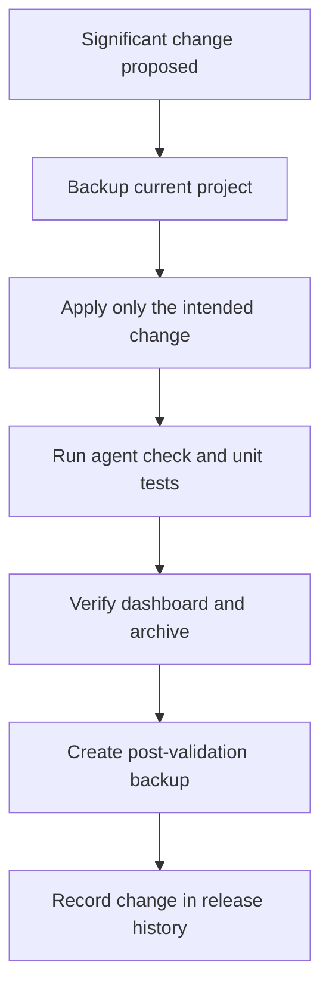

# SHYRKA AGENT — UPDATE, VERSIONING AND BACKUP POLICY

> **Document role:** Change, backup, validation and recovery workflow.  
> **Source:** `howto_update.txt` (archived unchanged under [archive/originals](./archive/originals/)).  
> **Conversion scope:** Markdown structure and presentation; underlying technical content retained. No Steam Deck audit or runtime revalidation was performed.

Before a significant change:
1. Stop an interactive agent session, if one is running.
2. Run /home/deck/LocalAIAgentrecovery/backup.sh
3. Apply only the intended change.
4. Run agent --check and the unit tests.
5. Verify the dashboard and archive.
6. Run another backup after validation.
7. Record the release in SHYRKA_RELEASE_NOTES.txt and
   /home/deck/LocalAIProject/PROJECT_VERSIONS.txt.

Unified backup:
  /home/deck/LocalAIAgentrecovery/backup.sh

Verify latest backup:
  /home/deck/LocalAIAgentrecovery/recovery.sh check

Restore a specific backup:
  /home/deck/LocalAIAgentrecovery/recovery.sh restore \
    /home/deck/LocalAIAgentrecovery/backups/Shyrka-Agent-TIMESTAMP

The restore process asks for explicit confirmation and creates a safety backup
before restoring. It restores the project files and SQLite archive. It does not
remove unrelated files or reinstall the virtual environment/model weights.

Keep the agent manual-start only. Do not add shell execution, arbitrary writes,
unapproved tools, unrestricted sudo, or credential access. Keep model inference
local unless explicitly authorized otherwise.

## Change workflow schema

The workflow reflects the existing policy. It is not a claim that these checks were run during this documentation conversion.
