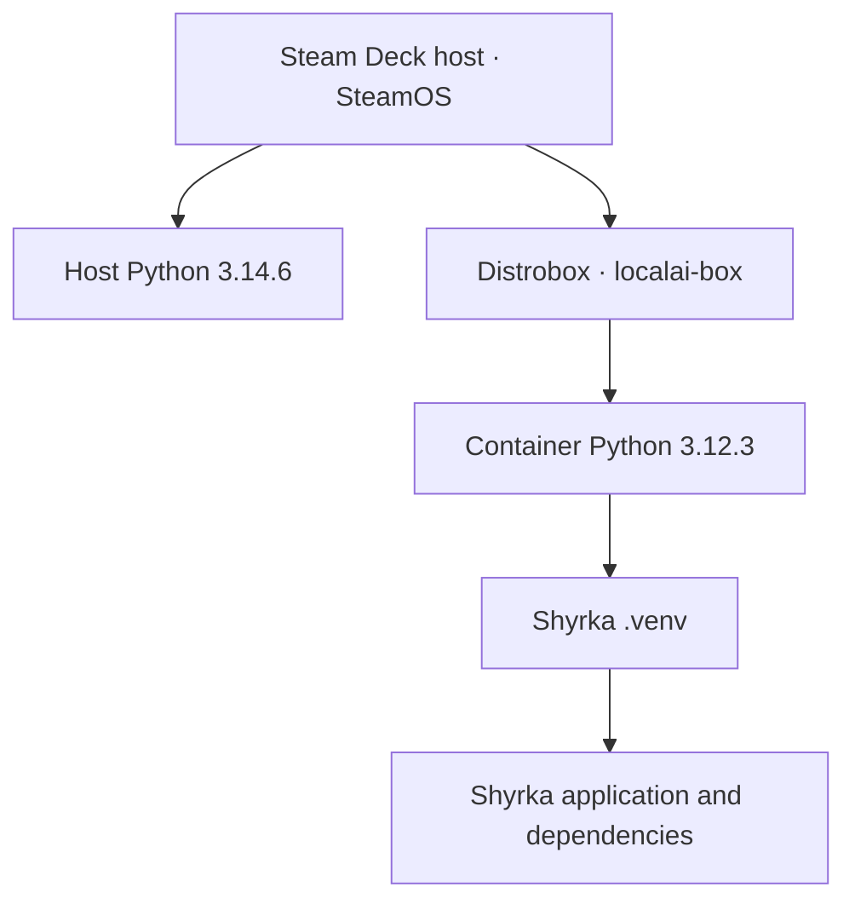

# PYTHON AND VIRTUAL ENVIRONMENT REFERENCE

> **Document role:** Shyrka-specific Python interpreter, virtual-environment and dependency inventory.  
> **Shared policy:** [Deck Python Runtime & Virtual Environment Standard](../../deck/docs/PYTHON-VIRTUAL-ENVIRONMENT-STANDARD.md).  
> **Source:** `PYTHON_VENV.readme` (archived unchanged under [archive/originals](./archive/originals/)).  
> **Conversion scope:** Markdown structure and presentation; underlying technical content retained. No Steam Deck audit or runtime revalidation was performed.

Last verified: 2026-10-28  
Scope: Steam Deck host, localai-box, Shyrka, and planned Kokoro runtime.

Consult the shared Deck standard for general policy. This document owns the Shyrka-specific paths, interpreter versions, dependency inventory and historical test results. Do not copy these values into another project.

## 1. ENVIRONMENT MAP

Steam Deck host:
- Host identity: deck@Laco
- OS: SteamOS, ID steamos, VERSION_ID 3.9.5
- Recorded build: 20261023.100; codename holo
- Host Python: /usr/bin/python3, Python 3.14.6
- Host Python is separate from the interpreter installed in localai-box.

Container:
- Distrobox: localai-box
- Image: docker.io/library/ubuntu:24.04
- OS: Ubuntu 24.04.5 LTS, Noble Numbat
- /usr/bin/python3 resolves to /usr/bin/python3.12
- Container Python: 3.12.3
- python3-minimal: 3.12.3-0ubuntu2.1
- python3.12-minimal: 3.12.3-1ubuntu0.17
- python3.12-venv: 3.12.3-1ubuntu0.17
- Python sqlite3 module: 3.45.1
- Package ownership: python3-minimal provides /usr/bin/python3

Shyrka:
- Project: /home/deck/LocalAIProject/AIAgent
- Virtual environment: /home/deck/LocalAIProject/AIAgent/.venv
- Interpreter: /home/deck/LocalAIProject/AIAgent/.venv/bin/python
- Python version: 3.12.3
- Base interpreter: /usr/bin/python3.12
- sys.base_prefix: /usr
- sys.prefix: /home/deck/LocalAIProject/AIAgent/.venv
- pyvenv.cfg: include-system-site-packages = false
- Recorded pip version: 24.0
- Installed packages last inspected:
  langgraph 1.2.17
  langchain-core 1.7.0
  langchain-ollama 1.1.0
  ollama Python package 0.6.3

## 2. PROJECT PYTHON POLICY

- Label commands with the intended environment.
- Use localai-box for Shyrka and other container project operations.
- Do not substitute the SteamOS host interpreter for a project venv.
- Each application should have its own independent .venv.
- Applications may share a compatible base interpreter within localai-box.
- Keep application dependencies isolated; do not install project packages globally.
- Host and container Python versions do not need to match.
- Do not upgrade Python or recreate an existing venv without a diagnosed compatibility reason and an approved plan.
- Planned Kokoro paths:
  /home/deck/LocalAIProject/Kokoro/
  /home/deck/LocalAIProject/Kokoro/.venv/
  /home/deck/LocalAIProject/Kokoro/models/
- Kokoro has not been installed or initialized as of this reference date.

## 3. SHYRKA CHECKS

Run from the Shyrka project directory in localai-box.

Syntax check:
./.venv/bin/python -m py_compile dashboard/server.py

Unit tests:
./.venv/bin/python -m unittest discover -s tests -p 'test_*.py' -v

The previously recorded test result was 27/27 passing on 2026-10-28. That is historical evidence, not a claim that tests were rerun during this documentation update. Do not assume pytest is installed.

## 4. MAINTENANCE

- Recheck interpreter versions when the OS, container image, or venv changes.
- Verify the interpreter path and active venv before installing dependencies.
- Update this reference and project history when verified facts change.
- Keep recovery documentation aligned with backup.sh's generated manifest.
- This document records observed state; it does not authorize upgrades.

## Environment boundary

The recorded environments are separate execution contexts. The Shyrka virtual environment is based on the Python interpreter inside `localai-box`; it is not the SteamOS host interpreter.

This diagram represents the documented environment relationship, not a live runtime check.
