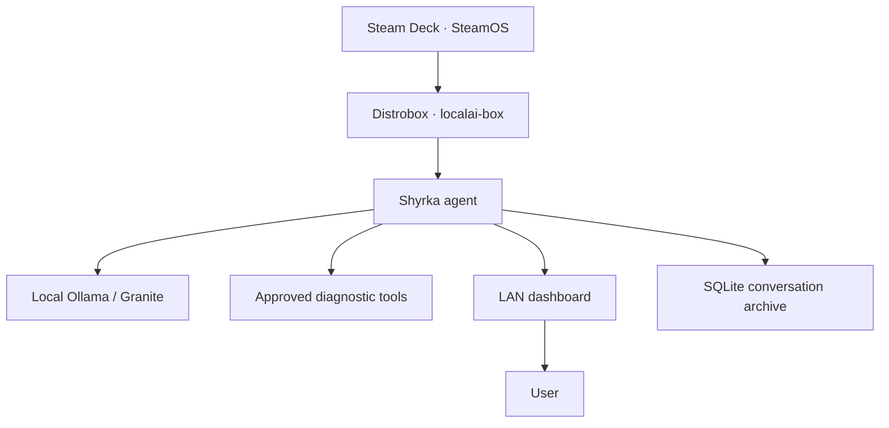
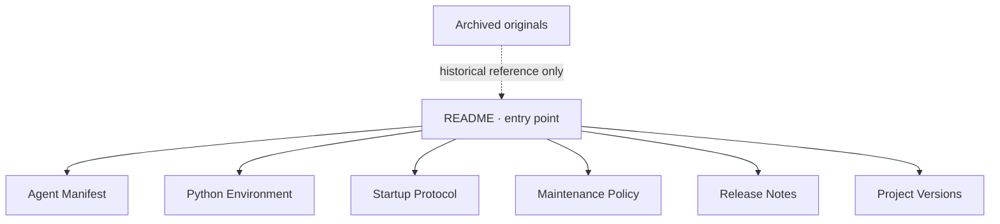

# Shyrka — Documentation

> **Purpose:** Entry point and index for the maintained Shyrka documentation.  
> **Format:** Markdown (`.md`).  
> **Conversion note:** Original source files are retained unchanged in [archive/originals](./archive/originals/). This conversion standardized presentation and added explanatory schemas; it did not audit the Steam Deck or revalidate runtime state.

## Documentation index

| Document | Role |
|---|---|
| [Agent Manifest](./AGENT-MANIFEST.md) | Recorded components, model profile, capabilities and operating boundaries |
| [Python Environment](./PYTHON-ENVIRONMENT.md) | Host/container/venv interpreter inventory and Python policy |
| [Startup and Reliability Protocol](./STARTUP-AND-RELIABILITY-PROTOCOL.md) | Session resumption, environment discipline and safe command generation |
| [Maintenance and Update Policy](./MAINTENANCE-AND-UPDATE-POLICY.md) | Backup, change, validation and recovery workflow |
| [Release Notes](./RELEASE-NOTES.md) | Chronological Shyrka feature and maintenance history |
| [Project Versions](./PROJECT-VERSIONS.md) | Broader LocalAI-Box and Shyrka version history |
| [Archived originals](./archive/originals/) | Exact original source files, retained for historical reference |

## Project relationship

This is a documentation-level view based on the existing records. It is not a live architecture audit.

## Documentation authority

## Content and evidence conventions

- Preserve the distinction between verified, tested, reported, documented, planned, pending and unknown.
- Treat dated test results as historical evidence unless a later check explicitly revalidates them.
- Do not infer current service state from a manifest or release note.
- Keep secrets out of all repository content, including archived files.
- Use relative links so the documentation remains navigable within the repository.
- Update only the document roles affected by a substantive project change.

## Scope of this conversion

- Converted six original documents to Markdown.
- Retained the six original source files unchanged in `archive/originals/`.
- Added Mermaid schemas to clarify relationships and workflows.
- Updated the Shyrka project README links to the new Markdown filenames.
- No application code, configuration, dependencies, model settings, services or Steam Deck state were changed or audited.
