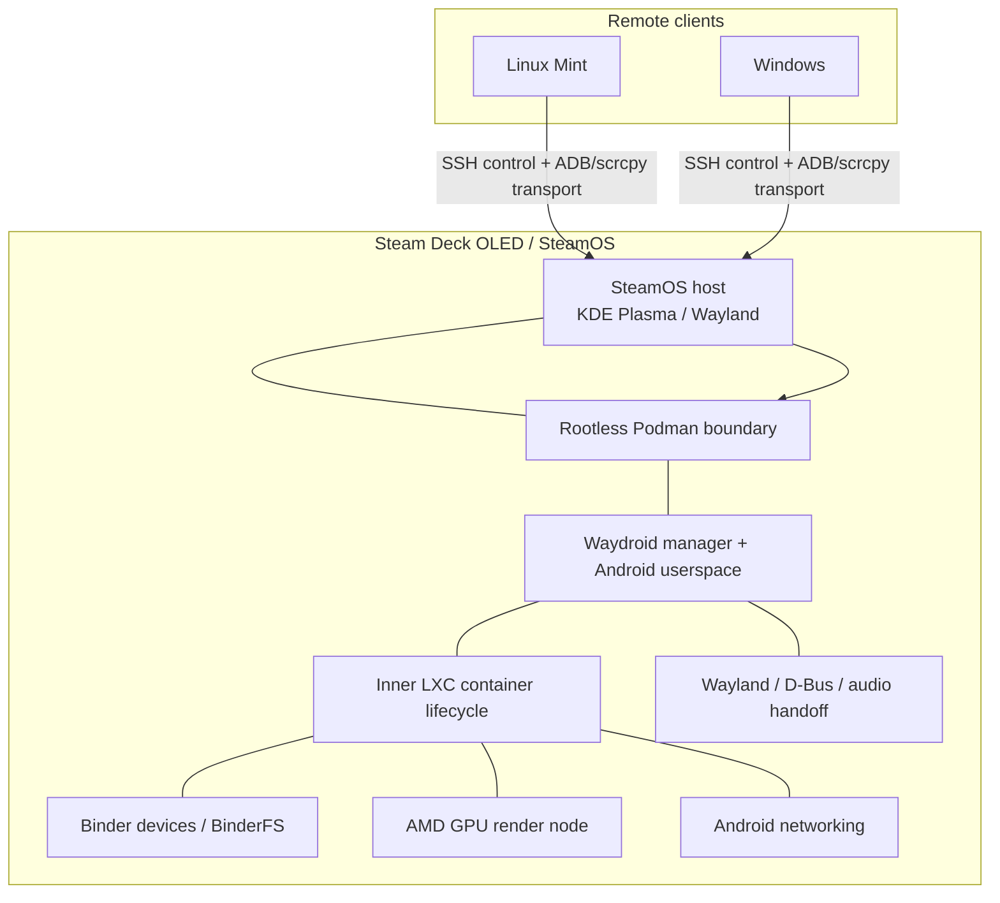
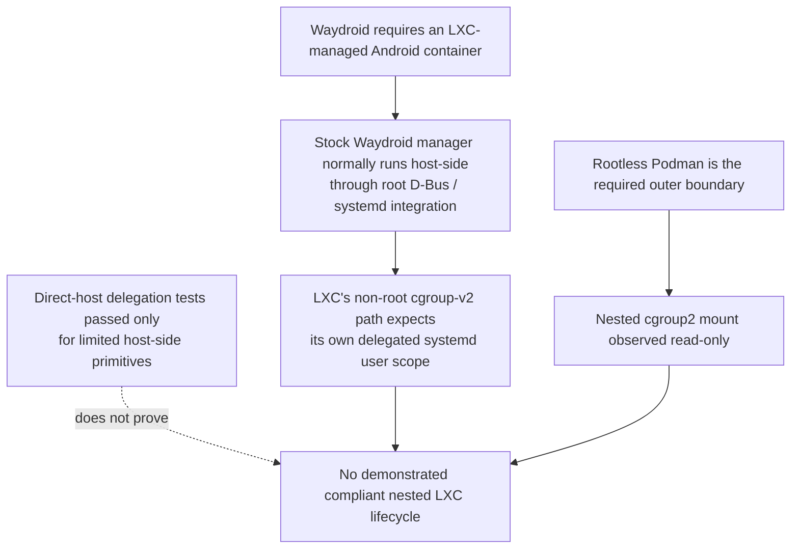
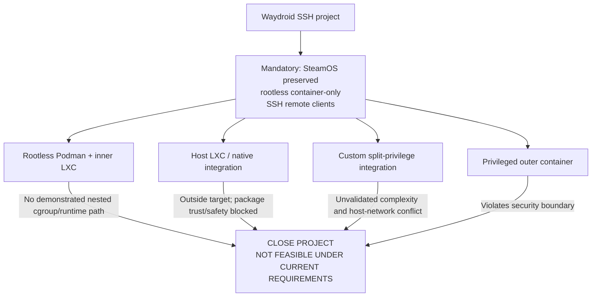

# Waydroid SSH — Final Feasibility Conclusion

> **Decision:** **CLOSED — NOT FEASIBLE UNDER THE CURRENT REQUIREMENTS AND SECURITY BOUNDARY.**
>
> **Project:** Android on Steam Deck OLED, controlled from Linux Mint and Windows through SSH-based launch/control and remote display/input.
>
> **Decision date:** 2026-11-07  
> **Conclusion version:** 1.0  
> **Evidence record:** [WAYDROID-SSH-LIVING-FEASIBILITY-AUDIT.md](../1.audit/WAYDROID-SSH-LIVING-FEASIBILITY-AUDIT.md)  
> **Scope:** Final architecture-level feasibility decision. This is not an installation guide.

---

## 1. Executive decision

The Waydroid SSH project is closed because **no secure, maintainable end-to-end deployment path was established that satisfies the mandatory container-only, rootless and SteamOS-preservation requirements**.

The largest constraints are the interaction of three layers:

1. **Steam Deck / SteamOS:** a tightly integrated appliance-style host with managed system paths, image-based updates, a running graphical session, protected host services and a limited appetite for persistent host modifications.
2. **Rootless container boundary:** Podman provides useful isolation, but it does not automatically provide the nested cgroup, mount, device, network and service-management behavior expected by an inner LXC-based Android runtime.
3. **Waydroid architecture:** Waydroid is not just an Android root filesystem. Its normal deployment expects host-side manager integration, LXC lifecycle control, Binder/device preparation, rootfs handling, networking and session handoff.

The problem is not that the Steam Deck lacks enough CPU or GPU capability. The hardware was identified as capable of providing relevant Linux graphics devices. The problem is that the **host integration and privilege model required to connect those capabilities to Waydroid conflicts with the project's approved container and security boundaries**.

<pre>
FINAL RESULT
┌───────────────────────────────────────────────────────────────┐
│ WAYDROID SSH                                                   │
│                                                               │
│  Required: container-only + rootless + no broad host changes  │
│  Required: SSH control + remote display/input                 │
│                                                               │
│  Result: no compliant end-to-end architecture demonstrated    │
│                                                               │
│  DECISION: CLOSED — NOT FEASIBLE UNDER CURRENT CONSTRAINTS     │
└───────────────────────────────────────────────────────────────┘
</pre>

This is an architecture-level conclusion. It does **not** claim that every component was experimentally proven impossible or that Waydroid could never run on SteamOS with a different architecture and relaxed requirements. Several end-to-end gates were deliberately not attempted because the foundational deployment path was already incompatible or unproven under the approved boundary.

---

## 2. Original target and non-negotiable requirements

### 2.1 Intended user experience

- Android runs on the Steam Deck OLED; the Deck performs the Android CPU/GPU work.
- Linux Mint and Windows are remote clients.
- SSH is used for secure launch/control and transport.
- The preferred result is an Android application/window on the client, not a full Steam Deck desktop stream.
- Operation is manual, explicit and reversible.

### 2.2 Mandatory constraints

| Requirement | Accepted boundary | Consequence |
|---|---|---|
| Container deployment | Waydroid must run inside a container environment; rootless Podman is the baseline | Native Waydroid installation is outside scope |
| Host integrity | No host-wide kernel, firewall, forwarding, service or package changes just to force feasibility | Host-integrated workarounds are restricted |
| Outer container | No privileged outer container, broad host mounts or host namespace sharing | Inner LXC cannot assume host-like privileges |
| Existing projects | Pi-hole, Odysseus and other Deck projects must remain unaffected | No shared networking/service experiments |
| Lifecycle | Manual start/stop; no boot autostart or persistent daemon without approval | Standard service integration is not acceptable by default |
| Remote access | SSH control from Mint and Windows is mandatory | A local-only Android boot is not project success |
| Safety | Diagnose first; backup before approved edits; no destructive action without approval | Failed gates cannot be bypassed by risky changes |

These are not optional optimizations. Relaxing them changes the project definition.

---

## 3. Architecture: where the requirements collide

### 3.1 Intended deployment stack

The diagram shows the required relationships, not a working implementation. The audit did not reach an Android boot or remote-client demonstration.

### 3.2 The decisive boundary

The key distinction is that **host-side cgroup delegation and nested cgroup delegation inside rootless Podman are different capabilities**. Passing a host primitive test does not make a read-only cgroup mount inside the outer container writable.

### 3.3 Waydroid is a host-integration stack

The normal Waydroid manager path is more than a command-line launcher:

- system D-Bus activation and a systemd service provide the manager/control plane;
- the service runs as root and invokes LXC;
- manager-side preparation handles Binder probing/permissions, optional driver setup, network setup, session-specific configuration, rootfs mounting and hardware management;
- the Android container then depends on LXC, kernel interfaces and selected host devices.

Wrapping a user-side CLI request in a user systemd scope does not automatically move the root D-Bus-activated manager or its LXC child into that scope. Upstream LXC 7.0.0 explicitly avoids its non-root user-scope creation path when its effective UID is root.

---

## 4. Three principal constraint groups

### 4.1 Steam Deck and SteamOS

| Host characteristic | Why it matters |
|---|---|
| Image-based SteamOS updates and managed system paths | Host-installed components may be replaced by updates; persistent custom host integration is undesirable |
| SteamOS-specific pacman DBPath and package-management behavior | The audit encountered an unexplained DBPath/write-access and lock-acquisition problem |
| Package signer provenance | The candidate LXC signing fingerprint was not independently authenticated; the exact archive signature remained unverified |
| Existing host session and devices | GPU, Binder, Wayland, D-Bus and audio access require deliberate, narrow handoff |
| Host network and firewall | Waydroid's standard network helper creates host bridge/forwarding/firewall state, conflicting with the approved no-host-network-change boundary |
| Existing protected services | Pi-hole and other Deck projects must not be affected |

SteamOS is not described here as technically incapable of running additional Linux software. The conclusion is narrower: the normal Waydroid integration model is a poor fit for a host that must remain controlled, update-safe and free of persistent project-specific changes.

### 4.2 Rootless Podman and nested containers

The intended stack requires an Android container managed by LXC inside an outer rootless Podman container.

The audit established several positive primitives, but the decisive nested lifecycle was not established:

- BinderFS could be mounted in a disposable rootless Podman container with explicitly granted CAP_SYS_ADMIN; the three Binder nodes were created and the Binder protocol version was queried.
- Nested user, mount and PID namespace operations succeeded in the tested combinations, including default seccomp for the specific tested operation.
- Ordinary outbound networking and DNS worked from a disposable Podman container.
- Host-side transient delegated systemd scopes and basic child-cgroup creation/removal and process placement were demonstrated.
- The nested Podman cgroup2 mount was observed as read-only. The host-side tests do not override this observation.

**Result:** the primitives are useful evidence, but they do not establish the writable delegated cgroup subtree and complete monitor/payload lifecycle that nested LXC needs.

### 4.3 Waydroid runtime and integration

| Component | Audit result | What remained unproven |
|---|---|---|
| LXC manager/lifecycle | Stock root-manager integration mismatch identified | Actual LXC runtime inside the approved Podman boundary |
| cgroups | Host-side delegated primitives partially confirmed; nested Podman cgroup2 mount read-only | Controller activation and nested LXC monitor/payload lifecycle |
| Rootfs | No approved-boundary runtime test | Mount/extract actual system/vendor images into a usable LXC rootfs |
| Binder | BinderFS/node/protocol primitive checks passed | Real Android Binder transactions and service stability |
| GPU | AMD render node identified on host | Actual Android hardware acceleration inside the container |
| Networking | Ordinary Podman outbound networking passed; standard Waydroid helper conflicts with host restrictions | Isolated Android netfilter and network behavior |
| Wayland / D-Bus / audio | Host session and socket were identified | Narrow SSH-launched session handoff without broad runtime mounts |
| Android boot | Not attempted | Actual Android userspace and service startup |
| ADB / scrcpy | Not attempted | Localhost-only ADB, SSH tunnel and remote display/input from Mint and Windows |
| Persistence / recovery | Not attempted | Safe Android data lifecycle and tested backup/restore |

---

## 5. Evidence classification

A feasibility conclusion must distinguish confirmed observations from assumptions and untested work.

### 5.1 Confirmed positive evidence

- BinderFS is registered in the recorded SteamOS kernel and BinderFS mounted in a disposable rootless Podman container when the required capability was explicitly granted.
- Binder nodes were created and the device returned protocol version 8 through BINDER_VERSION.
- Nested user/mount/PID namespace operations succeeded under the tested capability/seccomp configurations.
- Ordinary outbound networking and DNS succeeded from a disposable Podman container.
- Host-side transient delegated-scope and limited cgroup child/process operations succeeded.
- The host AMD GPU and render node were identified.
- Upstream Waydroid and LXC source review established the normal manager/service/launcher integration behavior and the privilege-context mismatch.

### 5.2 Confirmed blockers or adverse observations

- The nested rootless Podman cgroup2 mount was read-only.
- Stock Waydroid's root-owned manager path does not enter LXC's non-root systemd user-scope delegation path.
- Waydroid's standard network helper performs host bridge, forwarding and firewall operations that violate the current no-host-network-change boundary.
- The exact LXC archive signature was not verified against an independently authenticated Valve trust anchor.
- The configured pacman DBPath/write-access and lock-acquisition issue remained unexplained.
- The normal Waydroid installation model includes host D-Bus/systemd/PolicyKit and package integration that is not acceptable as an unreviewed container-only deployment.

### 5.3 Untested — not falsely labelled failed

- Actual nested LXC startup and teardown in the approved rootless Podman boundary.
- Rootfs mounting or extraction of the real Waydroid system/vendor images.
- Android Binder transactions and Android service communication.
- Real Android GPU acceleration.
- Isolated Android netfilter/networking.
- Wayland, D-Bus and audio handoff from an SSH-launched process.
- Actual Android boot, ADB, scrcpy, Mint/Windows remote-client operation.
- Android data persistence and recovery.

These items remain untested. The project closes because the architecture did not offer a sufficiently credible, compliant path to justify continuing—not because each untested item was experimentally disproved.

---

## 6. Why the apparent alternatives were rejected

### Option A — Install Waydroid natively on SteamOS

**Rejected.** It violates the container-only requirement and changes the project definition. Native installation is not a fallback within this decision.

### Option B — Install LXC on the SteamOS host and run Waydroid through it

**Rejected for this project.** This moves away from the intended rootless Podman architecture. The package provenance and package-manager safety blockers remained unresolved. Even if LXC were installed, it would not solve Waydroid's manager, rootfs, device, networking and remote-session integration by itself.

### Option C — Run stock Waydroid inside rootless Podman

**Not demonstrated feasible.** The observed read-only nested cgroup2 mount and stock root-manager/LXC delegation mismatch are foundational issues. No compliant nested LXC lifecycle was established.

### Option D — Custom split-privilege manager and LXC launcher

**Technically conceivable; not recommended.** This would require custom manager/launcher adaptation and explicit ownership of rootfs/data, Binder/GPU devices, networking, session setup, monitor/payload lifecycle and crash cleanup. The standard network helper conflicts with the current host-network restrictions. The design adds substantial maintenance and security complexity without a validated runtime foundation.

### Option E — Privileged outer container or broad host access

**Rejected.** It would weaken the agreed security boundary and violate the no-privileged-outer-container, no-broad-host-mount and no-host-namespace-sharing constraints.

---

## 7. Final decision matrix

| Decision area | Final status | Reason |
|---|---|---|
| Container-only Waydroid | **CLOSED** | No compliant end-to-end path demonstrated |
| Rootless Podman + inner LXC | **NOT FEASIBLE UNDER CURRENT BOUNDARY** | Nested cgroup and manager integration mismatch |
| Host-installed LXC fallback | **OUT OF SCOPE / BLOCKED** | Departs from target; signer and package-manager safety unresolved |
| Split-privilege custom architecture | **HOLD / NOT PURSUED** | Too much custom integration; critical runtime and network questions unresolved |
| Privileged Podman workaround | **REJECTED** | Violates security requirements |
| Native SteamOS Waydroid | **REJECTED** | Violates D-02 |
| Further experiments | **CLOSED** | No additional tests justified under unchanged requirements |

### Final architecture disposition

---

## 8. What would have to change to reopen the subject

This audit must not silently restart. Reconsideration requires a materially different project definition, for example:

1. Explicit acceptance of a supported host-integrated architecture and its persistent SteamOS/package/service implications; or
2. A different Android runtime/virtualization solution that does not require the same nested LXC integration; or
3. A different remote-display architecture that meets the actual client experience without the current Waydroid-on-Deck constraints.

Any new proposal must first define the changed requirements, host privileges, device access, networking model, update/recovery behavior and protection of existing services. It must be a new decision and a new scope, not a continuation of this closed audit.

---

## 9. Closure record

- **Waydroid feasibility audit:** CLOSED.
- **Separate LXC-only investigation:** CLOSED.
- **LXC installation:** not performed.
- **Waydroid installation or Android boot:** not performed.
- **Persistent host changes for this project:** none.
- **Unresolved package provenance and pacman safety:** preserved as historical blockers.
- **Untested runtime gates:** explicitly retained as untested.
- **Security boundary:** not relaxed.
- **Existing Steam Deck projects:** remain protected.

**Final conclusion:** The Steam Deck hardware is not the central obstacle. The combination of SteamOS host integration requirements, Waydroid's LXC-based architecture and the restrictions of rootless nested containers makes the intended design impractical under the current constraints. Closing the project is the technically and operationally responsible decision.

---

*End of conclusion.*
