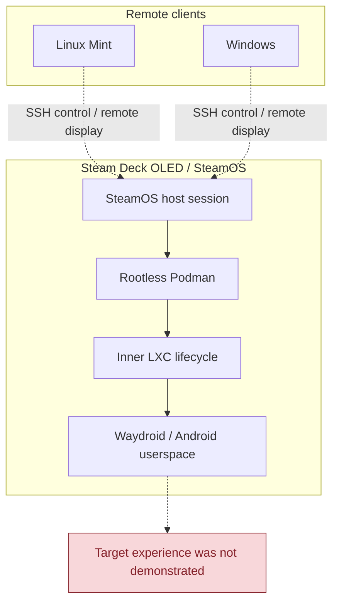

# Waydroid SSH — Feasibility Project (Closed)

**Final status: CLOSED — NOT FEASIBLE UNDER THE CURRENT REQUIREMENTS AND SECURITY BOUNDARY.**

This project investigated whether Android could run on the Steam Deck OLED while Linux Mint and Windows acted as SSH-controlled remote display/input clients. The intended deployment required Waydroid inside a rootless Podman boundary, with no native Waydroid installation, no privileged outer container, no broad host integration and no disruption to SteamOS or existing Deck services.

The audit is complete. This directory is retained as a record of the investigation and its findings, **not as an installation guide or an invitation to continue testing**.

## Documentation

- **[Final feasibility conclusion](./2.conclusion/WAYDROID-SSH-FEASIBILITY-CONCLUSION.md)** — executive decision, visual architecture schemas, constraint analysis, evidence classification and closure rationale.
- **[Canonical living feasibility audit — v5.14](./1.audit/WAYDROID-SSH-LIVING-FEASIBILITY-AUDIT.md)** — historical test ledger, source analysis, decisions and final handoff.
- [Historical audit materials](./1.audit/) — supporting and earlier records retained for traceability.

Start with the conclusion for the short version; consult the canonical audit for the underlying evidence and limitations.

## Intended architecture

This diagram describes the intended stack, **not a working deployment**.

## Final conclusion at a glance

The hardware was not the main blocker. The difficulty was the interaction of three layers:

| Constraint | Finding |
|---|---|
| **Steam Deck / SteamOS** | Managed host paths, image-based updates, package-manager and trust limitations, and protected host services make the normal host-integrated Waydroid deployment unsuitable for this project's boundary. |
| **Rootless Podman / nested LXC** | Useful namespace and BinderFS primitives were confirmed, but the nested cgroup2 mount was observed read-only. Host-side cgroup tests did not establish a usable nested LXC lifecycle. |
| **Waydroid architecture** | The normal manager relies on host-side service integration, LXC, Binder/device preparation, rootfs handling, networking and desktop-session handoff. A compliant end-to-end implementation was not established. |

Some prerequisites were positively tested, while rootfs handling, real Android Binder activity, GPU acceleration, isolated Android networking, Android boot and Mint/Windows remote-client operation remained untested. The decision does **not** claim that every component was experimentally proven impossible. It means that no sufficiently credible, secure and maintainable route was established within the agreed requirements.

## Project boundary and closure

- No native Waydroid installation on SteamOS.
- No LXC or Waydroid package installation was performed.
- No privileged outer container, broad host mounts or host namespace sharing as a workaround.
- No persistent host firewall, forwarding, service, kernel or network changes for this project.
- Existing Deck services and projects, including Pi-hole and Odysseus, remain protected.
- The separate LXC-only experimental branch is also closed.
- Unresolved package provenance and pacman safety issues are historical blockers, not pending tasks.
- No further experiment is planned under the current requirements.

**Do not resume the former test sequence, retry pacman, install LXC/Waydroid or relax the security boundary.** Reopening requires a materially different architecture or requirement set, documented as a new scope and explicitly approved.

---

*Steam Deck Lab — project index and closure notice.*
